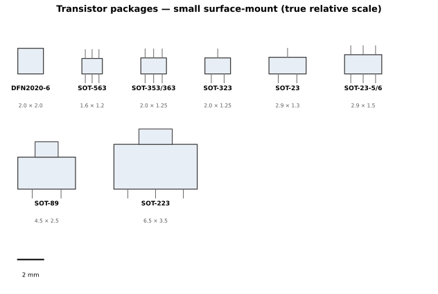
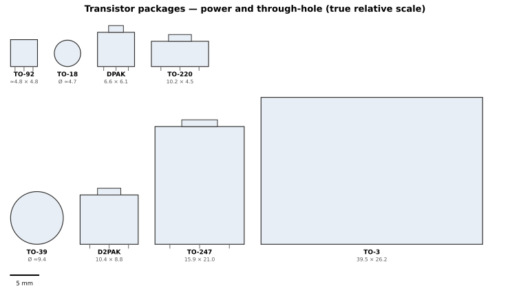
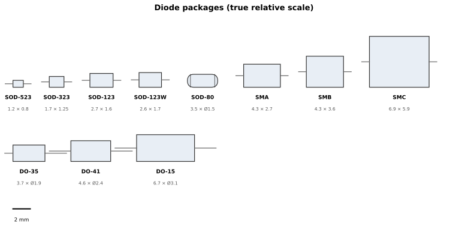
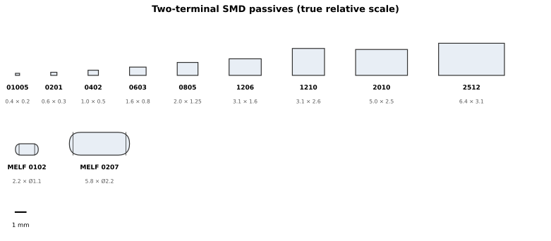
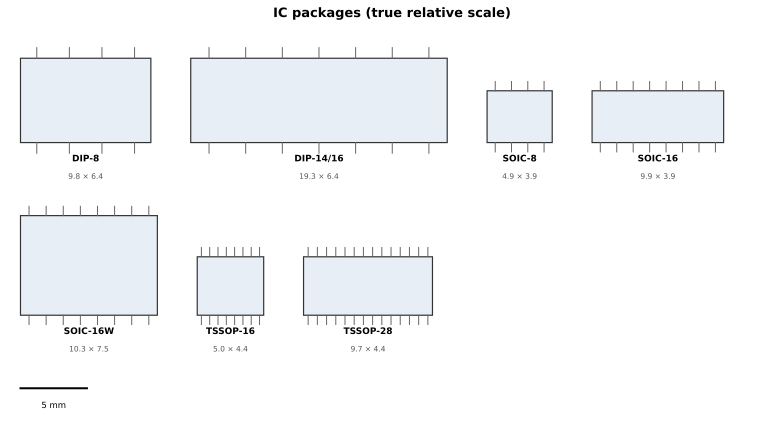

# Appendix E — Package reference

The tables a reader reaches for at the bench, mid-build, with a part in
one hand and a distributor page in the other: what is this package,
what else is it called, how big is it, and roughly what can it do.

## How to read these tables

- **Dimensions are nominal body sizes** in millimetres, length × width ×
  seated height, taken from manufacturer outline drawings. Where
  manufacturers disagree on a value, the table gives the range, not a
  single number.
- **Pitch** is the centre-to-centre spacing of adjacent terminals. Some
  manufacturers quote pitch two ways for the same package — `e` (the
  nominal pitch) and `e1` (the minimal pitch) — and the two numbers
  differ. Where that happens, both are given.
- **Power figures are order-of-magnitude bands only**, tied to a named
  example part and stated board conditions (FR-4, still air, 25 °C
  ambient, unless stated otherwise). A package has no power rating of
  its own: the same silicon in a different package, or on more copper,
  dissipates a different amount. Always check the part's own datasheet
  for Pd and θJA before designing near a limit.
- **Tables are ordered by size, smallest to largest** — by body footprint
  for surface-mount parts — not by package number. Through-hole cans
  are placed by rough size class, since a can's footprint does not sort
  cleanly against a flat package's.

## The traps, up front

Four ways these tables bite, all of which the rest of the appendix is
designed to defuse:

- **One package, many names.** SOT-363 is also SC-88, SC-70-6, SOT-323-6
  and TSSOP6. The "Also called" column exists so a reader can search
  the page for the name on their distributor listing and land on the
  right row.
- **One letter, a different package.** SOT-353 is SC-88A with five pins;
  SOT-363 is SC-88 with six. SOD-123F is flatter than SOD-123 and is not
  the same package. "SOIC-16" alone is three different bodies (see the
  IC table).
- **The numbers do not order by size.** SOT-563 (1.6 × 1.2 mm) is
  smaller than SOT-363 (2.0 × 1.25 mm), despite the bigger number. A
  metric "0603" is the smaller imperial 0201, and a metric "0402" is
  the imperial 01005. Never guess size from the number.
- **Power is not a package property.** The same 3904 die family rates
  625 mW in TO-92, 350 mW in SOT-23 and 1,000 mW in SOT-223 on FR-4 at
  25 °C — the package, and the copper under it, set the limit, not the
  silicon. Headline wattages for DPAK, D2PAK, TO-220, TO-247 and TO-3
  are case-temperature ratings (with a heatsink), not what the part
  sheds bare on a bench.

## Transistor packages

| Package | Also called | Pins | Body L × W × H (mm) | Pitch (mm) | Power, rule of thumb |
| --- | --- | --- | --- | --- | --- |
| DFN2020-6 | SOT1118, HUSON6 | 6, leadless | 2.0 × 2.0 × 0.65 max | 0.65 | ≈0.5 W std footprint; ≈1.2 W with 6 cm² drain copper |
| SOT-563 | SC-89-6, TI DRL, onsemi CASE 463A | 6 | 1.6 × 1.2 × 0.6 | 0.50 | ≈0.17–0.28 W |
| SOT-353 | SC-88A, TSSOP5 | 5 | 2.0 × 1.25 × 0.95 | 0.65 | — (not verified; same body as SOT-363) |
| SOT-363 | SC-88, SC-70-6, SOT-323-6, TSSOP6 | 6 | 2.0 × 1.25 × 0.95 | 0.65 | ≈0.2–0.3 W total |
| SOT-323 | SC-70 | 3 | 2.0 × 1.25 × 0.95 | 1.3 (e); 0.65 (e1) | ≈0.2 W |
| SOT-23 | SOT346, SC-59A, TO-236AB | 3 | 2.9 × 1.3 × 1.0 | 1.9 (e); 0.95 (e1) | ≈0.35 W |
| SOT-23-5 | SOT-25, SC-74A, TSOP5, SOT753 | 5 | 2.9 × 1.5 × 1.0 | 0.95 | — (not verified) |
| SOT-23-6 | SOT-26, SC-74, SOT457 | 6 | 2.9 × 1.6 × 1.1–1.45 | 0.95 | — (not verified) |
| SOT-89 | SC-62, TO-243 | 3 (one wide tab lead) | 4.5 × 2.5 × 1.5 | 1.5 (3.0 across) | ≈0.6 W std; ≈1.65 W with 6 cm² collector copper |
| SOT-223 | SC-73, TO-261 | 4 (3 leads + wide tab) | 6.5 × 3.5 × 1.65 | 2.3 (4.6 across) | ≈1 W (more with copper) |
| TO-92 | SOT54, TO-226AA | 3 | ≈4.8 × 4.8 × 3.7 (D-shaped) | 1.27 (2.54 outer, formed) | ≈0.6 W |
| TO-18 | TO-206AA, metal can | 3 | Can Ø ≈4.7 × ≈4.8 (not verified) | 2.54 (pin circle) | ≈0.5 W free air; 1.8 W at Tc 25 °C |
| DPAK (TO-252) | SC-63 | 3 + tab | 6.1 × 6.6 × 2.3 | 2.286 | ≈1–2.5 W on PCB; the 55 W headline is a case-temperature rating |
| TO-220 | TO-220AB | 3 | 10.2 × 4.5 × 15.5 (vertical) | 2.54 | ≈2 W bare; 40 W on a heatsink at Tc 25 °C |
| TO-39 | TO-205AD, metal can | 3 | Can Ø ≈9.4 × ≈6.1 (not verified) | 5.08 (pin circle) | ≈0.8 W free air; 3.0 W at Tc 25 °C |
| D2PAK (TO-263) | DDPAK, SMD-220 | 3 + tab | 8.8 × 10.35 × 4.46 | 2.54 | ≈3–7 W on PCB; tens of W with a heatsink |
| TO-247 | TO-247AC | 3 | 21.0 × 15.9 × 5.0 | 5.44 | 100–300 W class on a heatsink |
| TO-3 | TO-204AA | 2 pins + case | 39.5 × 26.2 × 8.7 | 10.92 | 115 W at Tc 25 °C with a heatsink |

Notes: the SOT-23-6 aliases and height are vendor-dependent and were
not all confirmed against a manufacturer outline — treat the height
range as approximate. TO-18 and TO-39 body dimensions are from
secondary sources that disagree; the figures above are the best
available and are flagged, not verified. The order is by body
footprint; TO-220 and the cans are placed by rough size class, since
footprint alone misorders heatsink-class parts.

## Diode packages

| Package | Also called | Pins | Body L × W × H (mm) | Pitch (mm) | Typical current / power |
| --- | --- | --- | --- | --- | --- |
| SOD-523 | SC-79 | 2 | 1.2 × 0.8 × 0.6 | 1.4 | ≤ ~200 mA; ~0.3 W |
| SOD-323 | SC-76 | 2 | 1.7 × 1.25 × 0.95 | 1.3 | ~100–200 mA; ~0.3 W |
| SOD-123 | onsemi Case 425-04 | 2 | 2.68 × 1.6 × 1.15 | 3.27 | ~200 mA–1 A; ~0.5 W |
| SOD-123W | CFP3 | 2 | 2.6 × 1.7 × 1.0 | 2.8 | 1–2 A Schottky; 0.68 W std, 1.15 W with 1 cm² cathode pad |
| SOD-80 (MiniMELF) | DO-213AA, LL-34 | 2, cylindrical glass | 3.5 long × Ø 1.5 | — (end caps) | ~150–200 mA; ~0.5 W |
| DO-214AC (SMA) | SOD-106 | 2 | 4.25 × 2.67 × 1.25–2.29 | — (use land pattern) | 1–2 A; ~1–2 W |
| DO-214AA (SMB) | SMB | 2 | 4.3 × 3.6 × 1.95–2.44 | — (use land pattern) | 2–3 A; ~2–3 W |
| DO-214AB (SMC) | SMC | 2 | 6.9 × 5.9 × ~2.4 | — (use land pattern) | 3–5 A; ~3–5 W |
| DO-35 | DO-204AH | 2, axial glass | 3.7 × Ø 1.9 | Leads formed by builder | 150–200 mA; 0.5 W |
| DO-41 | DO-204AL, R-1 | 2, axial plastic | 4.6 × Ø 2.4 | Leads formed by builder | ~1 A; ~1 W free air |
| DO-15 | DO-204AC | 2, axial plastic | 6.7 × Ø 3.1 | Leads formed by builder | 1.5 A; ~1.5–2 W |

Notes: axial parts are ordered by *mounted* footprint — body-only,
DO-35 is smaller than SMA, but its leads span 7.6–10.2 mm on the
board. DO-214 heights are vendor-dependent, so the table gives ranges.
No centre-to-centre pitch could be grounded from a manufacturer
outline for the DO-214 family; use the land pattern instead. The
current bands are what each package is *usually* asked to do, across
real parts — a 1 A diode exists in SOD-123 and a 200 mA one in SMA.
"SOD-80" is also used by some vendors for QuadroMELF multi-diode
arrays, which are not the 2-terminal MiniMELF. Not covered here:
SOD-923, SOD-128/CFP5, DO-201AD, DO-213AB.

## Two-terminal passives

| Imperial | Metric | Body L × W × H (mm) | Resistor power, std | Max working V | Capacitor note |
| --- | --- | --- | --- | --- | --- |
| 01005 | 0402 | 0.40 × 0.20 × 0.13 | 1/32 W | 15 V | MLCC 0.5 pF–470 nF; height varies 0.2–0.35 mm |
| 0201 | 0603 | 0.60 × 0.30 × 0.23 | 1/20 W | 25 V | MLCC up to 1 µF (X5R, 10 V) |
| 0402 | 1005 | 1.00 × 0.50 × 0.35 | 1/16 W | 50 V | MLCC up to 10 µF (X5R, 10 V); the workhorse 100 nF decoupling size |
| 0603 | 1608 | 1.60 × 0.80 × 0.45 | 1/10 W | 75 V | MLCC up to 10 µF (X5R, 6.3–10 V); at 50 V only ~100 nF |
| 0805 | 2012 | 2.00 × 1.25 × 0.50 | 1/8 W | 150 V | MLCC up to 10 µF (X7R, 25 V); ~1 µF at 100 V |
| 1206 | 3216 | 3.10 × 1.60 × 0.55 | 1/4 W | 200 V | MLCC 100 nF at 250 V; high-µF low-voltage parts exist |
| 1210 | 3225 | 3.10 × 2.60 × 0.55 | 1/2 W | 200 V | MLCC up to 10 µF (X7R, 50 V) |
| 2010 | 5025 | 5.00 × 2.50 × 0.55 | 3/4 W | 200 V | Not a standard MLCC size — mostly resistors, tantalum or film |
| 2512 | 6332 | 6.35 × 3.10 × 0.55 | 1 W | 200 V | Not a standard MLCC size |

Resistor power and voltage are the Yageo RC_L standard series values.
Two wrinkles: 0201 is 1/20 W and 2010 is 3/4 W — neither sits on the
1/32, 1/16, 1/10, 1/8, 1/4, 1/2, 1 W ladder. And ratings vary by
manufacturer and series: Yageo and Vishay disagree on max working
voltage for 0201 (25 V vs 30 V), 2010 (200 V vs 400 V) and 2512
(200 V vs 500 V), and Yageo sells double-power variants of 0402,
0603, 0805, 1206 and 2512 in the same footprint. Name the series, not
just the size. Capacitor heights vary within a size, so the height
column is the resistor nominal only.

### MELF (cylindrical)

| Type | Imperial | Metric | Body (L × Ø, mm) | Power | Max working V |
| --- | --- | --- | --- | --- | --- |
| Micro-MELF (MMU 0102) | 0102 | RC 2211M | 2.2 × 1.1 | 0.2 W (thin-film) | 150 V |
| MELF (MMB 0207) | 0207 | RC 6123M | 5.8 × 2.2 | 1 W (thin-film) | 350 V |

MELF resistors are colour-band marked per IEC 60062. The intermediate
MMA 0204 size (3.6 × 1.4 mm, 0.25 W precision) exists between the two
rows above, and the precision UMB 0207 variant is only 0.4 W — check
the series.

## Integrated-circuit packages

### DIP / PDIP (through-hole)

| Pins | Also called | Body L × W × H (mm) | Pitch (mm) | Row spacing (mm) | Where you meet it |
| --- | --- | --- | --- | --- | --- |
| 8 | PDIP, DIL; TI N; JEDEC MS-001-AB | 9.81 × 6.35 × ~3.3 | 2.54 | 7.62 | 555 timer, small logic, breadboarding |
| 14 | PDIP, DIL; TI N; JEDEC MS-001 | 19.30 × 6.35 × ~3.3 | 2.54 | 7.62 | 74xx quad gates, the classic logic DIP |
| 16 | PDIP, DIL; TI N; JEDEC MS-001 | 19.31 × 6.35 × ~3.3 | 2.54 | 7.62 | 74HC595, counters, wider logic |
| 20 | PDIP; TI N | 24.33 × 6.35 × ~3.3 | 2.54 | 7.62 | 74HC245 bus transceivers |

14-pin and 16-pin PDIP share the same ~19.3 mm body — the 14-pin just
has wider end margins, so body length is not simply
(pins/2 − 1) × 2.54. 24- and 28-pin DIPs also exist (wide, 15.24 mm
row spacing; e.g. ATmega328P in DIP-28) — check the part's datasheet
for body length. The ceramic variant CDIP (TI suffix J) is longer
again: CDIP-16 is 21.34 × 6.92 mm.

### SOIC (surface-mount, gull-wing)

| Variant | Pins | Also called | Body L × W × H (mm) | Standard | Where you meet it |
| --- | --- | --- | --- | --- | --- |
| SOIC-8 narrow | 8 | SO-8, SOIC-8N; TI D | 4.9 × 3.9 × 1.75 max | JEDEC MS-012-AA | 74HC in SMD, op-amps, EEPROMs |
| SOIC-14 narrow | 14 | SO-14; TI D | 8.65 × 3.9 × 1.75 max | JEDEC MS-012-AB | 74HC quad gates in SMD |
| SOIC-16 narrow | 16 | SO-16N; TI D | 9.9 × 3.9 × 1.75 max | JEDEC MS-012-AC | 74HC595 etc. in SMD |
| SOIC-16 wide | 16 | SO-16W; TI DW | 10.3 × 7.5 × 2.65 max | JEDEC MS-013-AA | Wider 16-pin logic/analogue |
| SOIC-20 wide | 20 | SO-20W; TI DW | 12.8 × 7.5 × 2.65 max | JEDEC MS-013-AC | 74HC245 in SMD |
| SOIC-24 wide | 24 | SO-24W | 15.4 × 7.5 × 2.65 max | JEDEC MS-013 | Wider logic |
| SOIC-28 wide | 28 | SO-28W | 17.9–18.4 × 7.5 × 2.65 max | JEDEC MO-119-AB | Wide 28-pin parts |
| SOP (JEITA) | 8 | SOP, EIAJ Type II; TI NS | 6.2 × 5.3 × ~1.75–2.0 | JEITA EIAJ Type II | The "wide SOIC" that is not MS-013 |

Pitch is 1.27 mm throughout (except 32-/54-pin wide variants, 0.65 mm).
"SOIC-16" alone is ambiguous three ways: 3.9 mm narrow (MS-012),
5.3 mm JEITA (TI calls this SOP), and 7.5 mm wide (MS-013, TI DW).
Retailers list all three as "SOIC" — measure the body width, or check
the vendor suffix (D = narrow, DW = wide, NS = JEITA).

### TSSOP (JEDEC MO-153) — and SSOP

| Pins | Body L × W × H (mm) | Where you meet it |
| --- | --- | --- |
| 8 | 3.0 × 4.4 × 1.0 | 8-pin logic/analogue in dense SMD |
| 14 | 5.0 × 4.4 × 1.0 | 74HC quad gates, dense SMD |
| 16 | 5.0 × 4.4 × 1.0 | 74HC595, dense SMD |
| 20 | 6.5 × 4.4 × 1.0 | 74HC245 in dense SMD |
| 24 | 7.8 × 4.4 × 1.0 | Wider dense logic |
| 28 | 9.7 × 4.4 × 1.0 | Wider dense logic |

Pitch 0.65 mm standard; body width 4.4 mm; height 1.0 mm nominal,
1.2 mm max. Aliases: TSSOP, Thin Shrink Small Outline; TI suffix PW.
SSOP looks identical at a glance — same 0.65 mm pitch, same gull-wing
form — but it is the taller, wider one: 5.3 mm body width and ~1.75 mm
seated height. If it is 4.4 mm wide and ~1 mm tall it is TSSOP; if
5.3 mm wide and ~1.75 mm tall it is SSOP. Watch also for QSOP
(0.635 mm pitch, 150-mil body), a near-identical footprint that is not
the same standard, and for 0.5 mm-pitch MO-153 variants — check pitch
per datasheet.

### The 1G single-gate family

74LVC1G, 74AHC1G and 74HC1G single gates ship in the small packages
above and below. The pattern: 5-pin functions (inverter, 2-input gate)
ship in 5-lead packages; 6-pin functions (3-input gate, configurable
gate) ship in 6-lead ones.

| Package | Pins | Also called | Body L × W × H (mm) | Pitch (mm) | 1G example |
| --- | --- | --- | --- | --- | --- |
| SOT-353 | 5 | SC-70-5, TSSOP5 | 2.0 × 1.25 × 1.0 (max 1.1) | 0.65 | 74LVC1G34GW |
| SOT-753 | 5 | SC-74A | 2.9 × 1.5 × 1.0 (max 1.1) | 0.95 | 74LVC1G34GV |
| SOT-457 | 6 | SC-74, TSOP6 | 2.9 × 1.5 × 1.0 (max 1.1) | 0.95 | 74LVC1G332GV |
| SOT-363 | 6 | SC-88, SC-70-6, TSSOP6 | See the transistor table | 0.65 | 74LVC1G332GW |
| SOT-23 (TI DBV) | 5–6 | SOT-23-5 / SOT-23-6 | 2.9 × 1.3 × 1.0 | 0.95 | SN74LVC1G32DBV |

SOT-753 and SOT-457 share an identical body and differ only in lead
count (5 vs 6); distributors routinely list SOT-753 as "SOT-23-5",
which is distributor shorthand, not a JEDEC name, and collides with
real SOT-23 parts.

Leadless 1G packages (XSON/X2SON — bottom terminals, no leads):

| Package | Pins | Body L × W × H (mm) | 1G example |
| --- | --- | --- | --- |
| SOT886 (XSON6) | 6 | 1.0 × 1.45 × 0.5 | 74LVC1G34GM |
| SOT891 (XSON6) | 6 | 1.0 × 1.0 × 0.5 | 74LVC1G34GF |
| SOT1115 (XSON6) | 6 | 0.9 × 1.0 × 0.35 | 74LVC1G34GN |
| SOT1202 (XSON6) | 6 | 1.0 × 1.0 × 0.35 | 74LVC1G34GS |
| SOT1226 (X2SON5, TI DPW) | 5 | 0.8 × 0.8 × 0.35 | 74LVC1G34GX |
| SOT1269-2 (X2SON4) | 4 | 0.6 × 0.6 × 0.32 | 74LVC1G34GX4 |
| SOT1255-2 (X2SON6, TI DSF) | 6 | 1.0 × 1.0 × 0.35 | 74LVC1G332GX |
| SOT-5X3 (TI DRL) | 5–6 | 1.6 × 1.6 | SN74LVC1G04DRL |

Pitches for the leadless parts were not all verified against outline
drawings, so only body sizes are printed here. X2SON is the thinner,
thermally-enhanced variant of XSON (0.35 mm max height vs 0.5 mm).
TI's SOT-5X3 (DRL) is TI's name for SOT-563 — see the transistor
table. DSBGA ball-grid 1G parts (TI YZP/YZV) also exist; they are
solder-ball packages, not hand-solderable, and are listed here only so
a reader recognises the suffix.

## References

- Nexperia package information: SOT363, SOT353, SOT323-1, SOT23, SOT753,
  SOT223, SOT89, SOT363-2 outline drawings (nexperia.com)
- Nexperia 74LVC1G34, Product data sheet Rev. 7 (8 June 2018), ordering
  information; Nexperia 74LVC1G332 package table
- Texas Instruments SN74HC595 datasheet (SCLS041), SN74HC245, NE555
  datasheet (SLFS022), SN74LVC1G04/32/58 product pages
- JEDEC MS-001 (DIP), MS-012/MS-013 (SOIC), MO-153 (TSSOP), MO-203
  (SOT-363/SOT-353), TO-236AB (SOT-23), TO-252 (DPAK), TO-263 (D2PAK)
- Yageo RC_L series product specification V.12 (Aug 2022)
- Vishay D/CRCW e3, doc. 20035; Vishay MELF precision datasheet
  doc. 28714 and professional datasheet doc. 28713; Vishay SMM0102,
  doc. 20003
- Samsung MLCC catalogue (X5R/X7R capacitance tables)
