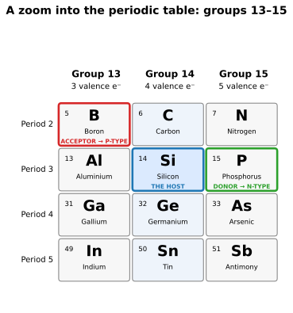

# Preface

## Who this book is for

This book expects very little of you, but it does expect two things: a
minimal foothold in electronics, and the curiosity and eagerness to learn
more. If you have ever wired up an LED and a resistor and wondered what
was really going on inside the chips around it, you have enough of both.

You do not need an engineering degree, and you do not need calculus. What
you need is a bench, a handful of cheap and obtainable parts, and the
willingness to build the thing instead of only reading about it. That is
how this subject has always been best learned: Forrest Mims taught a
generation of us electronics in exactly that spirit, and this book is
written in his debt.

What follows in the rest of this preface is a refresher, not a course.
It walks quickly over the fundamentals the book stands on — voltage,
current, resistance, capacitors, inductors and semiconductors. If you
already know them, skim it and move on to Chapter 1. If some of it is
new, read it slowly and keep it nearby; every idea here comes back later
wearing working clothes.

## How to use this book

The chapters form a ladder, and each one stands on the last: transistors
become switches, switches become gates, gates become families, families
become systems — adders, an ALU, counters and clocks. Read in order the
first time. After that, the book is a handbook: the 74xx reference table
in Appendix A and the glossary in Appendix C are there to be reached for
mid-build.

Every chapter has a worked example with all the arithmetic shown, and a
bench build you can measure your way through. Do the builds. Digital
logic rewards hands in a way few subjects do: the circuit either counts,
or it very instructively does not.

Conventions used throughout:

- Voltages are measured relative to ground (0 V) unless stated otherwise.
- Ratings are always quoted with the conditions they were measured at,
  and chapter references point to the manufacturer datasheets they came
  from.
- The default supply is 5 V and the default logic family is 74HC, because
  that is the friendliest place to learn. Where 3.3 V changes the answer,
  the book says so explicitly — Chapter 4 deals with mixing the two.

Safety: everything in this book is low-voltage, battery-or-bench-supply
work. Nothing here touches mains electricity. Even so, treat a shorted
supply with respect — it will happily melt a wire or a fingertip's
illusion of invincibility — and give electrolytic capacitors the polarity
respect they demand in the section below.

## Setting up your bench

"Who this book is for" promised you a bench and a handful of cheap and
obtainable parts. This is the list — everything the bench builds in this
book assume, bought once and used for the whole book. Each chapter's "You
will need" names the parts for its own builds; the tools below are what
those builds are built with.

**Essentials:**

- **Breadboard.** Full-size, and a decent one: a cheap board with loose
  contacts will have you doubting your circuit when the board is the
  fault. One board is enough to start; a second earns its keep when you
  want the last build to stay built while you start the next.
- **Power.** 5 V to start — a USB breadboard supply is enough, and a
  bench supply is the upgrade for later. 3.3 V arrives in Chapter 4, and
  the same supply that gives you 5 V usually gives you 3.3 V beside it.
- **Hook-up wire.** Solid-core, tinned, in several colours — one colour
  per signal makes a breadboard readable, and tinned wire does not
  oxidise the way bare copper does. A wire stripper to match, and a
  stripper gauge — a small jig that sets the stripped length so every
  wire seats the same — is worth making or printing.
- **Multimeter.** Digital, basic, and the book's main instrument: you
  will measure voltage, continuity and current with it in every chapter.
  It does not need to be expensive; it needs to be the one you reach for.
- **Hand tools.** Needle-nose pliers for placing parts and bending
  leads, tweezers for the small ones, and flush cutters for trimming
  wire and leads.
- **Soldering iron.** A fine tip, temperature-controlled if you can
  stretch to it, and solder. You will need it for breakout boards and
  for the occasional permanent build — and for nothing else in this
  book, which is mostly breadboard work. No hot-air rework station is
  needed: SOIC and TSSOP parts go down fine with a fine tip and drag
  soldering.
- **Breakout boards.** Small adapter boards that carry a surface-mount
  part — SOIC, TSSOP and the like — and present it on a DIP footprint
  your breadboard accepts. The usual distributors sell them ready-made,
  and they are the answer for the day a part you need has no DIP version
  at all. Chapter 4 explains why that day keeps coming.

**Nice to have:**

- **Logic probe.** It shows HIGH, LOW or pulsing at a glance, which is
  faster than a meter when you are chasing a signal through a circuit.
- **Component tester.** One of the cheap testers that identifies a
  transistor, a capacitor or a resistor and tells you its value. It
  earns its keep the first time you pick up a part whose markings you
  cannot read — or a part you salvaged and never knew.
- **Magnifier.** A loupe or a head-mounted magnifier for reading the
  tiny markings on surface-mount parts and for checking solder joints.
  A phone camera works in a pinch.

**Not needed:**

- **Oscilloscope.** This book is designed so a meter is enough. Where a
  measurement seems to need a scope — the carry delay in Chapter 5, for
  instance — the chapter shows a way to bring the answer down to where
  a meter can read it.
- **Hot-air rework station.** As above: a fine-tip iron covers
  everything this book asks you to solder.

**Safety, briefly:** leaded solder is easier to learn with than
lead-free; wash your hands after handling it, work with ventilation,
and never solder a circuit that is powered.

That is the bench. Everything after this page assumes it is within reach.

## The fundamentals, briskly

### Voltage: the push

Voltage is electrical pressure: the difference in electric potential
between two points, measured in volts (V). It is always a difference —
there is no such thing as the voltage "at" a point without an implied
"compared to what", and in this book the comparison is ground, our agreed
0 V reference rail.

The water analogy earns its keep here: voltage is the pressure in the
pipe. No pressure, no flow.

### Current: the flow

Current is the rate at which electric charge flows past a point,
measured in amperes (A) — in our circuits, almost always milliamperes
(mA, thousandths of an amp). Electrons in a wire drift slowly; the
*effect* of current — the push propagating around a circuit — is nearly
instant.

One convention to settle immediately: this book, like all datasheets,
uses *conventional current*, flowing from positive to negative. Electrons
physically travel the other way. A century and a half of diagrams is not
going to change for us, so we note it once and move on.

Current is what does the work and what does the damage. Voltage is what a
part is exposed to; current is what flows through it.

### Resistance, and Ohm's law

Resistance, measured in ohms (Ω), is opposition to current flow. The
three quantities are locked together by the most useful equation in
electronics:

- V = I × R (voltage = current × resistance)

Rearranged as needed: I = V / R and R = V / I. If you know any two, you
know the third. Chapter 1 uses this to size nearly every resistor we meet.

Two companions:

- Power: P = V × I, measured in watts (W). Power is where heat comes
  from. Every part in this book that gets warm is converting electrical
  power to heat, and most failures begin with a power calculation nobody
  did.
- Series and parallel: resistors in series add their resistance and share
  the same current. Resistors in parallel share the same voltage, and
  their combined resistance is lower than the smallest of them — current
  takes every path offered, in inverse proportion to resistance.

The humble resistor, beyond resisting, has two jobs in digital circuits
we will meet constantly: the *pull-up* and *pull-down*, which hold a
signal line at a known voltage when nothing is actively driving it.

### Capacitors: buckets for charge

A capacitor stores electric charge: two conductors separated by an
insulator. Its capacitance, measured in farads (F) — in practice
microfarads (µF), nanofarads (nF) and picofarads (pF) — says how much
charge it stores per volt.

Three behaviours explain almost every capacitor in this book:

- A capacitor resists changes in voltage across it. Charge has to flow
  in or out to change that voltage, and that takes time. This is why
  capacitors set timing: the clock circuits in Chapter 6 are, at heart,
  a capacitor charging through a resistor until a threshold trips.
- A capacitor blocks steady direct current once charged, but passes
  *changes*. It is why a capacitor across a chip's power pins — the
  decoupling capacitor of Chapter 4 — can swallow a sudden gulp of
  current demand without the supply voltage sagging.
- A polarised capacitor (most electrolytics) must be connected the right
  way round. Reversed, they can vent or burst. Respect the stripe.

The time a capacitor takes to charge through a resistor is governed by
their product, R × C, called the time constant: after one time constant
the capacitor is about 63% of the way there, after five, for practical
purposes, it has arrived.

### Inductors: flywheels for current

An inductor — a coil of wire — is the capacitor's mirror image. It
stores energy in a magnetic field, and it resists changes in the current
through it, just as a capacitor resists changes in voltage. Inductance
is measured in henries (H); in our world, usually millihenries and
microhenries (mH, µH).

Digital logic uses few deliberate inductors, but inductors are hiding in
this book all the same:

- Every coil of a relay or motor is an inductor. Switch its current off
  suddenly and it fights back, throwing a brief voltage spike large
  enough to damage a transistor. The flyback (freewheeling) diode across
  such a coil exists precisely to give that stored energy somewhere safe
  to go — our first real example of one component protecting another.
- Radio, waiting in the wings beyond this book, is inductors and
  capacitors resonating together. If you go there, this is the seed.

### Semiconductors: the adjustable middle

Conductors (copper, aluminium) pass current freely. Insulators (plastic,
ceramic) essentially do not. Semiconductors — silicon above all — sit
between, and the whole of modern electronics follows from one trick:
their conductivity can be deliberately controlled.

The control comes from *doping*: adding trace impurities to pure silicon
to make two flavours.

- **N-type** silicon has extra electrons available to carry current.
- **P-type** silicon has extra *holes* — missing electrons that behave
  like positive charges able to move.

### Why boron makes P and phosphorus makes N

The two flavours above are not arbitrary labels — they fall straight
out of the periodic table.

Silicon sits in group 14, so each silicon atom has four valence
electrons — the outer electrons that form chemical bonds. In a silicon
crystal, every atom bonds to four neighbours in a diamond lattice, and
in the ideal picture every valence electron is spoken for in a bond.
That is why pure silicon is a poor conductor: there are almost no free
carriers to move.

Doping swaps a few silicon atoms for neighbours from the columns
either side:

- Boron, in group 13, has only three valence electrons. Put a boron
  atom where a silicon atom was, and one bond goes unmade — a missing
  electron. That vacancy is a hole, and it can move: a neighbouring
  electron steps into it, and the hole appears one step over. Boron is
  called an *acceptor*, and the result is P-type silicon.
- Phosphorus, in group 15, has five valence electrons. Four of them
  make bonds like silicon's; the fifth is surplus, only loosely held,
  and is easily freed to carry current. Phosphorus is called a
  *donor*, and the result is N-type silicon.

A hole is not a particle — it is the absence of an electron, moving by
electrons shuffling into it — but for circuit purposes it behaves
exactly like a positive charge carrier, which is why the book treats it
as one.

The amounts involved are astonishingly small: far less than one dopant
atom per million silicon atoms in lightly doped material is enough to
change its conductivity by orders of magnitude. The same trick works
with the other neighbours in the figure — aluminium and gallium are
acceptors, arsenic and antimony donors — and germanium, silicon's
group-14 cousin below it, can be doped the same way. What this book
does not need is the deeper physics behind the picture: energy bands
and Fermi levels are real, and they are left to the further reading.

Where p-type and n-type meet, they form a *p-n junction*, which conducts
in one direction and not the other. That one-way behaviour, the simplest
semiconductor device there is, is a **diode**. Let current through,
block it in reverse: the LED in your first circuit is a diode that emits
light as it conducts, and the flyback diode above is a diode standing
guard over an inductor.

Put two junctions together in the right arrangement and something
wonderful happens: a small signal at one terminal can control a much
larger current between the other two. That is a **transistor**, and it
is where Chapter 1 begins — because a transistor you deliberately slam
fully on or fully off is a switch, and switches, stacked with intent,
are computers.

### Units and prefixes used in this book

| Prefix | Meaning | Example |
| --- | --- | --- |
| p (pico) | 10⁻¹² | pF — picofarads, for small capacitors |
| n (nano) | 10⁻⁹ | ns — nanoseconds, for propagation delays |
| µ (micro) | 10⁻⁶ | µA, µF |
| m (milli) | 10⁻³ | mA, mV |
| k (kilo) | 10³ | kΩ |
| M (mega) | 10⁶ | MHz |

## Onward

That is all the foundation this book assumes, and all it will ever assume
without stopping to explain. Chapter 1 picks up the transistor where
this preface left it, and puts it to work as a switch.

## References

1. Forrest M. Mims III, *Getting Started in Electronics* — begin there
   if the refresher above felt thin anywhere; it remains the gentlest
   full introduction in print.
2. Paul Horowitz and Winfield Hill, *The Art of Electronics*,
   introductory chapters — for the reader who wants this material at
   full depth.
