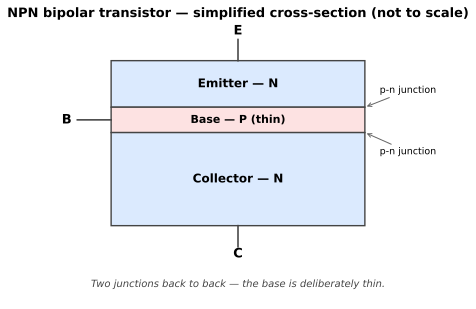
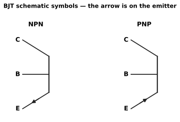
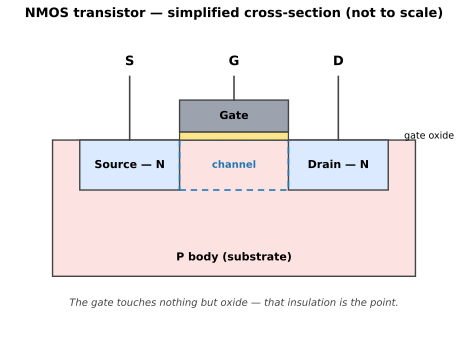
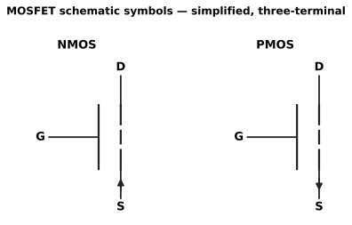
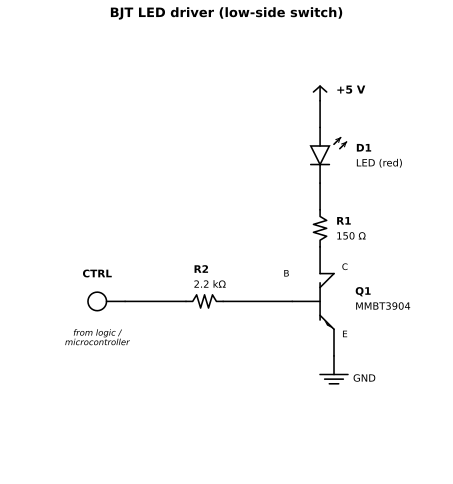
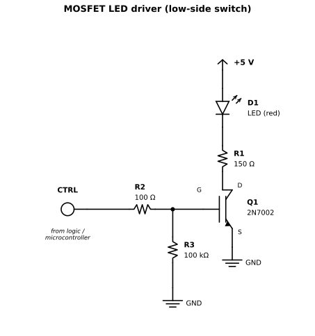

# Chapter 1 — Transistors as switches

Status: draft
Source material: [notes/transistor_theory.md](../notes/transistor_theory.md)

## Purpose

Everything in this book stands on one idea, so we will take it slowly
and get it exactly right: a transistor is an analogue device, and
digital logic is what happens when we refuse to let it be one. Drive a
transistor fully off or fully on and it stops being an amplifier and
becomes a switch — a switch with no moving parts, controlled by a signal
far smaller than the one it switches.

After this chapter you can pick a small bipolar transistor or MOSFET
from a datasheet, calculate what it needs to switch a real load, and
build the switch without cooking anything.

## Prerequisites

- The Preface refresher: voltage, current, resistance, Ohm's law, power,
  and what a p-n junction is

## You will need

- A 5 V supply
- A red LED and resistors (sized in the worked example below)
- One small NPN transistor (MMBT3904, or a through-hole 2N3904 to start)
- One small N-channel MOSFET (2N7002 family, or a through-hole BS170)
- A multimeter

## Theory

### The in-between place we avoid

A transistor has, loosely speaking, three conditions:

- **Off.** No control signal, no current through the load. The
  transistor is an open switch.
- **Fully on.** As much control signal as the device usefully wants.
  Current flows, the voltage left across the transistor is small, and
  the transistor is a closed switch.
- **In between.** The transistor is partly on: significant voltage
  across it *and* significant current through it at the same time.

The in-between is where amplifiers live — a radio or audio signal rides
through it, faithfully enlarged. It is also where heat is made, because
power is voltage times current (P = V × I), and only in between are both
large at once. A switch visits the in-between briefly on every change of
state and hurries out the other side. Keep that picture in mind; it
explains both why digital circuits run cool and why they warm up as they
switch faster.

What "fully on" is called, and exactly where the in-between lies,
depends on which kind of transistor you are holding. This is the single
most confusing piece of vocabulary in the subject, so each kind gets its
own careful treatment below.

### Bipolar transistors (BJT)

A bipolar junction transistor is built from two p-n junctions, and it
uses *both* kinds of charge carrier in the silicon — electrons and holes
— which is where "bipolar" comes from. It has three terminals:
**collector**, **base** and **emitter**.

There are two kinds:

- **NPN** — a p-type base sandwiched between two n-type regions. Current
  flows into the base and into the collector, and out of the emitter.
  The common, default kind — electrons are the faster-moving carriers,
  so NPN devices are typically a little quicker and cheaper.
- **PNP** — the mirror image: an n-type base between two p-type
  regions, with all currents reversed. Current flows into the emitter
  and out of the collector and base.

Here is that sandwich in cross-section:

The sketch is a layer diagram, not a photograph of a real part: in a
planar device the same layers are laid out sideways across the chip
surface, but the order — and the thin base — is the same. The thinness
matters: most carriers injected from the emitter cross the base before
they can recombine there, which is what lets a small base current
control a much larger collector current.

From here on, the book draws the transistor, not the sandwich. The
schematic symbol is the first abstraction in this book: it keeps the
three terminals and the one fact that matters for a switch — which way
the emitter arrow points — and throws the geometry away.

The arrow lives on the **emitter**, and it points in the direction of
conventional current through the emitter: out of the device for NPN,
into it for PNP. That one arrow tells you which kind of BJT you are
looking at and which way its currents flow. The bar is the base; the
two slanted leads are collector (top) and emitter (bottom).

A BJT is **current-controlled**. A small current into the base permits
a much larger current from collector to emitter. The ratio is the
transistor's gain:

- hFE (also written β) = Ic / Ib — collector current divided by base
  current, in the common-emitter configuration

"Common-emitter" simply means the emitter is the terminal common to
both the input loop (base–emitter) and the output loop
(collector–emitter), which is the arrangement every switch in this
chapter uses.

The BJT's three conditions have precise names:

- **Cutoff** — no base current, no collector current: off.
- **Active (linear) region** — collector current is hFE times base
  current: the amplifying in-between.
- **Saturation** — base current is more than enough. The collector
  current is now limited by the load and the supply, not by the base,
  and the voltage across the transistor collapses to a small remnant,
  Vce(sat), typically 0.2–0.3 V. The transistor is fully ON.

Notice what saturation means here: we have *overdriven* the input on
purpose. A switch designer does not ask the base to supply Ic / hFE.
hFE varies wildly between individual parts, with current, and with
temperature. Instead we design for a **forced gain** of about 10 —
supplying roughly a tenth of the collector current into the base —
which guarantees saturation for any specimen of the part, on any day.
We will do exactly that in the worked example.

For completeness, the words you will meet in old texts: a saturated BJT
has both of its junctions forward-biased. That is the physical
definition hiding under the practical one above.

### MOSFETs

A MOSFET (Metal Oxide Semiconductor Field Effect Transistor) also has
three terminals, but the family resemblance ends quickly:

- **Source (S)** — where the carriers enter the channel
- **Drain (D)** — where they leave it
- **Gate (G)** — the control terminal, insulated from the channel by a
  thin layer of oxide

Here is the NMOS device in cross-section:

Source and drain are two N wells in a P body, and they do not touch:
the gap between them is the channel region, and the gate sits above it,
separated by oxide. In the enhancement-mode devices this book uses,
there is no channel until the gate makes one: a positive gate voltage
inverts the surface beneath it, forming a conductive N channel that
joins source to drain. The gate never touches the silicon — that
insulation is why it draws essentially no steady current.

The symbol makes the same trade — geometry for meaning:

The gate is the bar set apart from the channel: that gap *is* the
oxide, and it is why the gate draws no steady current. The arrow sits
on the source lead and points in for NMOS, out for PMOS; it marks the
body connection, tied to the source inside the part. This is the
simplified three-terminal symbol that discrete datasheets use.

A MOSFET is **voltage-controlled**. Voltage on the gate creates an
electric field through that oxide, and the field opens or closes a
conductive channel between source and drain. Because the gate is
insulated, it draws essentially no steady current at all — in exchange,
it behaves like a small capacitor that must be charged and discharged
every time the device changes state. Both facts matter, and both are
used in the worked example.

Again there are two kinds:

- **N-channel (NMOS)** — turns on when the gate is made positive
  relative to the source. The default, faster, cheaper kind; normally
  used as a low-side switch, between the load and ground.
- **P-channel (PMOS)** — turns on when the gate is made negative
  relative to the source (that is, pulled *below* the source). The
  natural high-side switch, between the supply and the load.

### The saturation trap

> **Watch out:** "Saturation" means opposite things for the two kinds of
> transistor. This trips up working engineers, and most short
> explanations on the internet get one side or the other of it wrong.

For a **BJT**, *saturation = fully ON*, as above: input overdriven,
output voltage collapsed to Vce(sat).

For a **MOSFET**, the regions are these:

- **Cutoff** — gate voltage below the threshold: off, no channel.
- **Ohmic (triode) region** — gate driven well above threshold and the
  drain–source voltage small. The channel behaves like a low-value
  resistor, Rds(on). Voltage across the device is tiny. **This is a
  MOSFET switch fully ON.**
- **Saturation region** — the drain–source voltage has risen to roughly
  Vgs − Vgs(th) or beyond; the channel pinches off near the drain and
  the current becomes nearly independent of Vds. The device is in its
  amplifying in-between.

So a MOSFET switch is on in *ohmic*, off in *cutoff*, and passes through
*saturation* twice on every switching cycle — exactly the region a BJT
switch is aiming *for*. One word, two devices, opposite destinations.
Whenever this book says "saturated", it will say which device it means,
and so should any datasheet summary you read elsewhere.

Why MOSFETs won the switching world anyway is no mystery after Chapter
3. For now: near-zero control current while sitting still, and a
fully-on state characterised by a resistance instead of a fixed voltage
drop, which gets better — lower loss — the more modern the part.

### Reading the datasheet: the numbers that matter

The author's bench notes began as exactly this: a short list of small
parts actually investigated for LED driver modules, and the five numbers
per part that decided their fitness. Here they are, explained once and
used all book.

For BJTs:

- **Vceo** — the maximum collector–emitter voltage with the base open.
  A do-not-exceed rating. Design so your circuit voltage sits 20–50%
  below it.
- **Ic** — maximum continuous collector current. Your load should demand
  significantly less.
- **hFE** — DC gain in the active region. Read the conditions (it is
  quoted at a stated Ic) and remember the saturation lesson: design the
  switch with a forced gain near 10, not with this number.
- **Vce(sat)** — the voltage left across a fully-on transistor,
  quoted at a stated current. Your conduction loss is
  P = Vce(sat) × Ic — that is the heat you must get rid of.
- **Vbe(sat)** — the base–emitter voltage of a BJT driven into
  saturation, roughly 0.65–0.85 V for these silicon parts at 10 mA of
  collector current. It is the voltage you subtract from your drive
  signal when sizing the base resistor.

All values below are maxima unless marked typ, verified against the
manufacturer datasheets listed in the References (October 2026).

| Transistor 1 | Transistor 2 | Part Number | Package | Vceo | Ic | hFE | Vce(sat) | Vbe(sat) |
| --- | --- | --- | --- | --- | --- | --- | --- | --- |
| NPN | (none) | MMBT3904 | SOT-23-3 | 40 V | 200 mA | 100–300 (at 10 mA) | 0.2 V (at 10 mA), 0.3 V (at 50 mA) | 0.65–0.85 V (at 10 mA) |
| NPN | NPN | MMDT3904 | SOT-363 | 40 V | 200 mA | 100–300 (at 10 mA) | 0.2 V (at 10 mA), 0.3 V (at 50 mA) | 0.65–0.85 V (at 10 mA) |
| PNP | (none) | MMBT3906 | SOT-23-3 | −40 V | −200 mA | 100–300 (at −10 mA) | −0.25 V (at −10 mA), −0.40 V (at −50 mA) | −0.65 to −0.85 V (at −10 mA) |
| PNP | PNP | DMMT3906 | SOT-363 | −40 V | −200 mA | 100–300 (at −10 mA) | −0.25 V (at −10 mA), −0.40 V (at −50 mA) | −0.65 to −0.85 V (at −10 mA) |
| NPN | PNP | BC846BPN | SOT-363 | 65 V | 100 mA | 200–450 (B grade, at 2 mA) | — | — |

The BC846BPN's saturation voltages are not reproduced here — they are in
its Nexperia datasheet (References). Note the part number: plain BC846
is a *single* NPN in SOT-23. The complementary pair in SOT-363 is the
BC846BPN.

Dual packages — two transistors in one SOT-363 — are not a curiosity.
Keep them in mind; when we build gates from discrete transistors in
Chapter 3, and complementary pairs after that, they are how the part
count stays sane.

For MOSFETs:

- **Vdss** — maximum drain–source voltage the part can block when off.
- **Id** — maximum continuous drain current. Treat with suspicion: it is
  quoted under thermal conditions your small board will not reproduce.
- **Vgs(th)** — the gate voltage at which the device *just barely*
  begins to conduct, passing microamps.

> **Watch out:** Vgs(th) is not a drive voltage. A part with a 2 V
> threshold is not "on" at 2 V in any sense a load would notice — it is
> on when the gate is driven to the voltage at which its Rds(on) is
> specified.

- **Rds(on)** — the channel's resistance when fully on, *always* quoted
  at a stated Vgs. Conduction loss is P = Id² × Rds(on). A part whose
  Rds(on) is specified at Vgs = 10 V will run hot, or barely turn on,
  driven from a 3.3 V microcontroller. This is the most-misread line in
  small MOSFET datasheets.
- **Qg** — total gate charge: how much charge must be shovelled in and
  out of the gate capacitor per switching cycle. It sets how hard your
  driving source has to work at speed: average gate current ≈ Qg ×
  switching frequency.

Threshold voltages below are given as the datasheet's min–max range
(typ where stated); on-resistances are maxima unless marked typ; gate
charges are totals (Qg). All verified against the manufacturer
datasheets in the References (October 2026).

| Transistor 1 | Transistor 2 | Part Number | Package | Vdss | Id | Vgs(th) | Rds(on) | Qg |
| --- | --- | --- | --- | --- | --- | --- | --- | --- |
| NMOS | (none) | BSS123 | SOT-23-3 | 100 V | 170 mA | 0.8–2.0 V (typ 1.7 V) | 6.0 Ω (typ 1.2 Ω) at Vgs = 10 V | 1.8 nC typ (max 2.5 nC) |
| NMOS | NMOS | 2N7002DW | SOT-363 | 60 V | 115 mA | 1.0–2.0 V | 7.5 Ω (typ 3.2 Ω) at Vgs = 5 V | not specified † |
| PMOS | (none) | BSS84 | SOT-23-3 | −50 V | −130 mA | −0.9 to −2.0 V | 10.0 Ω (typ 4.7 Ω) at Vgs = −5 V | 2.2 nC typ |
| PMOS | PMOS | BSS84AKS | SOT-363 | −50 V | −160 mA | −1.1 to −2.1 V (typ −1.6 V) | 7.5 Ω at Vgs = −10 V; 8.5 Ω at Vgs = −5 V | 0.35 nC (typ 0.26 nC) |
| NMOS | PMOS | NTJD4105C | SOT-363 | N: 20 V, P: −8 V | N: 630 mA, P: −775 mA | N: 0.6–1.5 V (typ 0.92 V), P: −0.45 to −1.0 V (typ −0.83 V) | N: 0.375 Ω (typ 0.29 Ω) at 4.5 V, P: 0.30 Ω (typ 0.22 Ω) at −4.5 V | N: 1.3 nC typ, P: 2.2 nC typ |

† Diodes Incorporated's 2N7002DW datasheet specifies gate capacitances
(Ciss typ 22 pF) but no total gate charge — an honest gap, and a useful
reminder that not every datasheet answers every question.

Two rows deserve a second look, because both correct common assumptions.
The NTJD4105C is an **asymmetric** pair: a 20 V N-channel beside an
8 V P-channel, not the matched ±20 V you might expect. And the BSS84AKS
is a real, distinct part — Nexperia's dual PMOS in SOT-363 — not a typo
for the single BSS84.

## Worked example: one LED, two switches

The author's LED modules are the smallest honest load there is: a red
LED, forward voltage about 2.0 V at working current, on a 5 V supply,
target current 20 mA. We will switch it twice: once with an NPN BJT
(MMBT3904), low-side, and once with an NMOS (2N7002 family). Same LED,
same resistor question, two different drives.

### The shared part: the LED resistor

The resistor absorbs whatever voltage the LED and the switch do not.

- BJT version: 5 V − 2.0 V (LED) − 0.2 V (Vce(sat) at our current)
  = 2.8 V across the resistor. R = V / I = 2.8 V / 0.020 A = **140 Ω**.
  The nearest preferred value, 150 Ω, gives 2.8 V / 150 Ω ≈ 18.7 mA.
  Good — slightly under target is the right side to land on.
- MOSFET version: the fully-on channel is a resistance, so its share is
  I × Rds(on) = 0.020 A × 7.5 Ω = 0.15 V. Then
  R = (5 V − 2.0 V − 0.15 V) / 0.020 A ≈ 142 Ω → the same **150 Ω**,
  giving ≈ 19 mA.

Same answer by two slightly different routes, which is the normal state
of affairs in electronics.

### Driving the BJT: the base resistor

A switch designer promises saturation with a forced gain of 10:

- Required base current: Ib = Ic / 10 = 20 mA / 10 = **2 mA**.
- Voltage across the base resistor, driven from a 5 V signal:
  5 V − 0.7 V (Vbe, from the Vbe(sat) range above) = 4.3 V.
- Rb = 4.3 V / 0.002 A = **2150 Ω** → use **2.2 kΩ**, delivering
  ≈ 1.95 mA.

Driven instead from a 3.3 V microcontroller pin, the same arithmetic
gives (3.3 V − 0.7 V) / 2 mA = 1300 Ω → **1.2 kΩ** (≈ 2.2 mA, a touch
more drive — fine). Note the pattern: the drive current is a real,
continuous cost. While that LED is on, 2 mA of the base current is
flowing for the privilege, summer and winter.

### Driving the MOSFET: almost nothing, carefully

The gate draws no steady current, so there is no base-resistor
calculation. Three small things replace it:

- A **gate resistor** (≈ 100 Ω) in series with the gate, not to set a
  current but to soften the edge as the gate capacitance charges, and
  to keep the gate from ringing with stray inductance.
- A **pull-down resistor** (≈ 100 kΩ) from gate to ground, so that
  during reset — when the driving pin is not yet configured and is
  effectively disconnected — the gate cannot float up and turn the
  load on uninvited. Remember this resistor. Chapter 2 is built on the
  trouble floating inputs cause.
- A line in the power budget anyway: the gate charge has to come from
  somewhere. Average gate current = Qg × frequency. Take the BSS123
  from the table (Qg typ 1.8 nC): switched at 100 kHz, that is
  1.8 × 10⁻⁹ × 100 × 10³ ≈ **180 µA** — still nothing. At 20 mA and
  human timescales, our LED driver will never notice. A motor driver
  at 20 kHz and amperes of load will notice very much, which is why
  gate drivers exist as a product category — and why Qg is in the
  table. (The 2N7002DW's own datasheet gives no Qg; see the table's
  footnote. Its gate capacitance, Ciss typ 22 pF, tells the same story
  at this scale.)

### The heat check

- BJT: Vce(sat) × Ic = 0.2 V × 20 mA = **4 mW**. Nothing.
- MOSFET: Id² × Rds(on) = (0.02 A)² × 7.5 Ω (the maximum, so the
  pessimistic case) = **3 mW**. Nothing.

Both parts are loafing, exactly as intended for a first build. The point
of doing the arithmetic when the answer is "nothing" is to have the
habit ready for the day it answers "too much".

## Bench build

Build both switches on the same breadboard, driving the same LED at the
same current:

1. NPN version, low-side: supply → LED → 150 Ω → collector;
   emitter → ground; 5 V signal → 2.2 kΩ → base.
2. NMOS version, low-side: supply → LED → 150 Ω → drain;
   source → ground; 5 V signal → 100 Ω → gate, with 100 kΩ from gate
   to ground.
3. Measure and write down, for each: the LED current, the voltage across
   the transistor (Vce or Vds), and the control current or voltage.
   Compare with the worked example. Expect the BJT's Vce(sat) near
   0.2 V, the MOSFET's Vds near 0.15 V, and both LEDs indistinguishable
   by eye — the differences live in the drive, not the load.

The KiCad sources for both figures live in `schematics/`
(`ch01-bjt-led-driver.kicad_sch`, `ch01-mosfet-led-driver.kicad_sch`),
so you can open them, poke at them, and make them your own.

## Gotchas

- **Designing a BJT switch with headline hFE.** You get a transistor
  that is *probably* saturated, most days, for most specimens. Forced
  gain is cheaper than debugging.
- **Driving a MOSFET by its threshold voltage.** Vgs(th) is a
  barely-awake specification, not an on-switch. Check Rds(on)'s stated
  Vgs before believing it.
- **The floating gate.** A MOSFET gate left unconnected is a radio
  antenna connected to a very sensitive ear. The pull-down is not
  optional in real circuits.
- **Forgetting which saturation you mean.** If a forum post, video or
  book tells you a MOSFET switch "runs in saturation", it is applying
  BJT vocabulary to a MOSFET — the error this chapter's trap box exists
  to catch. The fully-on MOSFET is in its ohmic region.

## Summary

- A transistor is an analogue device; a digital switch is a transistor
  driven to its two extremes — cutoff and fully on — passing quickly
  through the amplifying region between them.
- A BJT is current-controlled: collector current follows base current at
  hFE in the active region, and in **saturation** (fully on) the load,
  not the base, sets the current; design with a forced gain of ~10.
- A MOSFET is voltage-controlled: the insulated gate draws no steady
  current but must be charged, characterised by Qg. It is fully on in
  the **ohmic region**, with a resistance Rds(on) — "saturation" names
  its amplifying region, the opposite of the BJT's usage.
- Ratings are never bare numbers: hFE, Vce(sat), Rds(on) and Vgs(th)
  each mean something only with their stated conditions.
- The worked habit: drop the voltages, size the resistor, guarantee
  the drive, check the heat.

## Extensions

- Repeat the LED driver with a PNP or PMOS device as a high-side
  switch, and watch what happens to the control signal's reference:
  a PMOS turns on when its gate is pulled *down* to ground, which is
  both its convenience and its trap.
- Pulse the MOSFET version faster and faster from a signal source and
  watch Vds with an oscilloscope: the brief journeys through the
  saturation region, invisible at LED speeds, become edges you can
  measure.

## References

All datasheet values in this chapter were verified against the
revisions below on 23 October 2026, and are indexed in
[datasheets/manifest.md](../datasheets/manifest.md).

1. onsemi, *MMBT3904L — General Purpose Transistor, NPN Silicon*,
   publication MMBT3904LT1/D, Rev. 15 (September 2026).
2. Diodes Incorporated, *MMDT3904 — 40 V Dual NPN Small-Signal
   Transistor in SOT363*, DS30088 Rev. 19-2 (August 2026).
3. Diodes Incorporated, *MMBT3906 — 40 V PNP Small-Signal Transistor
   in SOT23*, DS30059 Rev. 23-2 (October 2025). (onsemi's equivalent
   document is MMBT3906LT1/D.)
4. Diodes Incorporated, *DMMT3906W — 40 V Matched Pair PNP Small
   Signal Transistor in SOT363*, DS30312 Rev. 13-2 (February 2018).
5. Nexperia, *BC846BPN — 65 V, 100 mA NPN/PNP general-purpose
   transistor*, product data sheet (accessed October 2026).
6. onsemi, *BSS123 — N-Channel Logic Level Enhancement Mode Field
   Effect Transistor*, BSS123/D, Rev. 10 (November 2021).
7. Diodes Incorporated, *2N7002DW — Dual N-Channel Enhancement Mode
   Field Effect Transistor*, DS30120 Rev. 8-2.
8. onsemi, *BSS84LT1/D — MOSFET, Power, Single P-Channel, SOT-23,
   −50 V*, Rev. 11 (January 2020).
9. Nexperia, *BSS84AKS — 50 V, 160 mA dual P-channel Trench MOSFET*,
   product data sheet Rev. 1 (23 May 2011).
10. onsemi, *NTJD4105C/D — MOSFET, Small Signal, Complementary,
    SC-88, 20 V / −8.0 V*, Rev. 3 (January 2025).
11. Paul Horowitz and Winfield Hill, *The Art of Electronics*,
    chapters on bipolar transistors and MOSFETs — the regions
    terminology and characteristics used here, at full depth.
