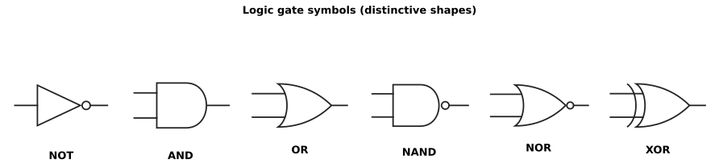
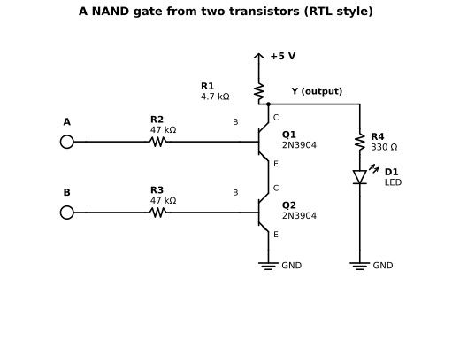

# Chapter 2 — From a switch to a gate

Status: draft
Source material: new writing, seeded by the gate theory in
[notes/logic_recipe_book.md](../notes/logic_recipe_book.md)

## Purpose

Chapter 1 gave us a switch. This chapter gives the switch a job:
making decisions. After it, you understand what a logic level really
is (it is not "5 volts or nothing"), you can read and write truth
tables, you know the basic gate operations — and you know the secret
the whole industry is built on: the natural gate of transistor physics
is not AND or OR, but NAND and NOR.

## Prerequisites

- Chapter 1: the transistor as a switch, forced gain, pull-ups and
  pull-downs

## You will need

- Two 2N3904 NPN transistors (through-hole) and resistors:
  4.7 kΩ (×1), 47 kΩ (×2), 330 Ω (×1), and an LED
- One 74HC00 (quad 2-input NAND) and a 100 nF ceramic capacitor
- A 5 V supply, a breadboard, and a multimeter
- Two slide switches, or just jumper wires you can move between the
  +5 V rail and ground, for the inputs

## Theory

### A gate is a switch with opinions

A logic gate is a circuit whose output voltage represents an answer —
1 or 0, true or false — computed from the voltages at its inputs. The
representation is the whole game, so we define it properly, once.

A digital input does not demand an exact voltage. It accepts a *band*:

- **VIL** — the highest voltage an input still guarantees to read as
  logic 0 ("low")
- **VIH** — the lowest voltage an input still guarantees to read as
  logic 1 ("high")
- Between VIL and VIH lies the *forbidden zone*: the input may read
  either way — or, worse in CMOS, sit half-awake drawing current.
  Well-built circuits pass through it quickly and never park there.

Outputs make matching promises:

- **VOL** — the highest voltage an output will produce when it is
  driving a logic 0
- **VOH** — the lowest voltage an output will produce when it is
  driving a logic 1

For one chip's output to talk reliably to another chip's input, the
promises must overlap with room to spare:

- VOL must be comfortably below the next chip's VIL
- VOH must be comfortably above the next chip's VIH

The spare room is the **noise margin** — how much electrical noise,
voltage sag and general real-world mess a signal can absorb and still
be read correctly:

- Noise margin (low) = VIL − VOL
- Noise margin (high) = VOH − VIH

These four numbers are why digital electronics conquered the world.
Analogue signals degrade a little at every stage. Digital signals are
*regenerated* at every gate: a tired, noisy 3.4 V goes in, and a fresh
5.0 V (or a clean 0 V) comes out. Errors do not accumulate.

### The numbers for real: a 74HC00 at 5 V

Our default family is 74HC, and its datasheet (Nexperia, *74HC00*,
References) specifies at a supply of 4.5 V — datasheets use 2.0, 4.5
and 6.0 V columns, and the 4.5 V column is the guaranteed one to design
a nominal 5 V system against:

| Parameter | Guaranteed limit | Meaning |
| --- | --- | --- |
| VIH | min 3.15 V | = 0.70 × VCC: at or above this, read as 1 |
| VIL | max 1.35 V | = 0.30 × VCC: at or below this, read as 0 |
| VOH | min 4.4 V | driving a light load (20 µA) |
| VOL | max 0.1 V | driving a light load (20 µA) |
| VOH | min 3.84 V | driving a full rated load (4 mA) |
| VOL | max 0.33 V | sinking a full rated load (4 mA) |

Do the noise-margin arithmetic at the light load first:

- High: 4.4 V − 3.15 V = **1.25 V**
- Low: 1.35 V − 0.1 V = **1.25 V**

A signal can be corrupted by more than a volt in either direction and
still be read perfectly. Now load the output to its full 4 mA rating
and watch the promises shrink, exactly as Chapter 1's physics says
they must:

- High: 3.84 V − 3.15 V = **0.69 V**
- Low: 1.35 V − 0.33 V = **1.02 V**

Still healthy — but the lesson is permanent: **outputs get worse as
they work harder**, and datasheets tell you by how much, at stated
currents, if you read the conditions column.

Two more numbers from the same table, worth meeting now:

- **Input current**: a 74HC input leaks at most ±1 µA. Inputs are
  listeners, not loads — a fact fan-out (below) cashes in.
- **Speed**: a 74HC00 gate's propagation delay — input change to output
  change — is typically **7 ns** at 5 V into a light 15 pF load
  (guaranteed maximum 23 ns at 4.5 V into 50 pF). Your discrete gate
  from Chapter 1 switches in microseconds on a good day. The chip is
  roughly a hundred times faster, and Chapter 3 explains what it does
  differently.

And one human number to hold onto when the bands feel abstract: a
typical (not guaranteed) 74HC input actually flips somewhere near the
middle of the supply, around 2.1–2.4 V on a 4.5 V rail. The bands are
promises about the worst specimen on the worst day — design to the
promises, and every specimen on every day works.

### The operations

Each operation also has a shape — its logic symbol. From here on, the
book draws the shape, not the transistors, whenever the circuit inside
does not matter. The six shapes below are in the same order as the
columns of the table that follows, so you can read symbol, name and
truth in one glance. A small circle — a *bubble* — on a pin means
inversion: a NAND is an AND shape with a bubble on its output, and the
bubble is the whole difference.

With two inputs, A and B, and one output, Y:

| A | B | NOT A | A AND B | A OR B | A NAND B | A NOR B | A XOR B |
| --- | --- | --- | --- | --- | --- | --- | --- |
| 0 | 0 | 1 | 0 | 0 | 1 | 1 | 0 |
| 0 | 1 | 1 | 0 | 1 | 1 | 0 | 1 |
| 1 | 0 | 0 | 0 | 1 | 1 | 0 | 1 |
| 1 | 1 | 0 | 1 | 1 | 0 | 0 | 0 |

In words (read 0 as low/false and 1 as high/true):

- **NOT** (inverter): the output is the opposite of the input. It has
  one input only; the table folds it in as a column for company.
- **AND**: 1 only when *all* inputs are 1.
- **OR**: 1 when *any* input is 1 (including both — this is not the
  "one or the other but not both" of everyday speech).
- **NAND**: NOT AND — 0 only when all inputs are 1.
- **NOR**: NOT OR — 1 only when all inputs are 0.
- **XOR** (exclusive OR): 1 when the inputs *differ*. Its complement,
  XNOR, is 1 when they match — an equality detector.

### Layers of abstraction

Step back and notice what has happened twice already. In Chapter 1, a
sandwich of doped silicon became a transistor, and then the transistor
became a symbol — three lines and an arrow. In this chapter, a handful
of transistors and a resistor became a gate, and then the gate became
a shape. Each step throws away detail and keeps only what the next
level up needs to know.

That is how all of electronics is built: in layers of abstraction.
Nobody designs a computer by thinking about holes in silicon, and
nobody debugs a gate by thinking about doping. You work at the highest
layer that still explains what you see, and you drop down a layer only
when it stops explaining — when the LED drags the "high" down to
2.2 V, the gate symbol has nothing to say, and the circuit underneath
does. Chapter 3 will make the point again, louder: six different
families, six different circuits, and the same NAND symbol on top of
all of them. The symbol is the contract; the circuit is one way of
keeping it.

### What a 1 is

One more layer up — the highest one, and the one everything else
serves. A **bit** is a single yes-or-no: true or false, 1 or 0. Two
values are the smallest distinction a physical device can make
reliably — on or off, high or low — and they turn out to be enough
for everything: two values can count (binary numbers; Chapter 5's
adders do the counting) and two values can reason. The rules for
reasoning with them are **Boolean algebra**, George Boole's 1854
system: AND, OR and NOT are operations on truth values, and a truth
table is not a summary of a gate — it is the *definition* of the
operation. The algebra exists before any transistor; a gate is a
piece of hardware that performs it.

Engineers write the operations three ways, and this book uses all
three — words where the sentence wants them, symbols where the
formula wants them:

| Operation | Words | Algebra | Also seen |
| --- | --- | --- | --- |
| AND | A AND B | A·B | AB, A ∧ B, A ∩ B |
| OR | A OR B | A + B | A ∨ B, A ∪ B |
| NOT | NOT A | Ā | ¬A, A′, ~A |
| XOR | A XOR B | A ⊕ B | — |

Read A·B as "A and B" and A + B as "A or B": the plus sign is OR,
not arithmetic addition, and the dot is AND, not multiplication.
The symbols are borrowed because the algebra behaves like
arithmetic in some ways and unlike it in others — A + A = A and
A·A = A, which no ordinary number survives. The overbar is the
NOT: Ā means "not A". The ∪ and ∩ forms come from set theory — OR
is union, AND is intersection — and ∨ and ∧ are the logician's
version of the same two shapes. In plain text, where no overbar is
available, NOT is written A′ (A prime) or ~A, and AND as A*B —
which is how Chapter 3 writes the TTL XOR as Y = (A + B)·(A·B)′.

So a gate is two agreements stacked. The first is the logic: which
truth table this gate computes. The second is the *encoding*: which
voltages stand for 1 and which for 0. This book uses **positive
logic** — the high band means 1, the low band means 0 — but that is
a convention, not physics: read the same NAND gate with low as true
and it becomes a NOR, as the De Morgan note below shows. And the
encoding is a matter of bands, not points: a 1 is not 5.0 V, it is
any voltage inside the band the family accepts — for the 74HC00,
anything above 3.15 V reads as 1 and anything below 1.35 V reads
as 0, with the forbidden zone between them. The noise margin is the
slack that makes the agreement hold across real devices, real
temperatures and real wiring.

Hold that split in your head and Chapter 3 falls into place. Every
family in it computes the *same* truth tables — the logic does not
change from RTL to CMOS. What changes is the encoding: the voltages
that mean 0 and 1, and the circuits that pull the output between
them. A logic family is a tribe that agrees on an encoding and on a
way of keeping it. Chapter 3 meets six of them.

### Why NAND and NOR run the world

Look at what a transistor switch naturally does. A pull-up resistor
holds an output high; a transistor (or several) can pull it down. That
single fact decides everything:

- Put two transistor switches **in series** between output and ground:
  the output falls only when *both* are on. Output low means
  "A AND B" — so the output itself is **NOT (A AND B) = NAND**.
- Put them **in parallel**: the output falls when *either* is on.
  Output low means "A OR B" — the output is **NOR**.

Series gives NAND, parallel gives NOR, free of charge, from the
physics. An AND gate is a NAND plus an inverter — two stages, more
transistors, more delay. That is why the iconic chip of the TTL era,
the 7400 that gave the whole 74 family its name, is not four AND
gates. It is four **NAND** gates. Our bench build and our default chip
in this chapter are both NANDs for the same reason.

The second secret is stronger: **NAND alone is enough.** Any logic
function whatsoever can be built from nothing but NAND gates:

- NOT A = A NAND A (tie the inputs together)
- A AND B = NOT (A NAND B) — two NANDs
- A OR B = (NOT A) NAND (NOT B) — three NANDs; check it against the
  table above, row by row

NOR has the same property (check it the same way — see Extensions).
Logicians call this *functional completeness*; engineers call it "one
part number on the shelf". When Chapter 5 starts assembling adders and
an ALU, everything still traces back to this paragraph.

### Saying it like an engineer

A few conventions carry the rest of the book:

- **The bubble.** A small circle at a pin means inversion — the signal
  is flipped there. A NAND symbol is an AND shape with a bubble on
  its output. A bubble on an *input* means "this pin does its job when
  the signal is low".
- **Active low.** Many real signals are named for what they do when
  they are *low*: reset, chip-select, output-enable. They are written
  with an overbar, or a trailing `_n` in plain text, and drawn with
  bubbles. "Asserted" means "doing its named job" — high or low, as
  the name says.
- **Positive and negative logic.** We assume *positive logic*: high
  voltage = 1 = true. Read the same NAND gate in negative logic (low
  = true) and it becomes a NOR. The hardware does not care what the
  voltages "mean"; meaning is a contract between the people connecting
  the pins. Mostly an academic point — until De Morgan makes it a
  practical one:
- **De Morgan's theorem.** Swapping AND and OR while flipping every
  input and output leaves the function unchanged, in both directions:
  (A·B)̄ = Ā + B̄, and (A+B)̄ = Ā·B̄. In words: NOT (A AND B) =
  (NOT A) OR (NOT B), and NOT (A OR B) = (NOT A) AND (NOT B).
  Engineers use this daily, not as algebra but as rewiring: a bubble
  pushed through a gate flips AND to OR (or back), so the NOR gate in
  your hand can stand in for the NAND you ran out of, by flipping how
  you read its pins.

### Fan-out: how many listeners can one talker drive?

**Fan-out** is how many inputs one output can drive while keeping its
promises. The two technologies in this chapter could not differ more:

- **74HC to 74HC**: each input asks for at most ±1 µA, so an output
  rated at 4 mA could, on paper, feed thousands of inputs. In practice
  the limit is *capacitance*, not current: every input adds about
  3.5 pF plus wiring, and charging capacitance takes time, so big
  fan-outs get slow before they get wrong. Dozens of loads is
  comfortable; hundreds wants a buffer (Chapter 4's job).
- **Our discrete RTL gate**: every driven input draws real current —
  about 90 µA through its 47 kΩ base resistor when high (worked out
  below). Ten loads would ask ~0.9 mA of the driving gate's output,
  and that current arrives *through its 4.7 kΩ pull-up resistor*,
  dropping 0.9 mA × 4.7 kΩ ≈ 4.2 V on the way. The "high" would arrive
  as under a volt. RTL fan-out is single digits — one honest reason
  the technology died. Chapter 3 tells the rest of that story.

## Worked example: designing the discrete NAND

The series version, RTL-style (the full recipe treatment is
Chapter 3's; here it is our specimen). A 4.7 kΩ pull-up resistor R1
holds the output high. Two 2N3904s, Q1 stacked over Q2, stand between
the output and ground. Both must conduct to pull the output low —
which is exactly NAND.

KiCad source:
[ch02-rtl-nand.kicad_sch](https://github.com/marsairforce/digital_logic_e_book/blob/main/schematics/ch02-rtl-nand.kicad_sch)

**The pull-up and the low level.** When both transistors are on, the
stack current is set by R1 and the two saturation voltages. Designing
with Chapter 1's discipline (Vce(sat) ≈ 0.2 V per device as a planning
figure):

- Stack current ≈ (5 V − 0.2 V − 0.2 V) / 4.7 kΩ ≈ **0.98 mA**
- The output low level will be the two saturation voltages *added*:
  ≈ **0.4 V by the planning figures**. On the bench you will likely
  measure 0.15–0.3 V, because at ~1 mA a real 3904 saturates more
  softly than its 10 mA datasheet line. Either way it is emphatically
  not 0 V — stacked switches stack their imperfections. Remember this
  tax; Chapter 3 collects it across a whole logic family.

**The base resistors.** Each transistor carries the same ~1 mA stack
current. Chapter 1's forced gain of 10 asks for Ib ≈ 0.1 mA each:

- Rb = (5 V − 0.7 V) / 0.1 mA = 43 kΩ → use **47 kΩ**, giving
  ≈ 91 µA of base current for each input held high.

**The high level — and a prediction you can test.** With either
transistor off, no stack current flows, R1 drops nothing, and the
output rises to the full 5 V — *if nothing is listening*. Our LED
indicator branch (R4 + D1) is listening. Work out what it does before
you build it:

- The LED branch reaches ground through R4, so its current must come
  down through R1: total series resistance 4.7 kΩ + 330 Ω ≈ 5.0 kΩ.
- Current ≈ (5 V − ~2 V across the LED) / 5.0 kΩ ≈ **0.6 mA**.
- So R1 drops 0.6 mA × 4.7 kΩ ≈ 2.8 V, and the "high" output lands at
  ≈ **2.2 V**, with the LED glowing weakly at 0.6 mA, if visibly
  at all.

Prediction, written down before the bench: *with the indicator
connected, VOH ≈ 2.2–2.5 V; disconnect it and VOH returns to 5.0 V.*
A resistor pull-up can only source as much current as its own voltage
drop allows — which is the fan-out section, measured instead of
asserted.

## Bench build

1. Build the discrete NAND exactly as drawn. Inputs A and B are
   jumpers (or switches) you move between the +5 V rail (logic 1) and
   ground (logic 0). Never leave an input unconnected for these
   measurements — decide its level deliberately.
2. Work through all four input combinations. For each, record the LED
   state and the measured output voltage. Expected: output low
   (LED off) only for A = 1, B = 1, at roughly 0.15–0.3 V; output high
   (LED faint) the other three times, at roughly 2.2–2.5 V.
3. Now lift the LED branch out of the circuit and re-measure a high
   output: 5.0 V. Same gate, same inputs — the load was the
   difference. File this next to the 74HC00 table in Theory, where the
   guaranteed VOH quietly fell from 4.4 V to 3.84 V between a 20 µA
   load and a 4 mA load. Physics does not grade on a curve.
4. Build the same gate from the 74HC00: pin 14 to +5 V, pin 7 to
   ground, 100 nF from pin 14 to pin 7 as close to the chip as the
   breadboard allows. Use gate 1: inputs on pins 1 and 2, output on
   pin 3. Tie the inputs of the *other three gates* to ground — see
   Gotchas before deciding that sounds fussy.
5. Repeat the truth table with the same LED branch on pin 3. The LED
   is bright now, and the levels are transformed: VOL measures in the
   hundredths of a volt, VOH stays up near the rail. One honesty
   note: at ~9 mA the LED is drawing more than the 4 mA at which the
   datasheet *guarantees* those levels (the chip tolerates it — its
   absolute maximum per output is 25 mA — but guarantees are
   guarantees). You are committing the classic bench sin, knowingly,
   and can now say exactly which corner of the datasheet you stepped
   outside.
6. Put the two builds side by side and compare: output-low voltage,
   output-high voltage loaded and unloaded, and how each treats its
   inputs. Then look at what is actually inside the chip:

KiCad source:
[ch02-cmos-nand.kicad_sch](https://github.com/marsairforce/digital_logic_e_book/blob/main/schematics/ch02-cmos-nand.kicad_sch)

Read the chip's circuit with Chapter 1 eyes. The two PMOS transistors
sit in **parallel** between VDD and the output; the two NMOS sit in
**series** between the output and ground. With either input low, its
PMOS is on (a path up exists) and its NMOS is off (the path down is
broken): output high. Only when both inputs are high are both PMOS
off and both NMOS on: output low. NAND again — but note what changed.
There is no resistor, and no standing current: in either resting
state, one network or the other is completely off, so the chip idles
at microamps (the datasheet promises ≤ 20 µA for the whole package)
and *actively* drives the output both up and down. Your RTL gate pulls
up politely through 4.7 kΩ; the CMOS gate grabs the output with both
hands. That difference — active pull-up *and* pull-down — is the
"complementary" in CMOS, and it is why the LED is bright.

## Gotchas

- **Floating inputs are not 0, not 1, and not safe to ignore.** A 74HC
  input left unconnected drifts with stray charge and nearby signals;
  the gate may read it either way, oscillate, or park in the
  forbidden zone drawing current and getting warm. Rule for the whole
  book: every CMOS input gets a definite level — a wire, a pull-up, or
  a pull-down — including the inputs of gates you are not using.
  (Your discrete RTL NAND forgives a disconnected input by simply
  staying off; bipolar habits will betray you with CMOS.)
- **The forbidden zone is a place, not a transition.** A slowly rising
  input — a big capacitor, a lazy sensor, a finger — can hold a CMOS
  gate half-on for as long as it lingers, wasting current the whole
  time. Chapter 4 meets the proper cure (Schmitt-trigger inputs,
  the 74HC14).
- **Stacked means summed.** Two saturated transistors gave us ~0.2–0.4
  V of "low". Three would give more. Series stacking spends noise
  margin; spend it knowingly.
- **An indicator is a load.** Anything you hang on an output to
  *observe* it also *changes* it — the 2.2 V "high" in this build was
  caused by the observing instrument. Measure with the meter
  (10 MΩ, nearly innocent) before believing the LED.

## Summary

- A logic level is a band with promises attached: VIL, VIH, VOL, VOH —
  and the noise margin, their difference, is why digital signals can
  be regenerated perfectly at every gate.
- A 74HC00 at 5 V guarantees better than a volt of noise margin
  lightly loaded, and its outputs weaken measurably as load current
  rises — the datasheet's conditions column is where that truth
  lives.
- Transistors in series naturally make NAND; in parallel, NOR. AND
  and OR are the composites. NAND (or NOR) alone can build anything.
- CMOS buys its clean levels and near-zero idle current with a
  complementary pair of networks — and demands, in return, that no
  input ever be left floating.
- Fan-out is a current budget in bipolar logic and a capacitance
  budget in CMOS.

## Extensions

- **Three inputs.** Stack a third transistor and a third base
  resistor. Predict the new VOL, then reflect: how tall can the stack
  get before the "low" stops being low enough to trust? (Real
  families hit this wall — see Chapter 3, fan-in.)
- **The other native gate.** Rebuild the bench gate with Q1 and Q2 in
  *parallel* instead of series, keeping everything else. Measure the
  truth table and confirm it is NOR.
- **De Morgan with your hands.** Using only the remaining gates of
  your 74HC00, build an OR function out of NANDs: an inverter on each
  input, then a NAND. Verify all four rows.
- **Negative logic.** Re-read the discrete gate's measured truth
  table calling *low* "true". Which gate is it now? Connect this to
  the De Morgan bullet in Theory.

## References

1. Nexperia, *74HC00; 74HCT00 — Quad 2-input NAND gate*, product data
   sheet Rev. 11 (29 April 2025) — all logic levels, leakage and
   timing figures quoted in Theory, verified October 2026 and indexed
   in [datasheets/manifest.md](../datasheets/manifest.md).
2. Paul Horowitz and Winfield Hill, *The Art of Electronics* —
   logic levels and CMOS gate internals at full depth.
3. Forrest M. Mims III, *Getting Started in Electronics* — the
   friendliest first encounter with gate truth tables.
