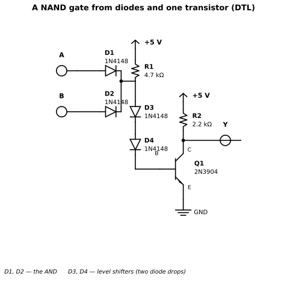
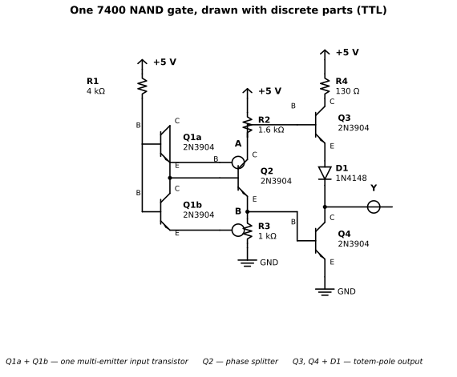
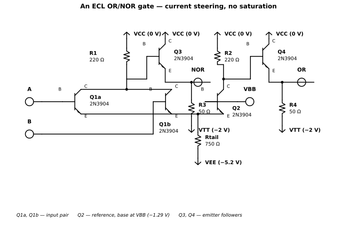
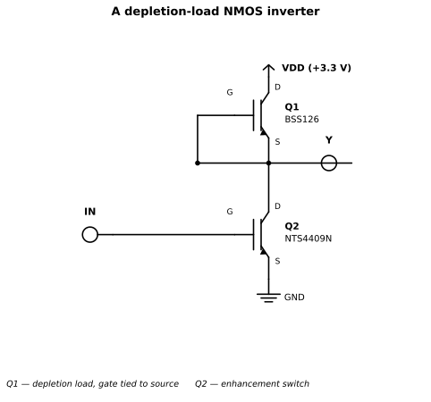
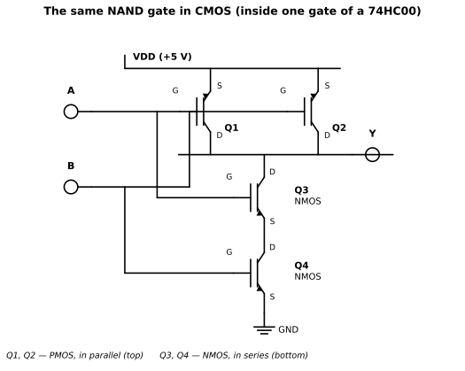
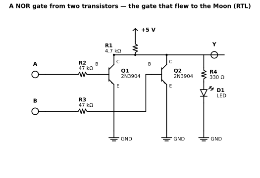

# Chapter 3 — Logic families through history

Status: draft
Source material: [notes/logic_recipe_book.md](../notes/logic_recipe_book.md),
[notes/logic_families.md](../notes/logic_families.md)

## Purpose

Chapter 2 built one gate one way. This chapter builds the same gates
six different ways — the six eras of logic — and watches the trade
each era made between speed, power and complexity. By the end you can
explain, in your own words, why CMOS won the war, and you can look at
any gate, from any era, and see the same few ideas wearing different
clothes. Every family here also has something it still teaches, so
none of this is museum tourism: it is a bench tour.

## Prerequisites

- Chapter 1: the transistor as a switch, saturation and the ohmic
  region, pull-ups and pull-downs
- Chapter 2: logic levels, noise margins, why NAND and NOR are the
  native gates

## You will need

- Two or three 2N3904 NPN transistors and resistors for the RTL
  builds: 4.7 kΩ pull-ups, 47 kΩ base resistors (the same values as
  Chapter 2's discrete NAND), one 330 Ω and an LED for the indicator
- One 74LS00 and one 74HC00 (quad 2-input NAND), a 100 nF ceramic
  capacitor for each, a 5 V supply, a breadboard and a multimeter
- Optional: one CD4011B, if you want to meet the CMOS that came
  before 74HC

## Theory

A logic family is a tribe that agrees on one answer to a hard
question: **how do you pull an output down, and how do you pull it
back up again?** Chapter 1 showed the down half is easy — a
transistor to ground. The up half is where all the history lives.
Every family below is really a different answer to "who pulls up",
and every answer cost something: speed, power, parts, or noise
immunity. Keep that sentence in your head and the whole chapter
organises itself.

### RTL — resistor-transistor logic (early 1960s)

The first answer was the simplest: a resistor pulls up. One NPN
transistor, base driven through a resistor, collector tied through a
pull-up resistor to the supply. Input high, transistor on, output
dragged to ground. Input low, transistor off, resistor floats the
output up. That is an inverter. Put two transistors in **parallel**
under one pull-up and you get a NOR: either input high pulls the
output down. Put them in **series** and you get a NAND — Chapter 2
built that one and measured the LED dragging its "high" down to
2.2 V.

RTL was the logic of the first integrated circuits. Fairchild's
Micrologic line put RTL gates on chips in 1961 — the μL900 series,
with 450 Ω base resistors and a 640 Ω collector resistor inside
each gate, running from a 3.0 V supply — and the most famous RTL
machine ever built was the Apollo Guidance Computer: its logic was
implemented entirely as dual 3-input **NOR** gates, about 2,800
chips holding some 5,500 NOR gates, each chip just six transistors
and eight resistors. The whole computer used only two IC types.
The AGC ran its logic from a +4 V supply. If one gate type sounds
restrictive, remember Chapter 2: NOR is functionally complete. The
Apollo engineers proved it on the way to the Moon.

What RTL teaches, honestly, is failure. The resistor is a lazy
pull-up: when the output must rise, the resistor fights the load
capacitance and the rise is slow. When the output is low, current
flows through the resistor and the transistor constantly — power is
burned doing nothing. Noise margins are thin, because the input
turns on at one base-emitter drop with no help: at a fan-out of
five, the high level sags to about 1.1 V against a threshold near
0.9 V, leaving a noise margin of roughly 0.2 V. Fan-out is small
for the same reason: every input you hang on an output steals
about 0.6 mA of base current through its own base resistor, and
five loads drop nearly 2 V across the shared pull-up. The
era's figures are about 25 ns of delay, about 12 mW per gate,
and a fan-out of five — and even the input count was limited to
about three before noise immunity fell apart.

Note the values: the IC's resistors (450 Ω and 640 Ω at 3 V) are
nothing like this book's bench values (47 kΩ and 4.7 kΩ at 5 V).
The bench build is deliberately lazier — smaller currents, gentler
on a breadboard — and the physics is identical, only the scale
differs. The bench build itself is drawn in the Bench build section
below.

Nobody builds RTL systems today. But every discrete-transistor gate
you will ever breadboard *is* RTL, and the failure modes above are
the same ones you meet on your own breadboard. RTL is the family
you build with your hands.

### DTL — diode-transistor logic (mid-1960s)

RTL's noise margin was embarrassing, and the fix was diodes. In DTL
the *diodes* do the logic and a single transistor does the driving:
for a NAND, the inputs feed diodes into a common node, and that
node drives the transistor's base through two more diodes in
series — level-shifters. Nothing conducts until the input side has
climbed about two diode drops plus a base-emitter drop, so small
noise spikes die on the vine. The transistor part is the same
saturated switch as RTL, with a resistor pull-up, so DTL inherits
RTL's slow rising edge and its constant power burn. (Fairchild's
real 930-series circuit is cleverer than the textbook drawing: it
replaces one of the level-shift diodes with a transistor whose
collector returns to the middle of the input pull-up resistor,
which doubles the gating efficiency. The textbook circuit below
is the idea; Fairchild's is the product.)

DTL arrived in 1962 (Signetics' SE100 series; Fairchild's 930
series, the commercially successful one, followed in 1964) and
briefly ruled the mid-1960s. Its noise margin, roughly 1 V, was a
revelation after RTL's 0.2 V, and it came with a fan-out of about
eight and a single +5 V supply — the rail the whole industry
would standardise on. When you wire two signal diodes and a
transistor on a breadboard today, you are building DTL, and it is
still a perfectly good way to make a wired logic function from
junk-box parts.

KiCad source:
[ch03-dtl-nand.kicad_sch](https://github.com/marsairforce/digital_logic_e_book/blob/main/schematics/ch03-dtl-nand.kicad_sch)

The resistor values here are the textbook discrete version, not
the IC's internal resistors — and the circuit is the textbook
one, not Fairchild's offset-transistor refinement.

Gotcha worth knowing: diode drops **stack**. Three diodes in series
need three forward drops before anything happens, which is why DTL
inputs and supplies never strayed far from 5 V, and why DTL has a
characteristic ~0.8 V low threshold that its successor kept.

### TTL — transistor-transistor logic (1964 onward)

TTL replaced DTL's input diodes with a single **multi-emitter
transistor**: one transistor whose emitter is split into several
legs, one per input. If *any* input is low, that emitter steals the
base current and the transistor stays off; only when *all* inputs
are high does current flow into the collector and drive the next
stage. The same transistor does the diode logic *and* provides
gain — "transistor-transistor". Behind it sits a phase splitter and
a **totem-pole output**: two transistors stacked, one pulling up,
one pulling down, only one ever on at a time. The lazy resistor
pull-up is finally gone, and with it the slow rising edge.

KiCad source:
[ch03-ttl-nand.kicad_sch](https://github.com/marsairforce/digital_logic_e_book/blob/main/schematics/ch03-ttl-nand.kicad_sch)

Q1a and Q1b together are one multi-emitter input transistor,
drawn as two devices sharing a base and a collector — the
standard discrete equivalent. The resistor values are the classic
7400 values (R1 4 kΩ, R2 1.6 kΩ, R3 1 kΩ, R4 130 Ω).

The original 7400 (1964) ran at the textbook figures of about
**10 ns** of propagation delay for about **10 mW** per gate — an
order of magnitude faster than the RTL and DTL it replaced, and TTL
ate the industry. Everything you know about 74-series part numbers
starts here, and Chapter 4 walks the subfamilies. The one you will
actually meet on a bench today is **74LS** (low-power Schottky),
the 1980s default: here are its real numbers, from the onSemi
datasheet (References), at 5 V. (The standard 7400 differs mainly
in power and drive: about 10 mW per gate instead of 2 mW, 16 mA
of output sink instead of 8 mA, and a fan-out of 10 instead of
20 — the speed and the levels are nearly the same. LS won on
power, not speed.)

> **Why 14 and 16 pins?**
>
> A quad 2-input gate needs 12 signal pins — four gates times two
> inputs plus one output each — plus power and ground: 14 pins.
> A hex inverter needs the same 14. Functions that need more
> signals, a 3-to-8 decoder or a 4-bit counter, take 16. The
> 14-pin DIP those parts live in was itself invented in 1964 at
> Fairchild by Don Forbes, Rex Rice and Bryant Rogers, because
> the transistor-style metal cans of the day topped out at about
> ten leads. Before it, every vendor had its own packaging: IBM's
> contemporary SLT (Solid Logic Technology) modules for the
> System/360, also 1964, were discrete transistors and diodes
> flip-chip mounted on a ceramic substrate under a square metal
> lid, chosen because IBM considered monolithic chips too immature
> to trust. The DIP ended that chaos by being a standard carrier
> anyone could buy, socket and solder — and Appendix E carries
> its dimensions.

| Parameter | Guaranteed limit | Meaning |
| --- | --- | --- |
| VIH | min 2.0 V | at or above this, read as 1 |
| VIL | max 0.8 V | at or below this, read as 0 |
| VOH | min 2.7 V | at IOH = −0.4 mA |
| VOL | max 0.5 V | at IOL = 8 mA |
| IIL | max −0.4 mA | current an input *sources* when held low |
| IIH | max 20 µA | at VIN = 2.7 V |
| tPLH / tPHL | typ 9 / 10 ns, max 15 ns | into 15 pF |
| ICC (per package) | 0.8–1.6 mA outputs high, 2.4–4.4 mA outputs low | four gates |

Two things to notice, because they are TTL's personality in numbers.
First, the noise margins: high side 2.7 − 2.0 = **0.7 V**, low side
0.8 − 0.5 = **0.3 V**. That 0.3 V low margin is *thin* — TTL systems
earned their reputation for needing clean grounds and fat
decoupling capacitors. Second, IIL: a TTL input held low **sources
0.4 mA back into whatever drives it**. TTL inputs are loads, not
listeners — the opposite of CMOS, and the reason a TTL output
driving many TTL inputs runs out of current (fan-out of 10 for LS,
each input counting as one 0.4 mA load against an 8 mA budget).

TTL's signature gotcha: **an unconnected TTL input reads as high**,
because with no current able to leave that emitter, the
multi-emitter transistor's base–collector junction forward-biases
and feeds the phase splitter exactly as a high input would. It
"works" — and it also works as a radio antenna, picking up mains
hum and your hand waving nearby. The datasheet is blunt about it:
all unused inputs must be held at VCC or GND. Tie them directly
to VCC (or to ground, where the logic allows), never leave them
floating, and never assume "unconnected = safely high" in a
finished circuit. Contrast Chapter 2's CMOS, where a floating
input drifts with stray charge and can park half-on: the TTL
input is a *deterministic* high and a *noisy* one, the CMOS
input an *indeterminate* one. Same rule — tie it down — for
opposite reasons.

Two output flavours, and confusing them is the classic TTL injury:

- **Totem-pole** (plain 7400/74LS00): two outputs must **never** be
  tied together — when one pulls up and the other pulls down they
  fight, and the fight ends with heat and a dead chip.
- **Open-collector** (7401, 74LS01): the upper transistor is
  missing, so the output can only pull *down*. Add one external
  pull-up resistor and you may tie several outputs together: the
  shared line is low if *any* gate pulls it low — a **wired-AND**
  (wired-OR if you think in negative logic). Busses, interrupt
  lines and I²C's SDA live on this trick to this day.

### ECL — emitter-coupled logic (1960s, and still the fastest)

Every family so far pays the same tax: its transistors **saturate**,
and getting a saturated transistor to turn off takes time (Chapter
1's storage time). ECL refuses to pay. Its gates are
**differential pairs** that *steer* a fixed tail current left or
right — the transistors never saturate, so there is almost no
switching delay beyond the physics of the silicon. The output is an
emitter follower, which gives ECL its signature: every gate
produces both the true and the complemented output for free.

KiCad source:
[ch03-ecl-nor.kicad_sch](https://github.com/marsairforce/digital_logic_e_book/blob/main/schematics/ch03-ecl-nor.kicad_sch)

The collector and tail resistor values are typical textbook values
for a discrete build, not the IC's internal resistors. Note the two
50 Ω termination resistors to −2 V: they are part of the gate, not
optional extras.

The price is everything else. Classic 10K ECL runs from **−5.2 V**
(the supply is negative so the collectors return to the quiet
grounded rail), swings less than a volt, and burns power
constantly — on the order of **25 mW per gate**, whether it is
switching or sitting still. From the onSemi MC10101 datasheet
(References): propagation delay typically **2 ns**, output levels
around −0.9 V (high) and −1.7 V (low), noise margins of roughly
**125–155 mV**. The reference voltage the pair steers against,
VBB, is about −1.29 V on-chip — and in 10K it drifts with
temperature, which is why the later 10H family advertises a
compensated reference and a 150 mV margin. That is the deal laid
bare: five times faster than TTL, five times hungrier, and noise
margins you can lose by breathing on the board — ECL systems need
terminated 50 Ω transmission lines, a −2 V termination supply, and
genuine high-speed layout discipline. Every output needs its 50 Ω
to −2 V, terminated at the far end; an unterminated ECL output
has no DC load path for its emitter follower and will not hold
its levels at all. It is not a breadboard family.

Nor is 2 ns the end of the story. The generations ladder down:
MECL III managed about 1 ns back in 1968, 10K traded speed for
lower power in 1971, 10H won the nanosecond back in 1981 at the
same 25 mW, and ECLinPS reached 350 ps in 1987. The notes'
blanket "<1 ns" collapses those three generations into one
number; the ladder is the truth.

Where ECL survives is exactly where its tax is worth paying: the
fastest discrete logic ever sold, still used in instrumentation,
clock distribution and fibre-optic front ends (modern descendants
go by PECL, LVPECL and CML). The Cray-1 — some 200,000 ECL
gates, a 12.5 ns clock, 250 kW including refrigeration — is the
monument to that trade. And the end of the story is a single
datapoint: in 1991 DEC's CMOS NVAX matched the ECL VAX 9000's
performance at a twenty-fifth of the cost. CMOS won not by
beating ECL's gate delay, but by scaling. ECL teaches the deepest
lesson of the chapter anyway: **saturation is the enemy of
speed**. Every fast logic since — Schottky TTL's anti-saturation
clamps, CMOS's never-on transistors — is an answer to the tax ECL
simply declined to pay.

### NMOS — the depletion load (1970s)

The MOS families flip the transistor type: instead of current into
a base, a voltage on a gate. Early NMOS gates use an enhancement
transistor as the switch and a second transistor — wired as a
**depletion-mode load** — as the pull-up. A depletion device
conducts with its gate at 0 V, so tying the load's gate to its
source leaves it permanently on, passing a near-constant current:
it is a current source, not a resistor, which is why it pulls the
output up faster and more sharply than RTL's resistor ever did.
Your notes' own recipe uses exactly this: a BSS126 depletion
MOSFET as the load over discrete enhancement switches. It is a
lovely construction, and it is how the 1970s built
microprocessors: the 8080 and the 6800, both 1974, are
depletion-load NMOS inside — the 8080 needing three supplies
(+5 V, +12 V, −5 V), the 6800 running on a single +5 V, a
difference the process details, not the logic, decided.

KiCad source:
[ch03-nmos-not.kicad_sch](https://github.com/marsairforce/digital_logic_e_book/blob/main/schematics/ch03-nmos-not.kicad_sch)

The gate-source tie on Q1 is the whole circuit: it is what makes
the BSS126 a depletion load rather than a switch. This book's
KiCad symbols draw depletion and enhancement MOSFETs with the same
solid channel bar, so the part number and the tie carry the
meaning here.

But a depletion load is **ratioed logic**. The output low voltage
is set by the *ratio* of the load's strength to the switch's
strength — size the transistors wrong and your "low" is not low
enough, and no datasheet can save you; the circuit must be designed
as a whole. Worse, the load conducts whenever the output is low, so
the gate burns static power in one of its two states, like RTL
with better manners. The output high, at least, is honest: with
the switch off there is no DC path to ground, so the load pulls
the output all the way to the supply. Two strikes, then — ratioed
design and static power — and the industry knew the pull-up needed
one more idea.

The recipe's parts are real, and worth meeting properly, because
they make the static-power problem concrete. The BSS126 load
(Infineon, SOT-23) guarantees an on-state current of at least
7 mA — with no maximum specified — so at the recipe's 3.3 V a
gate whose output is low burns on the order of 25–35 mW, and the
exact current varies part to part. A thousand such gates would
burn tens of watts standing still: the NMOS power wall in
miniature. The switches are an NTS4409N for the inverter (watch
its unusually low ±8 V gate rating — fine at 3.3 V, never drive
it from 12 V) and, for the NAND, both channels of a single
NTJD4401N dual package in SOT-363, one package per gate. One
correction to the notes, made here: their diagrams show a 1.0 kΩ
resistor wired in parallel with a direct wire between the load
and the output, where it is shorted out and does nothing. It is
deleted in the figure below; if you want to tame the load current,
the right component is a resistor in the load's *source* leg,
not at the output.

### CMOS — complementary MOS (1968 onward, the winner)

The final idea is embarrassingly elegant: use *two* transistors, a
PMOS that only pulls up and an NMOS that only pulls down, wired so
that **one of them is always off**. Input high: NMOS on, PMOS off,
output dragged to ground. Input low: PMOS on, NMOS off, output
pulled to the rail. In a steady state there is no path from supply
to ground at all — the gate draws essentially nothing. Power is
only spent *while switching*, charging and discharging the load
capacitance. That is why CMOS won: **power became proportional to
work done**, and the power wall — not speed — is what kills every
other family at scale.

RCA's 4000 series (1968) was the first CMOS family, and it is still
manufactured today. The CD4011B quad NAND (TI datasheet,
References) shows the family's personality at a glance:

- Supply: **3 V to 18 V** — the wide range is a CMOS superpower;
  TTL families get 5 V and like it.
- Noise margin: **1 V** at a 5 V supply, 2 V at 10 V, 2.5 V at
  15 V — the margin scales with the supply, because the switching
  threshold sits near mid-rail.
- Speed: propagation delay typically **60 ns** at 10 V into
  50 pF — slower than LS TTL, which is why the 1980s wanted a
  faster CMOS.
- Quiescent current: **1 µA** maximum per package. A battery
  barely notices it is there.

The faster CMOS arrived as **74HC** (high-speed CMOS, early
1980s): Chapter 2's numbers — 7 ns typical, ±1 µA inputs,
rail-to-rail outputs — are the family this book standardises on.
At 5 V the 4000 series is fifteen to twenty times slower than
74HC, which is the price the first CMOS paid for its near-zero
static power. The recipe book's CMOS NAND and NOR are the
canonical drawings: PMOS devices in parallel on top for NAND
(series for NOR), NMOS devices in series below for NAND (parallel
for NOR) — the **duality** of CMOS. The drawing itself is the
one from Chapter 2, repeated here for comparison:

And the elegant CMOS XOR,
built from **transmission gates** (a PMOS and NMOS in parallel
passing the signal straight through when enabled), does the job
in eight transistors — two inverters plus two transmission gates
— against twelve for static CMOS. Two honest footnotes: a
transmission-gate output is not restored, so it cannot drive a
heavy load or be cascaded without a buffer, and it needs both the
signal and its complement, which is why the inverters are in the
count. Note the trap the notes fell into, corrected here: the
classic TTL XOR is *not* a CMOS transmission-gate circuit — a
74HC86 is CMOS wearing a 74-series number, and a true TTL XOR,
the 7486, is an AND-OR-INVERT structure, Y = (A + B)·(A·B)′.
Family numbers lie; schematics don't.

One worked number, because it is the whole argument for CMOS in
a single line. A CMOS gate's power is the cost of charging and
discharging capacitance on every transition: P = C·V²·f. One
CD4011B gate, 50 pF of load, 5 V, switching at 1 MHz, burns
about 1.25 µW — and a 74HC00 gate under the same conditions about
0.4 µW. Set that against one depletion-load NMOS gate at 3.3 V
burning roughly 30 mW *standing still* with its output low:
twenty thousand times more, for doing nothing at all. That ratio
is why CMOS won.

CMOS's signature gotcha is **latch-up**: every CMOS chip contains
parasitic PNPN structures that form a silicon-controlled rectifier
between the rails. Drive an input beyond the supply (or below
ground) with enough current and the SCR fires, shorting VCC to
ground until power is cycled — or until something melts. The rule
is simple and absolute: **no input may exceed the supply rails**,
and series resistors on inputs that might see abuse are cheap
insurance. Chapter 4 covers protection properly.

### The families at a glance

Order-of-magnitude figures, each traceable to the datasheets and
sources in References — treat them as orientation, not guarantees:

| Family | Era | Supply | tpd (gate) | Power/gate | Defining trade |
| --- | --- | --- | --- | --- | --- |
| RTL | early 1960s | 3.0 V | ~25 ns | ~12 mW, always | Simplest; thin margins, slow rise |
| DTL | mid-1960s | 5 V | ~25 ns | ~9 mW | Diodes buy noise margin |
| TTL (7400) | 1964+ | 5 V | ~10 ns | ~10 mW | Totem pole kills the resistor |
| TTL (74LS00) | 1970s–80s | 5 V | ~10 ns | ~2 mW | Schottky clamps kill saturation delay |
| ECL (10K) | 1970s+ | −5.2 V | ~2 ns | ~25 mW, always | Never saturates; fastest, hungriest |
| NMOS (depl. load) | 1970s | 5 V (6800); +5/+12/−5 V (8080) | tens of ns | static when low | Ratioed; the CPU era's workhorse |
| CMOS (4000B) | 1968+ | 3–18 V | ~120 ns @ 5 V | ~µW static | One transistor always off |
| CMOS (74HC) | 1980s+ | 2–6 V | ~7 ns | ~µW static | The modern default (Ch. 2) |

Read the diagonal: delay falls left to right until ECL, power
falls off a cliff at CMOS, and the winner is the family that made
power proportional to work.

## Worked example

One NAND gate, three technologies, measured on the same bench. Take
the discrete RTL NAND from Chapter 2 (2× 2N3904, 4.7 kΩ pull-up),
one gate of a 74LS00, and one gate of a 74HC00. Power all three
from 5 V, tie the inputs, and measure three things.

**1. Output swing, both inputs high (output should be low).**

- RTL: expect roughly **0.15–0.4 V** — two saturated
  VCE(sat) drops stacked, Chapter 2's measured and planning
  figures.
- 74LS00: guaranteed **≤ 0.5 V** at 8 mA; typically ~0.25 V
  unloaded. The totem pole's lower transistor saturates, like the
  RTL stack, but only one deep.
- 74HC00: guaranteed **≤ 0.1 V** light-loaded. The NMOS pull-down
  is ohmic (Chapter 1's correction), not saturated — no stacked
  drops at all.

**2. Supply current, output high versus output low.**

- RTL, output low: the pull-up resistor and the saturated
  transistors form a path from 5 V to ground — roughly
  5 V / 4.7 kΩ ≈ **1 mA** burned doing nothing.
- 74LS00: the datasheet's ICCL (outputs low) is up to **4.4 mA**
  per package of four gates — about a milliamp per gate, same
  order as the discrete RTL. TTL never stopped burning current;
  it just burned it usefully.
- 74HC00: quiescent current is **microamps**, high or low. This
  single measurement is the whole chapter in one reading.

**3. Noise margins, from the datasheets.**

- 74LS00: high 2.7 − 2.0 = **0.7 V**; low 0.8 − 0.5 = **0.3 V**.
- 74HC00 (Chapter 2): high **1.25 V**; low **1.25 V**,
  light-loaded.

That 0.3 V low margin on LS is why TTL boards hum with decoupling
capacitors and obsess over ground planes, and why your CMOS
breadboard forgives sins a TTL board would punish. If you only take
one measurement from this chapter, make it the supply current. If
you take two, add the margins.

## Bench build

Build the gate that flew to the Moon: a discrete **RTL NOR**,
Apollo-style. Two 2N3904s in **parallel** under one 4.7 kΩ
pull-up to 5 V, each base driven through a 47 kΩ resistor, a
330 Ω resistor and LED on the output as the indicator (anode
toward the output through the resistor, cathode to ground — the
LED lights when the output is high).

KiCad source:
[ch03-rtl-nor.kicad_sch](https://github.com/marsairforce/digital_logic_e_book/blob/main/schematics/ch03-rtl-nor.kicad_sch)

Verify the NOR truth table with jumpers or slide switches on the
inputs. Then the Apollo exercise: the AGC built *everything*
from NOR gates, so build everything from yours. Wire two of your
NOR gates as inverters (tie both inputs together) and put them
after a third NOR to make an OR; cross-couple two NORs into an
SR latch (Chapter 6 will name it properly — for now, just notice
that it *remembers*). Count the transistors. The AGC's engineers
counted a few thousand dual-NOR ICs; you will understand, in your
fingers, why they picked exactly one gate and learned it
perfectly.

Compare with one gate of the 74LS00 and one of the 74HC00 doing
the same NOR-via-NANDs job, and re-run the worked example's
measurements. The discrete build teaches the physics; the chips
teach what fifty years of engineering did with it.

## Gotchas

- **Floating TTL inputs read high — and act as antennas.** Tie
  every unused TTL input up through ~1 kΩ. CMOS is the opposite
  failure: a floating CMOS input drifts to mid-rail, both
  transistors half-on, and the chip burns current and oscillates.
  Tie unused CMOS inputs to VCC or ground, directly.
- **Never parallel totem-pole outputs.** Use open-collector
  parts (and a pull-up) when outputs must share a line.
- **Family numbers lie; schematics don't.** A 74HC86 is CMOS,
  not TTL. The "74" prefix is a pinout promise, not a physics
  promise — Chapter 4 sorts the subfamilies properly.
- **Don't compare families on speed alone.** ECL wins every
  speed race and loses every power budget; 4000-series CMOS
  loses every speed race and wins every battery. The right
  question is always "at what power, at what supply, driving
  what load".
- **Inputs are not free.** TTL inputs source current (0.4 mA
  each for LS); ECL inputs need termination; CMOS inputs are
  nearly free but intolerant of overvoltage (latch-up).

## Summary

- Every logic family is an answer to "who pulls the output back
  up": a resistor (RTL), diodes plus a resistor (DTL), a
  totem-pole (TTL), a steered current (ECL), a depletion load
  (NMOS), or a complementary partner (CMOS).
- The resistor pull-up is slow on the rise and burns power when
  low — both failure modes haunted three decades of logic.
- TTL's multi-emitter input and totem-pole output made the
  7400 the industry's default: ~10 ns, ~10 mW, with thin noise
  margins (0.3 V low side on LS) and inputs that source current.
- ECL refused to let transistors saturate and became the
  fastest logic ever sold (~2 ns) at the price of constant
  ~25 mW per gate and 150 mV noise margins.
- CMOS won by making power proportional to work: one
  transistor always off, microamps at rest, margins that scale
  with the supply. 74HC is this book's default family.
- The numbers that matter on any datasheet are the same four
  from Chapter 2 — VIH, VIL, VOH, VOL — plus the current the
  inputs demand and the current the outputs promise.

## Extensions

- **The recipe matrix as a poster.** The notes' 6-families ×
  6-gates matrix is the seed of a wall poster: every cell a
  real schematic, drawn in KiCad, with the defining numbers
  underneath. This chapter is the figures pipeline's next
  customer after Chapter 2 — RTL, TTL and CMOS NOT/NAND/NOR
  schematics first.
- **The great race.** Build a ring oscillator (an odd number
  of inverters in a loop) in discrete RTL, in 74LS00 and in
  74HC00, and measure the frequency of each. You will *hear*
  the speed-power trade as pitch.
- **DTL from the junk box.** Two 1N4148s, one 2N3904 and three
  resistors make a DTL NAND. Measure its transfer curve and
  find the two-diode-drop knee where noise goes to die.

## References

- onSemi, *SN74LS00/D — Quad 2-Input NAND Gate*, Rev. 7,
  Oct 2001. Source for the 74LS00 table above (VIH/VIL,
  VOH/VOL, input currents, tPLH/tPHL, ICC).
  <https://www.onsemi.com/pub/Collateral/SN74LS00-D.PDF>
- Texas Instruments, *CD4011B — CMOS Quad 2-Input NAND Gate*,
  product page and datasheet (3–18 V supply, noise margins,
  60 ns tpd at 10 V, 1 µA quiescent).
  <https://www.ti.com/product/CD4011B>
- onSemi, *MC10101 — Quad 2-Input OR/NOR Gate (MECL 10K)*,
  MC10101/D, Rev. 7, Jan 2002. Source for the ECL 10K figures
  (−5.2 V, ~2 ns tpd, −0.9/−1.7 V levels, ~125–155 mV margins,
  VBB ≈ −1.29 V, 25 mW per gate, 50 Ω to −2 V termination).
  Document MC10101/D, onsemi.com.
- Texas Instruments, *SN7400, SN74LS00, SN74S00*, SDLS025D,
  Rev. D, May 2017 — the current revision of the 7400/74LS00
  datasheet; its headline numbers agree with the onSemi
  SN74LS00/D Rev. 7 cited above.
- Fairchild Semiconductor, Application Bulletin APP-107,
  April 1965, "Diode-Transistor Micrologic IC Family" — the
  930-series DTL circuits, including the offset-transistor
  level shifter and the wired-OR and XOR mechanisations.
  <https://archive.org/download/fairchild-app-107-apr.-1965/Fairchild%20APP-107%20Apr.%201965_text.pdf>
- Infineon, *BSS126I — SIPMOS Small-Signal-Transistor*, Rev. 2.2,
  1 July 2022 — the NMOS depletion load (IDSS ≥ 7 mA).
- onSemi, *NTS4409N/D* and *NTJD4401N/D* — the NMOS switches
  (NTS4409N single, NTJD4401N dual, both SOT-363 family).
- Eldon C. Hall, *Journey to the Moon: The History of the Apollo
  Guidance Computer*, AIAA, 1996 — the AGC's all-NOR RTL logic
  and the one-part-type decision.
- Texas Instruments, *The TTL Data Book for Design Engineers*,
  2nd edition, 1976 — the 54/74, H, L, LS and S families with
  no CMOS in sight, exactly the pre-HC world this chapter
  describes. Scan: <https://manuals.plus/m/623f6fa321671b6d9b4a294944b8c7c862496fe31304141a1063b30fe08125b2>;
  1977 supplement: <https://archive.org/details/SupplementToTheTTLDataBookForDesignEngineers2ndEdition>
- Ken Shirriff, "Inside the Apollo Guidance Computer" series —
  the AGC's all-NOR RTL logic, +4 V logic supply, and the two
  IC types in the machine. <https://www.righto.com/2019/01/inside-apollo-guidance-computers-core.html>
- Trinity College Dublin SCSS treasures catalogue, RTL
  collection notes — RTL's ~3-input fan-in limit and noise
  immunity, and its succession by DTL then TTL.
  <https://treasures.scss.tcd.ie/hardware/TCD-SCSS-T.20251002.001/TCD-SCSS-T.20251002.001.pdf>
- Horowitz & Hill, *The Art of Electronics* — the classic
  one-page logic-family comparison this chapter's table is
  modelled on.
