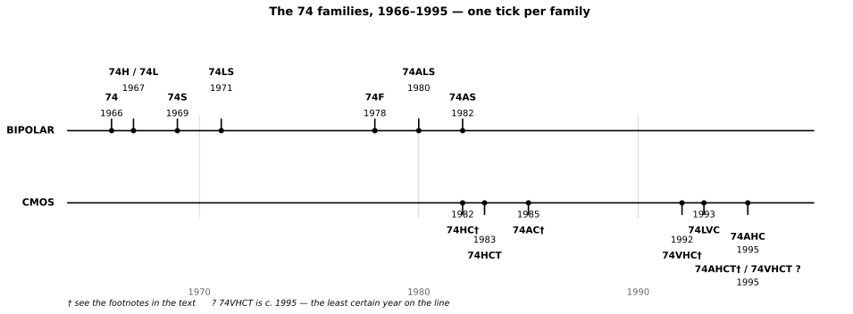
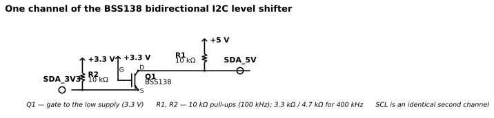
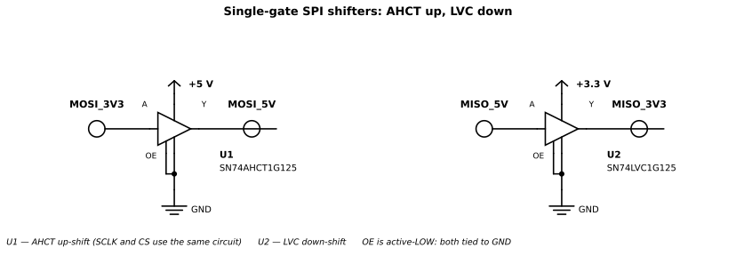

# Chapter 4 — The 74 series in practice

Status: draft
Source material: [notes/74xx_logic.md](../notes/74xx_logic.md) (families and bridging
sections)

## Purpose

Walk up to the 74-series catalogue and choose the right part, in the
right subfamily, at the right voltage — and interface it safely to
3.3 V and 5 V neighbours. Chapter 3 was history: six families, six
answers to "who pulls up". This chapter is the catalogue: the same
story told as part numbers you can order, with the numbers that
decide which one goes on your board.

## Prerequisites

- Chapter 3: how the families differ, and why CMOS displaced TTL
- Chapter 2: logic levels, noise margins, the 0.7 / 0.3 × VCC rule
  for CMOS thresholds

## You will need

- A small bench stock: 74HC00, 74HCT00 or a 74VHCT equivalent, a
  74HC595, a BSS138 level-shifter board, 5 V and 3.3 V supplies
- Single-gate shifters on breakout boards: SN74AHCT1G125 (up) and
  SN74LVC1G125 (down) — or the quad DIP alternative SN74AHCT125N
  for the up side, and a 74VHC125 on an SOIC breakout for the down
  side
- 10 kΩ and 3.3 kΩ resistors, 100 nF ceramic capacitors for
  decoupling, a multimeter; an oscilloscope if you want to see the
  rise-time arithmetic from the BSS138 section for real

## Theory

### Reading a part number

A 74-series part number is a sentence with four clauses, and every
clause matters when you order:

```text
74  LS  00  N
│   │   │   └─ package / grade suffix
│   │   └───── function number
│   └───────── family letters
└───────────── the series (74 = commercial, 54 = military)
```

**74 or 54.** The first two digits are the series. **74** is the
commercial grade (0 to 70 °C); **54** is the military grade (−55 to
125 °C). A 5400 and a 7400 are the same logic; the 54 costs more
and is specified over a wider temperature range. On the bench you
will almost always buy 74.

**The family letters.** These say which technology the gate is
built in — and therefore its speed, power, supply range and input
thresholds. The letters are the subject of this chapter: nothing
(S, LS, ALS, F) for the bipolar families, HC, HCT, AC, AHC/VHC,
AHCT/VHCT, LVC for the CMOS ones. Two parts with the same function
number but different family letters are the same logic in different
technologies: a 7400, a 74LS00 and a 74HC00 are all quad 2-input
NAND gates, and they are not interchangeable without thinking about
voltage and thresholds.

**The function number.** This is the logic itself. A small set of
numbers covers most of what you will ever need: **00** is the quad
2-input NAND (four NAND gates in one package — the reference part
for every figure in this chapter, exactly as in Chapter 3), **02**
is the quad 2-input NOR, **04** is the hex inverter, **125** is the
quad buffer with 3-state outputs. The same number means the same
pinout across families: a 74HC125 and a 74LS125 have the same pins
doing the same things, which is what makes it possible to swap
families on a finished board — when the voltage and thresholds
allow it.

**The package suffix.** This is a package code, and the code is the
vendor's, not the family's — the same letters can mean different
things at different vendors, so check the ordering table in the
datasheet you are actually buying from. At TI, **N** is PDIP
(the through-hole DIP you want for a breadboard), **D** is SOIC,
**PW** is TSSOP, **DBV** is SOT-23-5 and **DCK** is SC-70-5.
Nexperia uses **D** for SOIC and **PW** for TSSOP, but its small
packages are **GV** (SC-74A) and **GW** (TSSOP5). Diodes Inc.
marks SOT-353 with the suffix **SE**. The lesson is not the list —
it is that the suffix is where a part number stops being logic and
starts being a physical object with a footprint, and that is where
ordering mistakes live.

**Single-gate parts.** A **1G** in the number means one gate in the
package: SN74AHCT1G125 is a single AHCT buffer in a 5-pin
SOT-23 package, for exactly the bridging jobs in this chapter
where you need one buffer, not four. **2G** is two gates. The
single-gate family is the subject of the Extensions section.

### The subfamilies

Here is the whole story on one line. Read it left to right before
reading the text: bipolar first, each family a speed/power trade;
then CMOS, each family a voltage/threshold trade; the two eras meet
at the 1980–1982 gap, and the busiest stretch is 1992–1995, when
the low-voltage world arrived all at once.



The 1966–1971 cluster and the 1992–1995 cluster are the point —
progress came in bursts, not steadily. The line starts at 1964,
not 1966, because the series began in October 1964 as the military
5400 in a flat package; the commercial 7400 in a plastic DIP
followed in the third quarter of 1966. † On the 74HC tick: some
sources say 1983 (the year of National Semiconductor's HC
databook); TI datasheets for HC parts are dated December 1982.
† On the 74AC tick: Fairchild's FACT databook lists the AC range
in 1985, though some parts were still preliminary that year.
† On the 74VHC tick: the year rests on the © 1992 copyright on
onsemi's 74VHC00 datasheet. † On the 74AHCT tick: Wikipedia says
"1986?", citing an IDT databook that has not been checked; IDT's
line of that era was called FCT. TI's AHCT datasheet is October
1995. The 74VHCT tick is marked "c. 1995?" — Wikipedia says 1995,
citing a 1995 National datasheet that has not been checked, and
the earliest VHCT datasheet actually located is Fairchild's, July
1997. One more honest note, which belongs in the References rather
than on the graphic: all five bipolar years rest on Wikipedia's
family table — its citations are real (the TI TTL Data Book of
1981, Kühn's 1986 handbook, Fairchild's history page), but no
manufacturer document stating any of those five years was found.
They are the standard dates in the literature, printed here as
such.

**Bipolar era (1966–1980).** Every family here is 5 V only, with
the same 2.0 V / 0.8 V input thresholds — that fixed threshold is
what the CMOS families later escaped. The original **74** (1966)
is the baseline: about 10 mW per gate, 11 / 7 ns typical delay
(22 / 15 ns maximum), 16 mA of output sink current, fan-out 10.
**74S** (1969) added Schottky clamps so the transistors never
saturate: about 3 ns, roughly three times the speed of 74, at
roughly double the power (about 19 mW per gate) — the speed king
of its day, and the most expensive and hardest to buy of the five
now (NRND at TI). The first speed/power variants actually came
earlier, in 1967: **74H** was faster than 74 and hungrier (10 ns
maximum delay, 20 mA drive), **74L** was the same trick in the
other direction (60 ns maximum delay, 3.6 mA drive — low power
without Schottky clamping, so much slower). Both are obsolete; they
were the first attempt at the trade that S and LS later perfected.
**74LS** (1971) is the one that matters most for the bench: the
same speed as the original 74 at one-fifth the power (about
2 mW per gate, 9 / 10 ns typical), with four times less input
current, which is why its fan-out (20) is double the 7400's
despite half the output sink current. It was the workhorse of the
1980s, and it is still the easiest bipolar TTL to buy in DIP —
ACTIVE at TI, $0.27 in quantity. **74F** (1978) is Fairchild's
FAST: S-class speed (3.3 / 2.8 ns typical, 6.0 / 5.3 ns maximum)
at about a quarter of S's power (about 5.4 mW per gate) with
S-class 20 mA drive — the fastest bipolar family in common use.
**74ALS** (1980) is the only family here that wins on both axes at
once: faster than LS (4.0 ns typical, 11 / 8 ns maximum) *and*
lower power (about 1.25 mW per gate), the best speed–power product
of the five bipolar families at about 5 pJ. It is not the pinnacle
of bipolar, though — **74AS** (1982) was faster still (4.5 ns
maximum delay, 20 mA drive), which is why the notes' "absolute
evolutionary pinnacle" for ALS and "ultimate performance
evolution" for F both need qualifying. ALS is the pinnacle of
*low-power* bipolar; AS is the fast one.

**CMOS era (1982–1995).** **74HC** (1982) is CMOS doing TTL's job:
LS-class speed (7 ns typical, 23 ns maximum at 4.5 V), near-zero
static power (20 µA maximum per package), and a 2.0–6.0 V supply
— the first family in this chapter that is not tied to 5 V.
**74HCT** (1983) is HC with TTL input thresholds (2.0 V / 0.8 V,
fixed): the classic 3.3 V to 5 V bridge, at the cost of extra
supply current when its inputs sit at TTL levels (up to 675 µA
per input, Nexperia). **74AC** (1985) is CMOS speed with 24 mA
bus drive — six times HC's — and the price is ground bounce: those
fast, heavy edges bounce the ground rail, so AC belongs on a
board with good decoupling, not on a rat's nest. Its inputs are
*not* 5 V tolerant; its sibling **74ACT** is (TI: "Inputs accept
voltages to 5.5 V"). **74AHC** and **74VHC** are the same family
under two vendors' names — AHC is TI's name (also Diodes Inc. and
Nexperia), VHC is Fairchild/onsemi/Toshiba/Nexperia/ST's name —
with identical switching tables (3.7 ns typical, 8.5 ns maximum at
5 V), ±8 mA drive, a 2.0–5.5 V supply, and 5 V-tolerant inputs.
The tolerance comes from removing the *upper* input clamp diode
(the one to VCC); the lower clamp to GND is still there, so a
negative excursion below −0.5 V is still a fault. **74AHCT** and
**74VHCT** are the TTL-input twins of the same pair, and they
carry the chapter's sharpest vendor trap: TI's AHCT is specified
4.5–5.5 V, full stop — but onsemi's MC74VHCT00A is specified
**3.0–5.5 V** and is marketed as a translator ("allowing the
device to be used as a logic-level translator from 3.0 V CMOS
logic to 5.0 V CMOS Logic"), while Nexperia's and Toshiba's VHCT
parts are 4.5–5.5 V. There is no single "VHCT supply range" — it
is a per-part, per-vendor fact, and the book names the part
whenever it states one. **74LVC** (1993) is the 3.3 V family and
the fastest in this set (3.5 ns typical, 4.3 ns maximum at 3.3 V),
with ±24 mA drive at 3 V, 5 V-tolerant inputs and Ioff
partial power-down — and one hard ceiling: the quad LVC00A is a
**3.6 V maximum** family. It is not a 5 V family, and a reader who
treats it as a drop-in 5 V part will destroy it. (TI's
single-gate SN74LVC2G00 is a different part and *does* support
1.65–5.5 V — do not conflate the two.) Buy the quad LVC00A from
TI: Nexperia's quad part is discontinued.

The comparison table, with every row verified against the
datasheets listed in the References. All figures are for the quad
2-input NAND (the '00) in commercial grade, unless noted.

| Family | Year | Supply | tpd max | Power / gate | Drive | Best use today |
|---|---|---|---|---|---|---|
| 74 | 1966 | 4.75–5.25 V | 22 / 15 ns | ≈ 10 mW | 16 mA | Legacy / restoration only |
| 74S | 1969 | 4.75–5.25 V | 4.5 / 5 ns | ≈ 19 mW | 20 mA | Retro restoration only (NRND) |
| 74LS | 1971 | 4.75–5.25 V | 15 / 15 ns | ≈ 2 mW | 8 mA | Maintaining 1980s hardware |
| 74ALS | 1980 | 4.5–5.5 V | 11 / 8 ns | ≈ 1.25 mW | 8 mA | Maintaining legacy hardware |
| 74F | 1978 | 4.5–5.5 V | 6.0 / 5.3 ns | ≈ 5.4 mW | 20 mA | Legacy hardware; fastest bipolar in common use |
| 74HC | 1982 | 2.0–6.0 V | 23 ns¹ | ≈ 0.55 mW² | ±4 mA | Default 5 V bench stock |
| 74HCT | 1983 | 4.5–5.5 V | 25 ns¹ | ≈ 0.5 mW² | ±4 mA | Classic 3.3 V → 5 V bridge |
| 74AC | 1985 | 2.0–6.0 V | 8.5 ns³ | ≈ 1.0 mW² | ±24 mA | Heavy drive at 5 V; mind ground bounce |
| 74AHC / 74VHC | 1995 / 1992 | 2.0–5.5 V | 8.5 ns | ≈ 0.24 mW² | ±8 mA | Modern 5 V bench stock; 5 V → 3.3 V down-shift⁴ |
| 74AHCT / 74VHCT | 1995 / 1995? | 4.5–5.5 V⁵ | 9.0 ns | ≈ 0.26 mW² | ±8 mA | Modern 3.3 V → 5 V bridge |
| 74LVC | 1993 | 1.65–3.6 V | 4.3 ns⁶ | ≈ 0.21 mW² | ±24 mA⁷ | The 3.3 V family; fastest here |

¹ HC/HCT maximum at VCC = 4.5 V, CL = 50 pF (typical 7 ns / 11 ns at
5 V). ² CMOS power is dynamic power per gate at 1 MHz, no load
(Cpd × VCC² × f) — the bipolar figures are *static* power per gate
(typical, derived from supply current), because a bipolar gate burns
power standing still and a CMOS gate does not. CMOS static current
is ≤ 20 µA per package in every family here, effectively zero next
to the switching power. That difference is the whole point of
Chapter 3. (The HC Cpd of 22 pF is from Nexperia Rev. 04, 2010; the
Rev. 11 value was not confirmed.) ³ AC maximum is the slower edge (tPLH); tPHL maximum is
7 ns. ⁴ When powered at 3.3 V — the down-shift is a property of how
you power the part, not of the part alone. ⁵ TI's AHCT is 4.5–5.5 V;
onsemi's MC74VHCT00A is 3.0–5.5 V; Nexperia/Toshiba VHCT is
4.5–5.5 V. ⁶ LVC maximum at VCC = 3.3 V, CL = 50 pF; there is no 5 V
figure because there is no 5 V operation. ⁷ LVC drive is ±24 mA at
3 V. Bipolar test loads differ by family (74/LS/S at CL = 15 pF;
ALS/F at CL = 50 pF) — ALS and F are tested under a heavier load
than LS, so their maximum delays are faster than they look next to
LS's. 74H, 74L and 74AS do not get table rows: their figures come
from the Wikipedia family table only, not from datasheets, and the
text above says what there is to say about them.

### Choosing a family today

**74HC is the default 5 V bench stock.** Cheapest, widest supply
(2.0–6.0 V), stocked everywhere, and the same pinout as everything
else. If you are building one gate on a breadboard and you do not
have a reason to choose anything else, choose HC.

**74AHC / 74VHC is the modern upgrade.** Same pinout, about three
times the speed of HC, half the capacitance (TI's Cpd 9.5 pF
against HC's 22 pF), and 5 V-tolerant inputs — so the same part
does your 5 V logic and your 5 V to 3.3 V down-shifting, powered
from the 3.3 V rail. Buy either name; they are the same family.

**74HCT or 74AHCT / 74VHCT is the 3.3 V to 5 V bridge.** HCT is
the cheap classic (slower, ±4 mA, smaller ΔICC penalty); AHCT/VHCT
is the faster modern version with 5 V-tolerant inputs and
power-down protection. Both cost extra supply current when their
inputs sit at 3.3 V HIGH — up to 675 µA per input for HCT, up to
1.5 mA per input for VHCT125 — so a quad VHCT125 with all four
inputs driven from 3.3 V can draw about 6 mA standing still,
three orders of magnitude more than the part's 2 µA quiescent
current. It is not a defect; it is the price of a TTL threshold
in a CMOS part, and a battery-powered reader should know it before
choosing.

**74LVC is the 3.3 V family.** Fastest in this chapter, strongest
drive at 3 V, 5 V-tolerant inputs, and it goes high-impedance when
unpowered so it does not load a live bus. Never power the quad
part above 3.6 V.

**74AC is for heavy drive at 5 V** — ±24 mA, the only family here
in AC's class — with the ground-bounce caveat and the warning that
its inputs are *not* 5 V tolerant (reach for ACT if you need that).

**What "obsolete" really means.** Status is per package, not per
family, and it comes in three grades: **ACTIVE** (in production,
recommended for new designs), **NRND** — not recommended for new
designs (still in production for existing customers), and
**OBSOLETE** (no longer made). 74S is NRND at TI, not obsolete;
74F is ACTIVE at TI in most packages (only the tube SOIC variant
is obsolete) and obsolete at onsemi; 74LS and 74ALS are ACTIVE at
TI. A family can be legacy — no new design chooses it — and still
be orderable, and a part can be obsolete at one vendor and active
at another. Appendix B carries the full per-family status table;
the point here is to check the vendor you are actually buying
from, on the day you buy, and not to trust a word like "obsolete"
without a vendor and a date attached.

### Bridging 5 V and 3.3 V

There are two threshold rules in this chapter, and every bridging
decision is an application of one of them. **CMOS-threshold**
families (74HC, 74VHC, 74AHC) switch at a fixed *fraction* of
their own supply: VIH minimum 0.7 × VCC, VIL maximum 0.3 × VCC.
**TTL-threshold** families (74HCT, 74VHCT, 74AHCT) switch at
*fixed* voltages regardless of supply: VIH minimum 2.0 V, VIL
maximum 0.8 V — the same numbers as a 74LS input. The whole
bridging problem is that 3.3 V and 5 V disagree about where HIGH
begins, and the fix is always either to pick a part whose
threshold sits between the two rails, or to pick a part whose
inputs tolerate the other rail's voltage.

**Up: 3.3 V driving a 5 V 74HC input — unreliable, not
impossible.** The arithmetic is one line, and it is worth doing
properly, because the number everyone quotes is not quite a
datasheet number:

```text
VIH(min) at 5 V = 0.7 × 5.0 V = 3.50 V
Best possible driver HIGH = the 3.3 V rail itself = 3.30 V
Margin = 3.30 − 3.50 = −0.20 V → FAILS, before any losses
```

Nexperia tabulates VIH minimum 3.15 V at VCC = 4.5 V and 4.2 V
at VCC = 6.0 V. There is no tabulated VIH at VCC = 5.0 V in any
of these datasheets: 3.5 V is the 0.7 × VCC rule interpolated
between two real rows, safe arithmetic but not a quotation, and
the book says so. A real driver is worse than the ideal rail: a
3.3 V CMOS output under load does not reach its rail — a
74VHC125 guarantees only 2.58 V at 4 mA load (2.48 V over
temperature), and a TI SN74LVC1G125 guarantees VCC − 0.1 V =
3.2 V even at only 100 µA — so a realistic guaranteed HIGH from
a 3.3 V driver is 2.6–3.2 V, that is **0.3–0.9 V short** of the
3.5 V threshold. Supply tolerance makes it worse in both
directions at once: a 5 V rail at +5 % is 5.25 V, so VIH minimum
is 3.675 V, while a 3.3 V rail at −5 % is 3.135 V — worst case on
both rails, −0.54 V.

The LOW side is not the problem, and the book says so plainly:
VIL maximum at 5 V is 1.5 V, a loaded driver LOW is at most about
0.44 V, margin about +1.06 V. So a 3.3 V to 5 V HC link fails
*only* on HIGH — which is exactly why it is so treacherous.
LOWs look perfect, and most test patterns spend half their time
LOW.

**Why it "worked on the bench".** The guaranteed VIH minimum is
a worst-case limit over process and the full −40 to +125 °C
range. A typical 74HC input actually switches near VCC/2, about
2.5 V at 5 V, so a 3.3 V HIGH clears the *typical* threshold by
about 0.8 V and the circuit works — at room temperature, on that
particular chip, today. The datasheet guarantees nothing about
the next chip, or the same chip hot or cold. The failure mode is
intermittent, temperature- and unit-dependent, and it looks like
flaky logic, not a clean dead input.

**Up, fixed: HCT and VHCT.** Replace the receiver with a
TTL-threshold part powered at 5 V, and every margin turns
positive: VIH minimum 2.0 V against an ideal 3.3 V driver HIGH
gives +1.30 V, against a loaded 2.58 V HIGH gives +0.58 V, and
the LOW side gives +0.36 V. Its output is a full 5 V CMOS swing
(VOH minimum 3.94 V at 8 mA for VHCT125), so everything
downstream sees proper 5 V logic. Two costs, both stated above:
the bridge part must live on the 5 V rail (HCT and VHCT work
only at 4.5–5.5 V — with the onsemi MC74VHCT00A exception, which
is specified down to 3.0 V), and the ΔICC toll on every input
held at 3.3 V HIGH.

**Down: 5 V driving a 3.3 V 74HC input — destructive.** Two
ratings are violated, and they are different things. The
*recommended* range is VI = 0 V to VCC, so a 5 V input is 1.7 V
outside it. The *absolute maximum* is VI = VCC + 0.5 V = 3.8 V
at 3.3 V supply, with input clamping current IIK = ±20 mA — a
5 V input exceeds it by 1.2 V. The mechanism is the upper input
clamp diode to VCC: at about VCC + 0.7 V it forward-biases, and
the current through it is limited only by whatever resistance is
in series — a direct wire from a 5 V push-pull output has tens
of ohms at most, so the current is tens to hundreds of milliamps,
far past the ±20 mA rating. Three things can then go wrong, in
increasing order of subtlety: the diode and input structure
overheat and fail; current injected into the substrate can
trigger the parasitic thyristor (latch-up), and the part draws
large supply current until power is removed; and the clamp
current flows *into the 3.3 V rail* — if the rail's load is
light, that current lifts VCC above 3.3 V, the "3.3 V" chip
starts running at about 4 V, and the overvoltage spreads to
everything else on the rail. The circuit can appear to "work"
while quietly running out of spec.

A series resistor *can* keep the clamp current inside its rating,
and the arithmetic is worth showing once: the diode clamps at
about VCC + 0.7 V ≈ 4.0 V, so the current is (5.0 − 4.0) / R —
for 20 mA you need R ≥ 50 Ω, for a comfortable 1 mA about 1 kΩ.
So a 1 kΩ resistor makes a 5 V into 3.3 V HC input *survive*.
But it is a survival hack, not a design method: it relies on a
protection diode as a circuit element, it injects current into
the rail, and it does nothing for the reverse direction. The
proper fix is a tolerant-input part.

**Down, fixed: why 74VHC inputs tolerate 5 V.** A 74VHC part
powered at 3.3 V reads a 5 V input safely because its input
structure has **no upper clamp diode to VCC**. The evidence is
in the datasheets' IIK row: in every VHC/AHC/LVC datasheet, the
input clamping current is specified **only for negative** input
voltages — there is no IIK rating for VI above VCC + 0.5 V,
because there is no diode there to carry such a current. The
input leakage stays tiny with 5 V applied (about ±1 µA maximum
at VI = 5.5 V, with VCC anywhere from 0 to 5.5 V, including
VCC = 0 V), so a 5 V input draws about a microamp, injects
nothing into the 3.3 V rail, and the part simply reads it as
HIGH. The threshold maths at 3.3 V: VIH minimum 2.31 V against
a 5 V HIGH gives +2.69 V of margin, and the output is a 3.3 V
swing. Two corrections to the way this is usually told: only the
*upper* diode is gone (the lower clamp to GND remains, IIK
−20 mA below −0.5 V), and the tolerance ceiling is the
*recommended* 5.5 V that all vendors agree on — not a blanket
"7 V tolerant" (Nexperia's quad datasheet allows +7.0 V absolute
maximum; onsemi's current single-gate datasheet allows +6.5 V).
And a VHC part only down-shifts if it is powered from the 3.3 V
rail: powered at 5 V and fed 5 V, it outputs 5 V.

The corrected compatibility table, with a 74HCT column the
notes lacked:

| Supply | Input | 74HC | 74VHC | 74VHCT / 74HCT |
|---|---|---|---|---|
| 5 V | 5 V | ✅ Perfect | ✅ Perfect | ✅ Perfect |
| 5 V | 3.3 V | ⚠️ Unreliable — VIH min 3.5 V vs driver HIGH ≤ 3.3 V ideal, ~2.6 V loaded | ⚠️ Unreliable — same 0.7 × VCC rule | ✅ Perfect — VIH 2.0 V; margins +1.3 V ideal, +0.58 V loaded¹ |
| 3.3 V | 5 V | ❌ Dangerous — abs max VI = VCC + 0.5 V = 3.8 V; clamp diode forward-biases, back-powers the rail | ✅ Perfect — inputs tolerate 5.5 V regardless of VCC; II ≈ 1 µA | ❌ Invalid² |
| 3.3 V | 3.3 V | ✅ Perfect | ✅ Perfect | ❌ Invalid² |

¹ The "perfect" cells cost up to 1.5 mA per input of extra
quiescent current (ΔICC) for VHCT125, up to 675 µA per input for
HCT00, when the input sits at 3.3 V HIGH. ² For Nexperia/Toshiba
VHCT (4.5 V minimum supply) and for all HCT. Onsemi's
MC74VHCT00A is specified 3.0–5.5 V and is in spec at 3.3 V —
the only VHCT part in this chapter for which that cell is wrong.

**I2C: the BSS138 bidirectional shifter.** I2C is an open-drain
bus: either side may pull the line low, and neither side ever
drives it high — the pull-up resistors do that. So the shifter
does not need to know the direction; it needs to pass a LOW
through in either direction and keep the two HIGH voltages
apart. One N-channel MOSFET per line does exactly that, from
Philips application note AN97055 ("Bi-directional level shifter
for I²C-bus and other systems", 1997), and the author's own
build uses the **BSS138** (onsemi BSS138/D, Rev. 6, Nov 2021):
an N-channel logic-level MOSFET in SOT-23, VGS(th) 0.8–1.5 V,
RDS(on) maximum 6 Ω at VGS = 4.5 V, Ciss 27 pF, 220 mA
continuous. SOT-23 pinout, top view: pin 1 gate, pin 2 source,
pin 3 drain — the same pinout as the 2N7002/BSS123 family, which
is why the part is so easy to find on modules. (Beware: hobbyist
pinout pages disagree wildly about this part. The datasheet's
marking diagram is the authority, and it says 1 = gate, 2 =
source, 3 = drain.)



KiCad source:
[ch04-bss138-i2c.kicad_sch](https://github.com/marsairforce/digital_logic_e_book/blob/main/schematics/ch04-bss138-i2c.kicad_sch)

The circuit, one channel (SCL is identical): the gate goes to
the **low** supply (3.3 V) — the one connection that must be
right. The source goes to the low-voltage bus line, the drain to
the high-voltage bus line, and each bus line has its own pull-up
resistor to its own supply. The MOSFET's substrate is internally
connected to its source, so its body diode sits between drain
and source with the anode on the low side. Three states, from
AN97055: **idle** — both lines are pulled HIGH by their own
resistors (3.3 V and 5 V), gate and source are both at 3.3 V,
VGS = 0 V, the MOSFET is off, and the two sides do not interfere;
**a 3.3 V device pulls down** — the low side falls, VGS rises to
about 3.3 V, far above the 1.5 V maximum threshold, the MOSFET
turns hard on and drags the high side down with it; **a 5 V
device pulls down** — the body diode forward-biases first and
pulls the low side down to about VG − VGS(th) ≈ 2.0 V, at which
point the MOSFET turns on and pulls the low side the rest of the
way to LOW. Either side pulling low pulls both sides low, with
no direction signal and no arbitration — the wired-AND behaviour
I2C needs. A HIGH on the high side can never leak onto the low
side (the body diode is reverse-biased and the channel is off),
and if the low-side supply is switched off the MOSFET stays off,
so the high side keeps working undisturbed.

Does the BSS138 meet AN97055's own requirements? With margin:
VGS(th) maximum 1.5 V against the note's 2.0 V ceiling for a
3.3 V low side; RDS(on) maximum 6 Ω against a 100 Ω ceiling;
Ciss 27 pF against 100 pF; switching times about 12 ns on and
27 ns off against a 50 ns ceiling; 220 mA against a 10 mA
requirement. The FET is not the limit — the pull-up resistors
are. The falling edge is active (a device pulls the line down
through the FET) and fast, about 25 ns. The **rising** edge is
passive — a resistor charging the bus capacitance — and that is
where the speed limit lives: tr (30 % to 70 %) ≈ 0.85 × Rp ×
Cbus. With the 10 kΩ pull-ups on the Adafruit 757 and SparkFun
BOB-12009 modules and a 100 pF bus, the rise is about 0.85 µs —
inside the 1000 ns standard-mode budget at 100 kHz, but only
just, and it fails the 300 ns fast-mode budget outright. With
AN97055's own example values (3.3 kΩ low side, 4.7 kΩ high
side, 50 pF / 30 pF), the rise is about 140 ns / 120 ns —
comfortably inside 300 ns. The design rule, from the same RC
arithmetic: Rp(max) = tr / (0.85 × Cbus), so for fast mode
(300 ns) with a 100 pF bus, Rp(max) ≈ 3.5 kΩ, and with a 400 pF
bus, about 880 Ω. The lower bound comes from the VOL budget
(devices sink at least 3 mA at VOL ≤ 0.4 V), so Rp(min) is about
1.5 kΩ on the 5 V side and 1.0 kΩ on the 3.3 V side. Practical
window for 400 kHz with a typical bus: **about 1.5–3.5 kΩ**.
The 10 kΩ on the popular modules is a 100 kHz choice, and the
chapter says so — a reader who plugs a 10 kΩ module into a
400 kHz bus and gets garbled ACKs has hit this limit, not a
wiring fault. The extra LOW voltage through the shifter is
negligible: about 21 mV at 2.1 mA through a pessimistic 10 Ω of
channel resistance, against the I2C VOL budget of 0.4 V.
(RDS(on) at VGS = 3.3 V is not specified in the datasheet — only
4.5 V and 10 V are — so the chapter quotes no 3.3 V figure.)

When the BSS138 is the wrong choice: **push-pull signals at
speed — notably SPI.** The rising edge is an RC charge, so a
1–10 MHz SPI clock comes out rounded and late; Adafruit
themselves rate the module for "slow < 2 MHz SPI", and even that
is optimistic with 10 kΩ pull-ups. **Two push-pull drivers
fighting:** if one side drives HIGH while the other drives LOW,
the FET connects them and the current is limited only by the
drivers' output impedance — a short. **A low-side supply below
about 2.5 V:** at 1.8 V the gate drive is 1.8 V against a
worst-case threshold of 1.5 V — 0.3 V of headroom, weak turn-on,
high RDS(on). The BSS138 is a 3.3 V / 5 V part; below that, pick
a lower-threshold FET. And it is SMD-only — SOT-23, no
through-hole version — so on a breadboard you want a module or a
SOT-23 breakout, not the bare part.

**SPI: one-way lines get one-way shifters.** SPI has four lines,
and a 3.3 V controller talking to a 5 V peripheral needs all
four shifted — the notes list three and omit the fourth:

| SPI line | Direction | From → to | Shifter needed |
|---|---|---|---|
| SCLK | controller → peripheral | 3.3 V → 5 V | UP |
| MOSI | controller → peripheral | 3.3 V → 5 V | UP |
| CS / SS | controller → peripheral | 3.3 V → 5 V | UP — missing from the notes |
| MISO | peripheral → controller | 5 V → 3.3 V | DOWN |

All the parts below are single-gate non-inverting buffers with a
3-state output (the **125** function: output enabled when OE is
LOW). **OE is active-LOW on every part here: tie OE to GND to
enable the buffer permanently, and never leave it floating.** Do
not substitute a 126 variant (active-HIGH OE) without flipping
the enable wiring. All of them are surface-mount only
(SOT-23-5 / SC-70-5 and smaller) — there is no DIP single-gate
buffer; for a breadboard build use the quad alternatives below
or a breakout board.



KiCad source:
[ch04-spi-shifters.kicad_sch](https://github.com/marsairforce/digital_logic_e_book/blob/main/schematics/ch04-spi-shifters.kicad_sch)

**UP: 3.3 V → 5 V (SCLK, MOSI, CS) — a TTL-threshold buffer,
powered at 5 V.** The requirement is a buffer powered at 5 V
whose VIH minimum is below a 3.3 V driver's guaranteed HIGH
(2.58 V loaded): a TTL-threshold part, VIH minimum 2.0 V. A
CMOS-threshold part powered at 5 V (VIH 3.5 V) fails exactly as
in the threshold maths above. Primary recommendation:
**SN74AHCT1G125** (TI, SCLS378O Rev. O, Oct 2023) — TI's own
datasheet shows exactly this application, "translating up from
3.3 V to 5 V", with this part. VIH 2.0 V / VIL 0.8 V fixed,
VOH minimum 3.94 V at 8 mA, ±8 mA drive, tpd typical 3.8 ns /
maximum 6 ns at 5 V, ΔICC 1.35 mA typical / 1.5 mA maximum per
input at 3.4 V (the toll from the threshold section). Packages:
DBV (SOT-23-5), DCK (SC-70-5), DRL (SOT-5X3). Alternatives:
Nexperia **74AHCT1G125** (Rev. 11, Oct 2020; GV = SC-74A, GW =
TSSOP5); Diodes **74AHCT1G125SE-7** (DS35186 Rev. 1-2, May 2011;
SOT-353 — this is the real part behind the notes'
"74VHCT1G125SE-7", which does not exist); onsemi
**MC74VHC1GT125** (MC74VHC1G125/D Rev. 23, Aug 2023 — note the
**T**, which means TTL thresholds; the plain MC74VHC1G125 is
CMOS-threshold and must *not* be used here; tpd typical 3.5 ns
at 5 V).

**DOWN: 5 V → 3.3 V (MISO) — an overvoltage-tolerant buffer,
powered at 3.3 V.** The requirement is a buffer powered at 3.3 V
whose inputs tolerate 5 V (VI recommended to 5.5 V regardless
of VCC) and whose output is a 3.3 V swing. A plain 74HC1G125
fails this: its inputs clamp to VCC. Primary recommendation:
onsemi **MC74VHC1G125** (no T — CMOS thresholds;
MC74VHC1G125/D Rev. 23, Aug 2023). VIH 2.31 V / VIL 0.99 V at
3.3 V, VI recommended 0–5.5 V, input leakage about ±0.1 µA at
5.5 V, Ioff power-down protection, ±8 mA drive, tpd typical
4.5 ns at 3.0–3.6 V. Strongest alternative: TI **SN74LVC1G125**
(SCES223U Rev. U, Aug 2026) — ±24 mA at 3.3 V, tpd maximum
3.7 ns at 3.3 V, "Inputs accept voltages to 5.5 V" and "Provides
down translation to VCC" in its own features list. Also usable:
TI **SN74AHC1G125** and Nexperia **74AHC1G125** (CMOS
thresholds, overvoltage-tolerant inputs, ±8 mA).

**Bench-friendly quad versions — one chip per direction.**
Four single-gate parts means four SOT-23-5 packages to solder.
For the bench build, the quad equivalents: UP —
**SN74AHCT125N** or **CD74HCT125E** (both PDIP-14, the only
through-hole options here) or Nexperia **74VHCT125D** (SO-14);
DOWN — Nexperia **74VHC125D** (SO-14) or TI **SN74LVC125A**
(SOIC/TSSOP; a PDIP version was not verified, so the chapter
does not promise one). Unused channels on the quad parts: tie
each unused input to VCC or GND (never float a CMOS input) and
leave its output unconnected; tie an unused channel's OE HIGH
(disabled) so its output is high-impedance.

What not to use: **74HC1G125 / 74HCT1G125 for down-shifting**
(their inputs clamp to VCC — the fault from the threshold
section); **the BSS138 for SPI** (RC rising edges, no active
drive); **a resistor divider for MISO** (works slowly in one
direction, loads the peripheral's output, rounds the edge with
its own RC, and cannot shift up — a historical hack, not the
recommended build); **TXB010x-style auto-direction translators**
for SPI (not verified in this track and not recommended here —
they are designed for push-pull, have weak drive with edge
accelerators, and misbehave with pull-ups and long traces).

### Living with real inputs

**Never leave a CMOS input floating.** An unconnected CMOS input
drifts to mid-rail, where both transistors in the input stage
are half on: the part draws supply current doing nothing, and
the input picks up noise and oscillates. Tie every unused input
to VCC or GND — directly, since a CMOS input draws about 1 µA —
and leave unused *outputs* unconnected. The same rule applies to
the OE pin on every '125 in this chapter: an unused or
permanently-enabled OE goes to GND, never into the air.

**Decoupling: one capacitor per chip, close, always.** A 100 nF
ceramic capacitor across each chip's supply pins, as close to
the chip as the board allows. Every switching edge draws a gulp
of current from the supply, and the capacitor is the local
reservoir that keeps the gulp from becoming a voltage dip on
the rail — the same dip that shows up as ground bounce on a
fast, heavy family like 74AC. This is not optional garnish: a
74AC part switching 24 mA edges with no decoupling will
corrupt its own neighbours.

**Schmitt-trigger inputs (74HC14) for slow and noisy signals.**
A plain CMOS input has one threshold, and a slow edge crossing
it once can chatter — the input stage hovers at mid-rail while
noise pushes it back and forth across the threshold, and the
output toggles with it. A Schmitt-trigger input has two
thresholds (one for rising, one for falling) with hysteresis
between them, so a slow or noisy edge crosses once and stays
crossed. The 74HC14 (hex Schmitt inverter) is the standard part
for cleaning up a slow clock, a switch contact, or a sensor
output before it reaches real logic. HCT parts, for reference,
specify a maximum input transition time of 500 ns — an edge
slower than that is out of spec, and a Schmitt trigger is the
fix.

## Worked example

A 3.3 V microcontroller talks SPI to a 5 V peripheral. Four
lines, both directions shifted, levels calculated before wiring.

**SCLK, MOSI, CS — up, through SN74AHCT1G125 powered at 5 V.**
The microcontroller's 3.3 V output, loaded, guarantees VOH
minimum 2.58 V (the VHC125 figure at 4 mA; at light load it is
closer to 3.2 V). The AHCT input needs VIH minimum 2.0 V:
margin +0.58 V loaded, +1.2 V light. On the LOW side, VOL
maximum 0.44 V against VIL maximum 0.8 V: margin +0.36 V.
The buffer's output is a full 5 V swing, VOH minimum 3.94 V
at 8 mA — against the peripheral's CMOS-threshold VIH of 3.5 V
that is +0.44 V, and against a TTL-threshold 2.0 V it is
+1.94 V. The buffer's delay (maximum 6 ns at 5 V) is negligible
against a 10 MHz SPI bit of 100 ns.

**MISO — down, through SN74LVC1G125 powered at 3.3 V.** The
peripheral's 5 V output is inside the buffer's recommended
input range (0–5.5 V regardless of VCC) and draws about a
microamp. The buffer's output at light load is about 3.2 V
(VCC − 0.1 V), against the microcontroller's CMOS-threshold
VIH of 2.31 V at 3.3 V: margin +0.89 V. At the buffer's rated
24 mA the output would sag to 2.3 V minimum — but a
microcontroller input draws microamps, so the rated-current
figure is not the one that applies.

**The standing-current bill.** Three up-shifters, each input
held HIGH at 3.3 V, each drawing up to 1.5 mA of ΔICC: up to
4.5 mA total while all three lines sit HIGH, against the parts'
10 µA quiescent current. When the lines are LOW, the penalty
vanishes. A battery-powered design that leaves its SPI bus idle
HIGH pays this continuously; one that idles LOW does not. That
is a design decision, not a defect — but it is one you make
with the numbers in front of you.

**What the BSS138 version would have looked like.** Four
BSS138 channels with 10 kΩ pull-ups: the falling edges would
be fine, but the rising edges would take about 0.85 µs on a
100 pF bus — eight times longer than a 10 MHz bit period. The
clock would never reach HIGH. This is the worked proof of the
section above: the BSS138 is an I2C part, and SPI wants active
buffers.

## Bench build

**Build A — the BSS138 I2C shifter.** Use a module (Adafruit
757, SparkFun BOB-12009) or build one channel on a breadboard
from a SOT-23 breakout: one BSS138, two 10 kΩ pull-ups (one to
3.3 V, one to 5 V), gate to the 3.3 V rail. Measure the idle
voltages first: 3.3 V on the low side, 5 V on the high side,
with the FET off. Then pull the low side down with a jumper to
GND and watch both sides go LOW; pull the high side down and
watch both sides go LOW again. If you have a scope, measure the
rise time: about 0.85 µs with the 10 kΩ pull-ups on a light bus.
Then swap the pull-ups for 3.3 kΩ (low side) and 4.7 kΩ (high
side) and watch the rise fall to about 140 ns — the difference
between a 100 kHz bus and a 400 kHz one, in two resistors.

**Build B — the single-gate SPI shifters.** One SN74AHCT1G125
on a SOT-23-5 breakout for the up direction, one SN74LVC1G125
on another for the down direction, both OEs tied to GND. The
quad DIP alternative for the up side is SN74AHCT125N (or
CD74HCT125E); the down side's quad parts are SOIC/TSSOP, so
use a breakout there. Test it as a loopback before you trust
it with a real peripheral: drive MOSI from the microcontroller,
measure 5 V on the far side of the up-shifter, feed that back
through the down-shifter, and check the microcontroller reads
its own byte. Then put the real peripheral in the middle and
run the worked example's numbers against what you measure —
VOH on each side, and the standing current with all three
up-shift lines held HIGH.

## Gotchas

- **"It worked on the bench" at 3.3 V into 74HC — until
  temperature moved.** The typical threshold is about VCC/2, so
  a 3.3 V HIGH clears it by 0.8 V at room temperature on that
  chip. The guaranteed threshold is 3.5 V. The gap between
  typical and guaranteed is where bench builds go to die.
- **Powering a VHCT part at 3.3 V: check whose part it is.**
  The skeleton's gotcha as written — "outside its 4.5 V minimum
  supply" — is true for Nexperia and Toshiba VHCT and false for
  onsemi's MC74VHCT00A, which is specified 3.0–5.5 V and
  marketed as a translator. The gotcha is real; the vendor is
  part of it.
- **Never power the quad 74LVC00A at 5 V.** Its ceiling is
  3.6 V. The single-gate SN74LVC2G00 is a different part with a
  1.65–5.5 V range — same letters, different ceiling. Read the
  part number, not the family name.
- **"74VHCT1G125" does not exist.** If you search for it you
  will find nothing, because no manufacturer makes a part of
  that name. The TTL-threshold single gate is called
  **74AHCT1G125** (TI / Nexperia / Diodes) or **MC74VHC1GT125**
  (onsemi — note the T). The notes got this wrong, and it is
  exactly the kind of plausible-looking name that costs an
  afternoon.
- **A resistor divider for MISO is a hack, not a method.** It
  works slowly in one direction, loads the peripheral's output,
  and cannot shift up. Use a buffer.
- **The 10 kΩ module at 400 kHz.** The Adafruit and SparkFun
  BSS138 modules ship with 10 kΩ pull-ups, which is a 100 kHz
  choice. Plug one into a 400 kHz bus and the ACKs come back
  garbled — not a wiring fault, the RC limit from the BSS138
  section.
- **OE floats, the bus floats.** A '125 with its OE unconnected
  is a buffer that may or may not be enabled. Tie it to GND.

## Summary

- The 74 series is eleven families (plus three one-line
  footnotes: 74H, 74L, 74AS) covering thirty years, and the
  catalogue is a set of trades: bipolar traded speed against
  power at 5 V; CMOS traded voltage and thresholds against
  everything else.
- The default 5 V bench stock is 74HC; the modern upgrade is
  74AHC / 74VHC (same family, two names); the 3.3 V to 5 V
  bridge is 74HCT or 74AHCT / 74VHCT; the 3.3 V family is
  74LVC — never powered above 3.6 V in its quad form.
- Bridging is threshold arithmetic, not luck: CMOS thresholds
  are 0.7 / 0.3 × VCC, TTL thresholds are fixed at 2.0 / 0.8 V.
  3.3 V into a 5 V CMOS input is unreliable (negative margin);
  5 V into a 3.3 V CMOS input is destructive (the clamp diode);
  both have a part that fixes them.
- The BSS138 shifter is the right tool for I2C and the wrong
  tool for SPI: its rising edge is a resistor charging a
  capacitor, and 10 kΩ pull-ups are a 100 kHz choice.
- SPI wants active buffers: AHCT up, VHC/LVC down, OE tied to
  GND, CS shifted like any other up line.
- Status is per package and per vendor, and "obsolete" without
  a vendor and a date means nothing.

## Extensions

- **Single-gate ("Little Logic") parts.** One gate per package
  for exactly these bridging jobs — the 1G family (SN74AHCT1G125,
  SN74LVC1G125 and their siblings) is the subject of the SPI
  section above, and the whole 1G/2G/3G range is worth a bench
  drawer of its own: one buffer, one inverter, one AND gate,
  each in a 5-pin package, for the job that needs exactly one
  gate and no more.
- **74HC4049 / 74HC4050: the 15 V down-converters.** These hex
  buffers take inputs up to 15 V (Nexperia 74HC4050 Rev. 4: VI
  0–15 V recommended) and convert them down to 0–5 V logic —
  the answer when the "high" side is not 5 V at all but a 12 V
  sensor or an old industrial signal.
- **74ACT: AC with TTL inputs *and* tolerant inputs.** If the
  AC section's drive appeals to you but its intolerant inputs
  do not, ACT is the same speed and drive with inputs that
  accept 5.5 V (TI SN74ACT00).
- **Auto-direction translators (TXB010x and kin).** A different
  tool for a different job — designed for push-pull, weak drive
  with edge accelerators, unhappy with pull-ups and long traces.
  Not covered here; if the chapter ever takes them on, that is
  a separate research track, not an assertion from this one.

## References

- TI SDLS025D — SN5400, SN54LS00, SN54S00, SN7400, SN74LS00,
  SN74S00 (May 2017). <https://www.ti.com/product/SN74LS00>
- TI SDAS187A — SN54ALS00A, SN54AS00, SN74ALS00A, SN74AS00
  (Apr 1982, Rev. Dec 1994). <https://www.ti.com/product/SN74ALS00A>
- TI SDFS035A — SN54F00, SN74F00 (Mar 1987, Rev. Oct 1993).
  <https://www.ti.com/product/SN74F00>
- Fairchild DS009454 — 74F00 (Dec 1994, Rev. Sep 2000)
- Nexperia 74HC00; 74HCT00, Rev. 11 (29 Apr 2025).
  <https://www.nexperia.com/products/analog-logic-ics/logic/gates/nand-gates/serie/74hc00-74hct00>
- TI SN74HCT00, SCLS062 (Rev. F, Oct 2022)
- TI SN74AC00, SCAS524E (Rev. G). <https://www.ti.com/product/SN74AC00>
- TI SN74AHC00, SCLS227J (Oct 1995–Rev. May 2013).
  <https://www.ti.com/product/SN74AHC00>
- TI SN74AHCT00, SCLS229K (Oct 1995–Rev. Jul 2003).
  <https://www.ti.com/product/SN74AHCT00>
- onsemi 74VHC00/D, Rev. 2 (Feb 2024, © 1992)
- onsemi MC74VHCT00A/D, Rev. 4 (Sep 2008)
- TI SN74LVC00A, SCAS279P (Jan 1993–Rev. Jul 2005; current Rev. R,
  Feb 2016). <https://www.ti.com/product/sn74lvc00a/samplebuy>
- TI SN74AHCT1G125, SCLS378O (Rev. O, Oct 2023)
- Nexperia 74AHC1G125; 74AHCT1G125, Rev. 11 (13 Oct 2020)
- Diodes Inc. 74AHCT1G125, DS35186 (Rev. 1-2, May 2011)
- onsemi MC74VHC1G125, MC74VHC1GT125, MC74VHC1G125/D
  (Rev. 23, Aug 2023)
- TI SN74LVC1G125, SCES223U (Rev. U, Aug 2026)
- Nexperia 74VHC125; 74VHCT125, Rev. 02 (13 Oct 2009)
- Philips AN97055 — H. Schutte, "Bi-directional level shifter
  for I²C-bus and other systems" (4 Aug 1997)
- onsemi BSS138/D, Rev. 6 (Nov 2021)
- Nexperia 74HC4050, Rev. 4 (5 Feb 2016); TI CD74HC4049/4050,
  SCHS205I (Feb 1998–Rev. Feb 2005)
- TI, *The TTL Data Book for Design Engineers*, 2nd ed. (1981),
  p. 6–2
- E. Kühn, *Handbuch TTL- und CMOS-Schaltkreise*, Verlag Technik,
  Berlin (1986), p. 72
- Fairchild, *Advanced CMOS Technology Logic Data Book* (FACT)
  (1985)
- National Semiconductor, *MM54HC/74HC High Speed microCMOS
  Logic Family Databook* (1983)
- Fairchild AN-368 (Mar 1984)
- Wikipedia, "7400-series integrated circuits" — family table and
  history (introduction years only).
  <https://en.wikipedia.org/wiki/7400-series_integrated_circuits>

**A note on the introduction years.** The five bipolar years
(1966, 1969, 1971, 1978, 1980) rest on Wikipedia's family table,
which cites the TI TTL Data Book (1981), Kühn (1986) and
Fairchild's history page. No manufacturer document stating any
of those five years was found; they are the standard dates in
the literature, printed here as such. The CMOS years rest on
firmer ground: LVC 1993 and AHC/AHCT 1995 are TI datasheet
first issues, HC 1982 is a TI datasheet dated December 1982,
AC 1985 is Fairchild's FACT databook, and VHC 1992 is the
copyright on onsemi's datasheet. VHCT's year is the least
certain in the chapter — "c. 1995?" — and is printed with its
question mark on the timeline.
