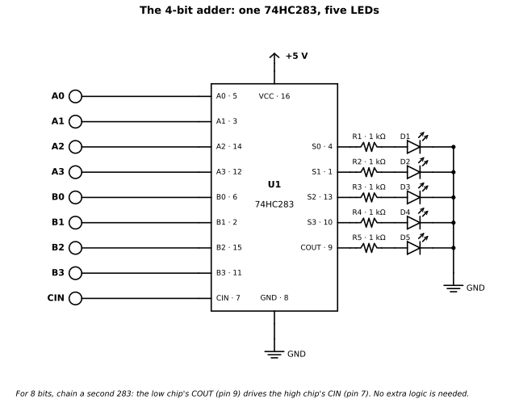
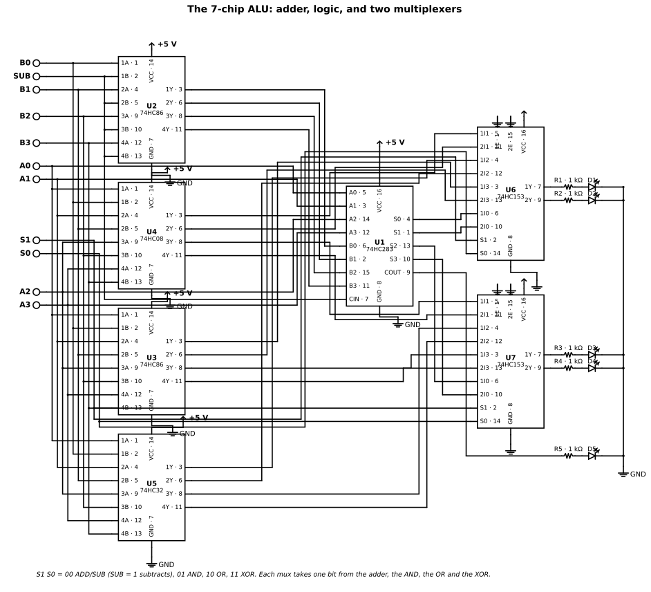

# Chapter 5 — Combinational building blocks

Status: draft
Source material: [notes/74xx_logic.md](../notes/74xx_logic.md) (list by function);
full device details in [Appendix A](../appendices/A-74xx-reference.md)

## Purpose

Assemble gates into systems whose outputs are pure functions of their
inputs — selecting, routing, comparing and adding — and finish with a
working multi-bit adder growing into an ALU.

## Prerequisites

- Chapter 4: choosing parts and families

## You will need

- 74HC283 × 2 (CD74HC283E from TI, or 74HC283N from Nexperia) — the adder
- 74HC153 × 2 (CD74HC153E from TI) — the ALU's multiplexers
- 74HC86 × 2, 74HC08, 74HC32 — the ALU's gates
- 74HC00 and 74HC4040 — the carry-delay race in the bench build
- Two 8-position DIP switch banks (Grayhill 76SB08 or similar),
  10 kΩ pull-down resistors, LEDs with 1 kΩ series resistors,
  100 nF ceramic capacitors, one per chip
- 5 V supply, breadboard, solid-core jumper wire (as in Chapters 1–2)
- For the Theory sections, the parts in Appendix A: 74HC138, 74HC148,
  74HC151/153/157, 74HC85, 74HC280, 74HC244/245 — read their rows
  there; only the adder and ALU chips above go on the bench.
  (Version B of the ALU, in Extensions, adds a 74HC04 and four
  74HC151s.)

## Theory

Before the details, the whole cast in one view:

| Kind | In one sentence |
|---|---|
| Gates | Compute: AND, OR, NOT and XOR turn input bits into output bits — the atoms everything else is built from. |
| Decoders | One binary number in, exactly one output on — the part that selects a chip, a line or a memory block (feed data into an enable and the same part is a demultiplexer). |
| Encoders | Many request lines in, one binary code out — with priority, so the highest-order request wins. |
| Multiplexers | Many inputs in, one output out — the select code picks which input gets through, and a mux can implement any logic function. |
| Buffers and transceivers | Decide which chip gets to talk on a shared bus — drive it, or step aside. |
| Comparators | Judge two numbers: equal, greater or less — the equality test and the threshold check. |
| Parity generators | Add one check bit so a corrupted byte shows up — the simplest error check there is. |
| Adders | Column sums with carries, from one bit to a whole word — half, full, ripple and lookahead. |
| The ALU | All of it at once: one build that adds, subtracts, ANDs, ORs and XORs on command. |

### Routing signals

Gates compute. Routing parts move signals around: a decoder picks
which output fires, an encoder turns many request lines into one
binary code, a multiplexer picks which input reaches the output,
and a buffer or transceiver decides which chip gets to talk on a
shared bus. Everything in this section is combinational — the
output is a pure function of the inputs right now — but the
function is steering, not arithmetic.

A note on the numbers, before they start arriving. Every delay
below is a Nexperia HC figure at VCC = 4.5 V, CL = 50 pF,
25 °C, typical and maximum, unless the text says otherwise; where
the datasheet also gives a typical-only value at VCC = 5.0 V,
CL = 15 pF, that is quoted alongside it. TI datasheets of the same
era specify at CL = 50 pF and 2 V / 4.5 V / 6 V, and a "typical
tpd" headline on a TI product page is a single-number summary
whose test conditions are not stated — a headline, not a quotable
spec. All thirteen parts in this chapter exist in HC. None is
obsolete in HC outright, but several package variants are
end-of-life, and Nexperia has dropped DIP for almost all of them
(see the sourcing note at the end of this section).

**Decoders — one of many outputs.** A decoder takes a binary
number and switches on exactly one of its outputs. The **74HC138**
is the classic: three address inputs (A0–A2) decoded to eight
mutually exclusive active-LOW outputs (Y0–Y7) — one output LOW at
a time, the rest HIGH. It has three enable inputs (E1, E2 active
LOW; E3 active HIGH), and every output stays HIGH unless E1 and
E2 are LOW and E3 is HIGH. That three-enable scheme is the
teaching point: feed data into an active-LOW enable and the
decoder becomes a 1-to-8 demultiplexer, with the other two enables
acting as strobes or chip-selects. The datasheet shows 1-of-32
expansion with four '138s plus one inverter, and this is the
classic memory chip-select part. Address-to-output delay is
typ 15 ns / max 30 ns at 4.5 V (typ 12 ns at 5 V, CL = 15 pF);
enable-to-output is typ 17 ns at 4.5 V. Datasheet: Nexperia
*74HC138; 74HCT138*, Rev. 10, 26 February 2024. Sixteen pins; no
DIP in the current Nexperia revision — but TI's SN74HC138 is
ACTIVE (Rev. G, 8 October 2021) and lists PDIP, so DIP is still
obtainable from TI.

The **74HC154** is the same idea scaled up: four address inputs
decoded to sixteen active-LOW outputs, with two active-LOW
enables (HIGH on either forces all outputs HIGH), in a 24-pin
package — the widest part in this chapter. As a 1-to-16 demux,
one enable is the data input and the other stays LOW. Address
delay typ 13 / max 30 ns, enable delay typ 14 / max 30 ns at
4.5 V. Datasheet: Nexperia *74HC154; 74HCT154*, Rev. 9,
19 August 2021 (dynamic characteristics in Rev. 7,
29 February 2016). No DIP: the Rev. 7 revision history states
the DIP24 types (74HC154N, 74HCT154N) were removed — DIP
discontinued in 2016. UNVERIFIED: whether TI offers SN74HC154N
in DIP was not checked.

The **74HC139** is the small-scale decoder: two independent 2-to-4
decoders in one 16-pin package, each with its own active-LOW
enable, each decoding two address inputs to four mutually
exclusive active-LOW outputs. Address delay typ 14 / max 29 ns,
enable delay typ 12 / max 27 ns at 4.5 V. Datasheet: Nexperia
*74HC139; 74HCT139*, Rev. 4, 11 December 2015. One wiring
gotcha: the second half's pins run in reverse order — 2Y3 is
pin 9 and 2Y0 is pin 12 — so do not wire the two halves as mirror
images by habit.

**Encoders — many inputs, one code.** An encoder is a decoder
run backwards: many request lines in, one binary code out. The
**74HC148** is an 8-to-3 priority encoder: eight active-LOW input
request lines encoded to three active-LOW outputs, and *priority*
is the new idea — when several inputs are active at once, only
the highest-order active line is encoded, not the first one that
arrived. An enable input (EI) and an enable output (EO) let
encoders cascade to 16 bits without external circuitry, and a
group-select output (GS) signals that some input is active.
Typical delays at 4.5 V are path-dependent: inputs to outputs
typ 23 ns, to EO typ 20 ns, to GS typ 25 ns; EI to outputs
typ 26 ns, to GS typ 19 ns, to EO typ 22 ns. One gotcha from the
TI datasheet's application information: a HIGH-to-LOW change at
EI can cause a transient LOW on GS when all inputs are HIGH,
which must be considered when strobing the outputs. Datasheet:
TI *SN54HC148 / SN74HC148*, SCLS109 Rev. G, April 2004 — and
note the vendor, because **Nexperia does not make a 74HC148**,
despite what the notes' links imply. Rev. H (2 March 2022) is
the current revision, but its switching table was not read in
full, so the numbers here are Rev. G. UNVERIFIED: the Rev. G
switching-table maximum columns are ambiguously aligned in the
PDF extraction, so no maximum delays are quoted; the data-input
and A-output pin numbers were not cleanly confirmed either
(confirmed: VCC pin 16, GND pin 8, EI pin 5, EO pin 15,
GS pin 14). TI's headline "typical tpd = 16 ns" matches no
path-dependent typical in Rev. G (19–26 ns at 4.5 V) and its
test conditions are unstated — treat it as a headline only.
SN74HC148N in PDIP is listed, with a distributor offer shown in
stock.

The 148's decimal sibling, the **74HC147** (10-line to 4-line
priority encoder, with decimal zero implied), did exist in HC —
NXP's 74HC147D and TI's CD74HC147 — but both are now obsolete,
and the notes' link to a Nexperia HC147 datasheet is not a live
source. UNVERIFIED: the obsolescence rests on distributor and
TI-store listings, not on a manufacturer datasheet revision.
The TI CD74HC147 datasheet quotes typ tpd 13 ns at VCC = 5 V,
CL = 15 pF, TA = 25 °C.

**Multiplexers — many inputs, one output.** A multiplexer is a
data selector: N inputs, a select code, one output carrying the
selected input. The **74HC151** is the 8-input version — eight
data inputs, three selects, and complementary outputs Y and
Y-bar, a free inversion. Its active-LOW enable E forces Y LOW
and Y-bar HIGH when HIGH. Two timing facts worth noticing: the
select path is slower than the data path (Sn-to-Y typ 22 ns
against In-to-Y typ 19 / max 34 ns at 4.5 V), and the part is a
universal function generator — any function of four variables
fits in one chip (ST M74HC151 datasheet, February 1993). That
second fact is the bridge to the ALU: a mux does not just select
data, it *implements logic*. Datasheet: Nexperia
*74HC151; 74HCT151*, Rev. 8, 18 March 2021. Sixteen pins; no DIP.

The **74HC153** is two independent 4-input muxes sharing common
select inputs S0/S1, each with its own active-LOW enable — two
bits steered together by one select code, and the separate
enables let one half be parked LOW while the other runs.
Input-to-output typ 17 / max 29 ns at 4.5 V. Datasheet: Nexperia
*74HC153; 74HCT153*, Rev. 11, 11 March 2024. Sixteen pins, SO16
and TSSOP16 only; no DIP, no SSOP, no QFN.

The **74HC157** is the data-path switch: four 2-to-1 muxes with
one common select S and one common active-LOW enable E — a
4-bit-wide two-way switch, the part that chooses between two
4-bit sources, for example the ALU's operand mux later in this
chapter. HIGH on S selects data source 1, LOW selects source 0.
Input-to-output typ 13 / max 25 ns at 4.5 V, and its CPD of
70 pF is the highest of the muxes here. Datasheet: Nexperia
*74HC157; 74HCT157*, Rev. 10, 28 May 2024. Sixteen pins; no DIP
— Nexperia lists 74HC157N and 74HCT157N as EndOfLife — though
TI's SN74HC157N (PDIP) was shown in stock on TI's store. Two
close relatives to know by name: the 74HC257 is the same part
with 3-state outputs, and the 74HC158 is the inverting version.

**Buffers and transceivers — sharing a bus.** A bus is one set of
wires that many chips take turns driving, and the trick that
makes turn-taking possible is the **three-state output**: HIGH,
LOW, or *disconnected* — high impedance, electrically absent.
The **74HC244** is an octal non-inverting buffer and line driver
with 3-state outputs, usable as two 4-bit buffers or one 8-bit
buffer, with two output enables (1OE, 2OE) each controlling four
outputs; HIGH on an enable puts its outputs in the
high-impedance OFF-state. Input-to-output delay typ 11 /
max 22 ns at 4.5 V; output drive 6.0 mA at 4.5 V (7.8 mA at
6.0 V) per Nexperia, ±6 mA at 5 V per TI. Datasheet: Nexperia
*74HC244; 74HCT244*, Rev. 5, 26 February 2016 (dynamic
characteristics) and Rev. 4, 24 September 2012 (ordering).
Twenty pins; DIP20 is listed in the Rev. 4 ordering table, but
UNVERIFIED: whether it is still orderable was not confirmed
(the 2012 revision is old), though TI lists PDIP (N) 20. One
layout warning: the two 4-bit groups interleave — 1A0 is pin 2
and 1Y0 is pin 18, 2A0 is pin 17 and 2Y0 is pin 3 — so the
pinout does not read left-to-right the way you expect.

The **74HC245** is the 244's bidirectional partner: an octal bus
transceiver with non-inverting 3-state outputs, where DIR sets
the direction and an active-LOW OE enables the part; HIGH on OE
puts both sides in high-impedance. UNVERIFIED: the Rev. 4
function-table extraction is garbled, so the standard behaviour
— DIR HIGH = A-to-B, DIR LOW = B-to-A — is stated here from the
datasheet figure's convention and should be confirmed against
that figure, not taken from the extracted table text.
Through-delay typ 9 / max 18 ns at 4.5 V, the fastest part in
this section. Datasheet: Nexperia *74HC245; 74HCT245*, Rev. 4,
26 February 2016. Twenty pins; no DIP from Nexperia, but TI
lists PDIP (N) 20. The pin layout is itself a lesson: all eight
A pins on one side (pins 2–9), all eight B pins on the other
(pins 11–18), DIR on pin 1, OE on pin 19. Drive differs by
vendor: Nexperia quotes 6.0 mA at 4.5 V / 7.8 mA at 6.0 V, TI
quotes ±6 mA at 5 V with typ tpd 12 ns — quote the vendor and
the voltage with the number.

**Gotcha: a disabled output is not always disconnected.** On the
151, 153 and 157, a HIGH enable forces the outputs to a *driven*
LOW. On the 138, 139 and 154, a HIGH enable forces the outputs
to a *driven* HIGH. In neither case is the output high-impedance:
a disabled decoder output still drives its line, and wiring two
disabled outputs together expecting them to share is a short
between two drivers. Only the 244 and 245 (and the 3-state
muxes 251/253/257/258) actually go high-impedance. "Enable"
does not mean "disconnect" — it means whatever that part's
datasheet says it means, and for most of the parts in this
section it means "drive a fixed level".

**Sourcing note: DIP is disappearing at Nexperia.** Current
Nexperia HC datasheets list no DIP (N) variant for the 138, 139,
151, 153, 157, 154, 85, 280 or 245. The bench buy is TI's
SN74HCxxN / CD74HCxxE lines, which still list PDIP for the 138,
148, 157, 85 (as CD74HC85) and 245. The 244 is the exception
that proves the rule — DIP20 is still in its Nexperia ordering
table, though from a 2012 revision whose currency is unverified
(see above). Check the vendor you are actually buying from, on
the day you buy; a part can be obsolete at one vendor and active
at another, and a family can be legacy and still orderable.

| Part | Function in one line | Pins | Datasheet |
|---|---|---|---|
| 74HC138 | 3-to-8 decoder/demux, active-LOW outputs, three enables | 16 | Nexperia Rev. 10, 26 Feb 2024 |
| 74HC154 | 4-to-16 decoder/demux, two active-LOW enables | 24 | Nexperia Rev. 9, 19 Aug 2021 |
| 74HC139 | Dual 2-to-4 decoder/demux, independent enables | 16 | Nexperia Rev. 4, 11 Dec 2015 |
| 74HC148 | 8-to-3 priority encoder, EI/EO/GS cascade | 16 | TI SCLS109 Rev. G, Apr 2004 |
| 74HC147 | 10-to-4 priority encoder (decimal) — obsolete in HC | 16 | TI CD74HC147 (obsolete) |
| 74HC151 | 8-input mux, complementary outputs | 16 | Nexperia Rev. 8, 18 Mar 2021 |
| 74HC153 | Dual 4-input mux, common selects, separate enables | 16 | Nexperia Rev. 11, 11 Mar 2024 |
| 74HC157 | Quad 2-to-1 mux, common select and enable | 16 | Nexperia Rev. 10, 28 May 2024 |
| 74HC244 | Octal non-inverting 3-state buffer/line driver | 20 | Nexperia Rev. 5, 26 Feb 2016 |
| 74HC245 | Octal bidirectional 3-state bus transceiver | 20 | Nexperia Rev. 4, 26 Feb 2016 |

### Comparing and checking

Routing moves signals; comparing and checking *judge* them. Two
parts do the judging in this chapter: one that asks whether two
numbers are equal or which is bigger, and one that asks whether a
byte has been corrupted on its way here.

**The 74HC85 — a 4-bit magnitude comparator.** It compares two
4-bit words A and B and gives three outputs: QA&gt;B, QA=B and
QA&lt;B. A3 and B3 are the most significant bits, and the comparison
works for binary, BCD or any other monotonic code — the part
compares bit patterns by weight, not by what the patterns mean.
The three expander inputs (IA&gt;B, IA=B, IA&lt;B) cascade units to
almost any word length: the least-significant unit is strapped
with IA&lt;B = IA&gt;B = LOW and IA=B = HIGH, and each higher unit
takes its expander inputs from the unit below. Data-to-output
delay is typ 23 / max 39 ns at 4.5 V for the greater/less outputs
(typ 20 ns at 5 V, CL = 15 pF) and typ 21 / max 35 ns for the
equality output; cascade inputs to outputs are faster, typ 18 /
max 28 ns (IA=B to QA=B typ 14 / max 24 ns). Datasheet: Nexperia
*74HC85; 74HCT85*, Rev. 5, 2 April 2024. Sixteen pins, SO16 and
TSSOP16 only — no DIP from Nexperia; the DIP route is TI's
CD74HC85, ACTIVE, Rev. F, 25 February 2022, including PDIP (N)
16. Nexperia lists the SSOP16 74HC85DB / 74HCT85DB as End of
life; UNVERIFIED: whether the Nexperia D and PW variants are
still ACT was not confirmed from Nexperia's product listing.

Two surprises live in this part. The first is the pinout: B3 is
pin 1, and the A and B bits are interleaved around the package
rather than grouped — read the pin diagram, do not guess it.
The second is in the function table: in the parallel-expansion
rows, the three outputs are *not* mutually exclusive, so a
cascaded comparator can assert more than one output at once
while the expansion is settling. If your circuit treats QA=B as
"the numbers are equal, full stop", make sure you are reading it
from a single unit, or after the cascade has settled. What the
reader uses it for: equality tests (is this address mine?),
threshold and range checks (is the count past the limit?), and
cascaded 8-, 12- or 16-bit comparisons built from two to four
chips.

**The 74HC280 — a 9-bit odd/even parity generator/checker.** Nine
data inputs produce both parity outputs at once: PE (even) is
HIGH when an even number of inputs is HIGH, PO (odd) is HIGH
when an odd number is HIGH. Nine bits is one byte plus a parity
bit, which is the natural fit: the same chip generates the parity
bit when you send a byte and checks it when you receive one.
Word length expands by tying the PE outputs of up to nine
parallel devices into a final stage's inputs — the datasheet's
Figure 7 shows a cascaded 17-bit generator/checker. The delay
is slow-ish for a part this simple, typ 20 / max 40 ns to PE and
typ 23 / max 40 ns to PO at 4.5 V, because the XOR tree inside
is deep — a speed lesson in itself. Datasheet: Nexperia
*74HC280; 74HCT280*, Rev. 4, 16 August 2021. Fourteen pins, SO14
only for HC (HCT adds TSSOP14); no DIP for either. UNVERIFIED:
whether TI offers a DIP version was not checked. The pinout is
untidy — pin 3 is no-connect, and the inputs are scattered
around the package rather than in order (I6 pin 1, I7 pin 2,
I8 pin 4, then I0–I5 on pins 8–13) — so this is another part to
wire from the diagram, not from memory.

Parity is the simplest error check there is: one extra bit that
makes the total number of HIGH bits even (or odd, by agreement).
The sender sets the parity bit so the count comes out right; the
receiver recomputes it and complains if it does not match. It
catches any single flipped bit, and it catches nothing else — two
flipped bits look fine, which is why real systems moved on to
checksums and CRCs. But as a first encounter with the idea that
a circuit can check its own data, and as a use for a tree of XOR
gates that is otherwise invisible inside the package, the 280
earns its place.

| Part | Function in one line | Pins | Datasheet |
|---|---|---|---|
| 74HC85 | 4-bit magnitude comparator, QA&gt;B / QA=B / QA&lt;B, cascadable | 16 | Nexperia Rev. 5, 2 Apr 2024 |
| 74HC280 | 9-bit odd/even parity generator/checker | 14 | Nexperia Rev. 4, 16 Aug 2021 |

### Arithmetic

Adding is a column sum, exactly like decimal addition on paper:
each column produces a digit and a carry into the next column.
The carry is the whole story of this section. It is what makes
addition need more than a pile of one-bit adders, and it is what
makes a fast adder fast — not the adding itself, but getting the
carry where it needs to go in time.

#### The half adder: two bits in, no carry in

The smallest adder adds two single bits, A and B, and produces a
sum S and a carry C:

| A | B | S | C |
|---|---|---|---|
| 0 | 0 | 0 | 0 |
| 0 | 1 | 1 | 0 |
| 1 | 0 | 1 | 0 |
| 1 | 1 | 0 | 1 |

Two gates do it:

```text
S = A XOR B
C = A AND B
```

That is **1 XOR + 1 AND** — the smallest possible adder, or
5 NAND gates (or 5 NOR gates) if you build it from universal
gates. And it is not enough. It has **no carry-in**. It can only
add two bits that arrive with nothing carried from below — in
other words, only the least-significant bit of a multi-bit sum.
The moment a lower bit produces a carry (1 + 1 = 0, carry 1),
the next bit up has *three* things to add — A, B, and the
incoming carry — and the half adder has nowhere to put the
third. A half adder alone can never be chained into a multi-bit
adder. At most one half adder, at bit 0, can appear in a ripple
adder, and in practice even bit 0 is usually a full adder, so
that its carry-in can be used as a control input — you will see
why in the subtraction section below.

#### The full adder: three bits in

The full adder adds three bits — A, B, and carry-in Cin — and
produces a sum S and a carry-out Cout:

| A | B | Cin | S | Cout |
|---|---|-----|---|------|
| 0 | 0 | 0 | 0 | 0 |
| 0 | 0 | 1 | 1 | 0 |
| 0 | 1 | 0 | 1 | 0 |
| 0 | 1 | 1 | 0 | 1 |
| 1 | 0 | 0 | 1 | 0 |
| 1 | 0 | 1 | 0 | 1 |
| 1 | 1 | 0 | 0 | 1 |
| 1 | 1 | 1 | 1 | 1 |

```text
S    = A XOR B XOR Cin
Cout = A·B + Cin·(A XOR B) = A·B + A·Cin + B·Cin
```

The standard form is **2 XOR + 2 AND + 1 OR = 5 gates** (or
9 NAND gates, or 9 NOR gates). Read it as two half adders plus
an OR gate: the first half adder adds A + B, the second adds
that sum + Cin, and the two half-adder carries are ORed — they
can never both be 1 at once, so the OR is safe.

Two consequences of the carry are worth stating before going
further. First, the carry is what makes addition sequential in
the worst case: the top bit cannot settle until the carry has
had a chance to arrive from the bottom. Second, the carry-out
of the most-significant bit is the overflow signal for unsigned
arithmetic: if COUT = 1, the true sum did not fit in the
available bits — 15 + 1 in 4 bits is 10000, so the sum bits
read 0000 and COUT = 1. For signed (two's complement) numbers
the rule is different — overflow is the carry *into* the sign
bit XOR the carry *out of* it — and the 283 does not bring the
carry into the top bit out to a pin, so a bench build detects
signed overflow by comparing the sign of the result against
the signs of the operands instead.

#### Ripple carry, and why it is slow

Chain full adders so that Cout of bit *i* feeds Cin of bit
*i* + 1, and you have a ripple-carry adder. It is simple and
uses the minimum gates — a 4-bit ripple is 4 full adders, 20
gates in the 5-gate form — but the delay grows linearly with
width. Each stage's carry path costs 2 gate delays (one AND
plus one OR in Cout = A·B + Cin·(A XOR B)), so an *n*-bit
ripple adder costs about 2*n* − 1 gate delays. For 16 bits
that is 16 × 2 − 1 = **31 gate delays**. At 74HC gate speeds
that is still only tens of nanoseconds for 4–8 bits, which is
why ripple is fine on the bench — but it is the reason real
CPUs do not ripple.

#### Carry lookahead: generate and propagate

The trick is to notice that whether bit *i* produces a carry
depends only on A(*i*) and B(*i*) — except for whether it
*passes along* an incoming carry. Define, per bit:

```text
Generate   G(i) = A(i) · B(i)      — this bit creates a carry, whatever Cin is
Propagate  P(i) = A(i) XOR B(i)    — this bit passes an incoming carry along
```

G costs 1 AND gate. P costs 1 XOR gate — the same XOR that
already computes the first stage of the sum, so in a
full-adder-based design it costs no extra gate. (The OR form
P(*i*) = A(*i*) + B(*i*) also works for lookahead and is
cheaper in transistors; the two differ only when A = B = 1, in
which case G is 1 anyway, so the P term is irrelevant.)

Then the carry recurrence is one line:

```text
C(i+1) = G(i) + P(i) · C(i)
```

Expand it, and the sequential dependence disappears — every
carry is expressed directly in terms of the input bits and the
original Cin:

```text
C1 = G0 + P0·C0
C2 = G1 + P1·G0 + P1·P0·C0
C3 = G2 + P2·G1 + P2·P1·G0 + P2·P1·P0·C0
C4 = G3 + P3·G2 + P3·P2·G1 + P3·P2·P1·G0 + P3·P2·P1·P0·C0
```

Each expanded carry is a two-level AND–OR sum, so **the
carry-out of a 4-bit block is ready after about 3 gate delays**
(1 for P/G, 2 for the AND–OR), and the sum bits after one more
XOR delay. The delay is the same no matter which bit — that is
the whole win. The price is more gates and wide fan-in: C4
needs a 5-input AND and a 5-input OR, and each extra bit adds
another input to the widest gates, so flat lookahead does not
scale. Lookahead is done in 4-bit blocks, and blocks are
combined hierarchically with group generate and group
propagate per block:

```text
PG = P0·P1·P2·P3
GG = G3 + G2·P3 + G1·P3·P2 + G0·P3·P2·P1
group carry-out CG = GG + PG·Cin
```

A second-level lookahead unit — the 74182, which belongs to
the ALU section below — computes the between-block carries
from the groups' PG and GG. Four 4-bit lookahead blocks plus
one lookahead unit make a 16-bit adder whose worst case is
about **8 gate delays**, against 31 for the 16-bit ripple.
That comparison assumes 2 gate delays per carry stage for the
ripple figure; under a different per-stage assumption the
ripple number changes, so quote the pair together, with the
assumption stated, not as an absolute.

#### The 74HC283: a 4-bit adder with fast carry, ready-made

You do not have to build any of this from gates on the bench.
The **74HC283** is a 4-bit binary adder with full internal
carry lookahead across all four bits, in a 16-pin DIP, and it
is the part to stock. Cite it as Nexperia (Philips) 74HC283,
Rev. 03, 11 November 2004; TI's CD74HC283 (SCHS176E, Rev. E,
July 2022) is the second source. TI does not make an
"SN74HC283" — its HC283 is the CD74HC283, inherited from
Harris/RCA. Same function, different numbering.

It adds two 4-bit words plus the incoming carry — A + B + CIN
— with the sum on S1–S4 and the carry-out on COUT, per the
datasheet's own arithmetic:

```text
CIN + (A1+B1) + 2(A2+B2) + 4(A3+B3) + 8(A4+B4)
    = S1 + 2·S2 + 4·S3 + 8·S4 + 16·COUT
```

**A note on bit numbering, before the pinout.** In this
chapter bit 0 is the least-significant bit. Nexperia numbers
that bit 1 (A1, B1, S1) through bit 4; TI numbers it bit 0
(A0, B0, S0) through bit 3. Same pins, different labels — a
reader cross-checking TI against Nexperia should expect this,
and the bench build in this chapter uses the bit-0 convention.

**Pinout — 74HC283, 16-pin DIP.** Read this from the
datasheet's pin-configuration figure, not from bit order,
because the pinout is scrambled:

| Pin | Symbol | Pin | Symbol |
|-----|--------|-----|--------|
| 1 | S2 (sum output 2) | 16 | VCC |
| 2 | B2 | 15 | B3 |
| 3 | A2 | 14 | A3 |
| 4 | S1 (sum output 1) | 13 | S3 |
| 5 | A1 | 12 | A4 |
| 6 | B1 | 11 | B4 |
| 7 | CIN | 10 | S4 |
| 8 | GND | 9 | COUT |

S2 is on pin 1, S1 on pin 4, A3 and B3 are pins 14 and 15
while A1 and B1 are pins 5 and 6. Power is on the corners
(VCC 16, GND 8) — that corner-power placement is the whole
point of the 283 over the 83, below. (One caution about the
source itself: in the Rev. 03 PDF the pin-description table
text scrambles the A3/B3 rows, reading "B3 — pin 14" and
"A3 — pin 15". The pin-configuration figure in the same
document, the functional diagram, and the December 1990
Philips specification all agree on **A3 = 14, B3 = 15**. The
figure governs.) Two wiring conveniences from the datasheet:
interchanging inputs of equal weight does not affect the
operation, so CIN, A1 and B1 can be assigned arbitrarily to
pins 5, 6 and 7 when routing a breadboard; and because of the
symmetry of the binary add function the chip also works with
all-active-LOW operands (negative logic), in which case S1–S4
and COUT are read as active LOW too. **CIN must be held LOW
when no carry-in is intended** — it must not be left floating.
For HC that is the general CMOS rule anyway; for LS, floating
inputs drift HIGH.

**Supply and static characteristics** (Nexperia Rev. 03;
TI agrees on the headline figures). Supply 2.0–6.0 V; the
book runs it at 5 V. At VCC = 4.5 V, VIH minimum 3.15 V and
VIL maximum 1.35 V — the usual 30% / 70% HC thresholds.
Output drive is ±4 mA recommended per pin (VOH minimum
3.98 V at IOH = −4 mA; VOL typical 0.26 V, maximum 0.33 V at
IOL = 4 mA), with an absolute maximum of ±25 mA per pin and
±50 mA total through VCC or GND per package — the whole
adder's LED load has to stay inside that 50 mA package
budget, and the bench build below does, with room to spare.
Quiescent supply current is 8 µA maximum at 6 V and 25 °C
(80 µA maximum over −40 to +85 °C, 160 µA over −40 to
+125 °C). Input leakage is ±0.1 µA typical, ±1.0 µA maximum —
that number is what justifies the 10 kΩ pull-downs in the
bench build: the worst-case drop across 10 kΩ is 10 mV.
Input capacitance is 3.5 pF per Nexperia (TI quotes 10 pF —
different processes and measurement conventions; quote the
vendor you are using), and the power-dissipation capacitance
CPD is 88 pF per Nexperia (70 pF per TI for the HC part).
Dynamic power is PD = CPD × VCC² × fi × N + Σ(CL × VCC² × fo),
so at VCC = 5 V, fi = 1 MHz, one input switching, CPD = 88 pF
gives 88 × 10⁻¹² × 25 × 10⁶ ≈ **2.2 mW per switching input**
(plus load terms). The quiescent 8 µA — about 40 µW at 5 V —
is negligible next to switching power even at modest
frequencies. That is a good chapter point about CMOS: the chip
itself draws essentially nothing standing still; the LEDs
dominate the supply current.

**Propagation delays.** Typical values at VCC = 5 V,
CL = 15 pF, 25 °C (Nexperia Rev. 03):

| Path | tpd typ (ns) |
|---|---|
| CIN → S1 | 16 |
| CIN → S2 | 18 |
| CIN → S3 | 20 |
| CIN → S4 | 23 |
| An or Bn → Sn | 21 |
| CIN → COUT | 20 |
| An or Bn → COUT | 20 |

Guaranteed maxima at VCC = 4.5 V, CL = 50 pF, 25 °C:
CIN → S1 32 ns, CIN → S2 36 ns, CIN → S3 39 ns,
CIN → S4 46 ns, An/Bn → Sn 42 ns, CIN → COUT 39 ns,
An/Bn → COUT 39 ns. (Over −40 to +85 °C the maxima rise to
CIN → S4 58 ns and CIN → COUT 49 ns.) TI's typical figures
are a few nanoseconds faster than Nexperia's (13 ns for the
lowest sum bit against Nexperia's 16 ns) but the two vendors'
maxima at 4.5 V are identical — they agree on worst case.
Notice the staircase: each higher sum bit waits a little
longer for the carry (16 → 18 → 20 → 23 ns from CIN to
S1…S4). The lookahead is fast but not instantaneous, and the
sums still depend on the carry chain inside the chip. The
HCT version, 74HCT283, is the same function and pinout with
TTL-compatible inputs (VIH 2.0 V minimum, VIL 0.8 V maximum),
supply 4.5–5.5 V only, and slightly slower (CIN → S3 typical
22 ns at 5 V / 15 pF). Use it when driving from LS-TTL
outputs at 5 V; the plain HC part is the default for a 5 V
CMOS bench.

The bipolar comparison, in one paragraph, because it is the
same speed/power trade Chapter 3 and 4 already established,
shown here with one number per family: the **74LS283 is still
ACTIVE at TI** (SN74LS283N, PDIP) and is about twice as fast
on the carry path as the HC part at 5 V (C0 → C4 maximum
17 ns against the HC's 39 ns maximum; TI's headline is a
carry term of 10 ns typical for the '283 and 'LS283), but it
draws 19–22 mA typical — about 95–110 mW — against the HC
part's microamps, roughly 2,000× the quiescent power. The
Schottky **74S283** is faster still (7.5 ns typical carry
term) and the FAST **74F283** faster again (5.7 ns typical
carry-out). Speed costs power, every time, in the same ratio.

**Buying it.** The safe DIP buy is **TI CD74HC283E**
(16-pin PDIP, ACTIVE). The Nexperia DIP, 74HC283N, is
orderable per the datasheet, but franchised-distributor stock
seen in October 2026 was thin — broker and small-distributor
listings only — while the SOIC 74HC283D is the high-volume
version. UNVERIFIED: whether the Nexperia 74HC283N DIP is
still in production — the Rev. 03 (2004) datasheet is still
Nexperia's current document, but some distributors list NXP
74HC283 variants as obsolete and Nexperia's own product page
was not reached. The 283 is not obsolete anywhere; it is a
slow-moving DIP in a surface-mount world. Buy the TI part.

#### The 74HC83 trap: the same adder, a different pinout

The **74HC83 / 74LS83 is the same adder in a different
pinout**. TI's own words: the '283 is "electrically and
functionally identical to the '83A… only the arrangement of
the terminals has been changed". Motorola said the same from
the other side: "The SN74LS283 is recommended for new designs
since it is identical in function with this device and
features standard corner power pins." The 283 exists because
the 83's power pins sit in the middle of the package, which is
awkward on a PCB; the 283 moves them to the corners
("Supply Voltage and Ground on Corner Pins to Simplify
P-C Board Layout"). Note the **A suffix**: the 283 matches
the **7483A / 74LS83A**, the improved version; the original
7483 (no A) is the earlier part.

The 83 pinout (Renesas/Hitachi HD74HC83, Rev. 2.00,
October 2005), 16-pin DIP:

| Pin | Symbol | Pin | Symbol |
|-----|--------|-----|--------|
| 1 | A4 | 16 | B4 |
| 2 | S3 | 15 | S4 |
| 3 | A3 | 14 | C4 (COUT) |
| 4 | B3 | 13 | C0 (CIN) |
| 5 | **VCC** | 12 | **GND** |
| 6 | S2 | 11 | B1 |
| 7 | B2 | 10 | A1 |
| 8 | A2 | 9 | S1 |

Compare with the 283 above: VCC 5 → 16, GND 12 → 8,
CIN 13 → 7, COUT 14 → 9, and every A/B/S pin moves.
**Nothing is pin-compatible between an 83 and a 283 except
the function.** A builder swapping one for the other without
rewiring will put 5 V on a signal pin. And the part-number
trap on top of the pinout trap: **Nexperia and TI do not list
a 74HC83**, and there is no "SN74HC83" in TI's catalogue —
that number appears only in hobby-shop listings, where it is
sold interchangeably with DM74LS83A/74LS83, so treat it as
dubious stock, not a real TI part. Renesas/Hitachi did make
an HD74HC83, but no current major-vendor DIP supply for it
was verified. **Buy the 283. Warn the reader off the 83.**
What is obsolete is the *pinout variant* as a new-design
choice, not the adder itself.

#### Subtraction by complement: the adder does that too

A − B = A + (~B) + 1, where ~B is B with every bit inverted.
The 283 supplies the "+1": invert the B operand (a 74HC04
does it, one inverter per bit) and tie CIN HIGH, and the chip
computes A + ~B + 1 = A − B. COUT = 1 means "no borrow"
(the result is ≥ 0, unsigned); COUT = 0 means borrow
(A &lt; B), and the result is the two's-complement negative —
for example 4 − 9 reads as 1011, which is −5 in 4-bit
two's complement. This is a mathematical identity, not a
datasheet claim — the datasheet's negative-logic note is the
same symmetry from the other side. And this is why even bit 0
is built as a full adder in practice: CIN doubles as the
subtract control. The ALU build below uses exactly this
trick, with the B-inversion done through XOR gates so one
switch flips the whole operand between add and subtract.

#### Chaining to 8 bits and beyond

"Cascadable in 4-bit increments" — the datasheet says so, and
the wiring is one wire per added chip: COUT of the low chip
into CIN of the next, first CIN tied LOW, no other logic
needed. Low chip: A = bits 0–3, B = bits 0–3. High chip:
A = bits 4–7, B = bits 4–7, CIN = COUT of the low chip.
Outputs: the low chip's sums are bits 0–3, the high chip's
are bits 4–7, and the high chip's COUT is the 8-bit
carry-out. Twelve bits is three chips, sixteen bits is four,
and so on.

What it costs in time: the carry *between* chips still
ripples, so each added chip adds one CIN → COUT hop plus the
final CIN → S4 hop. The figures below are **derived** from
the datasheet tables above — arithmetic on the published
typicals and maxima, not measured numbers — and the chapter
should print them as such:

```text
74HC283, typical @ 5 V / 15 pF (derived):
  4-bit   A/B → S4 (or CIN → S4)                 21–23 ns
  8-bit   A/B → COUT (low) + CIN → S4 (high)     20 + 23 = 43 ns
  16-bit  3 × (A/B → COUT) + CIN → S4            20+20+20+23 = 83 ns

74HC283, maximum @ 25 °C, 4.5 V / 50 pF (derived):
  8-bit   39 + 46 = 85 ns
  16-bit  39+39+39+46 = 163 ns
```

For comparison, the LS283 worst case at 5 V / 15 pF gives
an 8-bit adder in 41 ns maximum (17 ns A/B → C4 plus 24 ns
C0 → Σ) — about twice as fast as the HC worst case, as
expected. The point for the chapter is not the exact
nanoseconds, which depend on load and temperature, but the
shape: the delay grows by about 20 ns typical (39 ns
maximum) per added chip on the carry path. That linear
growth is exactly the motivation for carry lookahead between
blocks, and the reason the 283's internal lookahead only
helps *inside* each nibble. There is no way to get full
lookahead across 283s: the chip exposes no P or G outputs,
so the 74182 lookahead generator cannot be used with it —
it pairs with the 74181 ALU instead. TI's own phrasing for
the 283 captures the compromise exactly: "Full-Carry
Look-Ahead Across the Four Bits… Systems Achieve Partial
Look-Ahead Performance with the Economy of Ripple Carry".

### From a function to a circuit

So far in this chapter every block has arrived ready-made: a decoder
decodes, a mux selects, an adder adds. But where do those blocks come
from? Somebody, somewhere, started with a sentence — "the output is 1
when exactly two of the three switches are up" — and turned it into
gates. This section is that turning. It is also the most transferable
skill in the whole book: the same steps that turn a sentence into a
handful of 74HC gates are the steps a synthesis tool performs, millions
of times, inside every chip you will ever use.

The pipeline, in full, is five steps:

1. **Say it in words** — "the output is 1 when…".
2. **Truth table** — every input combination, one output column.
3. **Canonical sum of products** — one AND term per 1-row, ORed
   together. Always correct, almost never minimal.
4. **Karnaugh map** — group the 1s, read off the minimized sum of
   products.
5. **Gates** — one AND gate per product term, one OR gate to combine
   them. (In practice you will build it as NAND–NAND with 74HC00s via
   De Morgan — Chapter 2 already covers that transformation, so this
   section only points back to it.)

Step 4 is the one that needs explaining, because it is where the
cleverness lives. Step 3 is mechanical; step 5 is wiring. Step 4 is
where you *see* the function.

#### Karnaugh maps: the truth table, redrawn so the answer is visible

A Karnaugh map — a K-map — is a truth table redrawn as a grid, so that
simplification becomes a visual job: find rectangles of 1s, read off
one product term per rectangle, OR the terms together. The trick that
makes it work is the cell ordering. Rows and columns are labelled in
Gray code — 00, 01, 11, 10 — so that **any two cells that share an edge
differ in exactly one variable**. Grouping such cells therefore deletes
exactly the variable that changes. That is Boolean algebra done by eye:
`X·Y + X·Y' = X`, with the `Y` cancelling because it appears once
uncomplemented and once complemented.

The map is the invention of Maurice Karnaugh, published as "The Map
Method for Synthesis of Combinational Logic Circuits" in the
*Transactions of the American Institute of Electrical Engineers, Part I:
Communication and Electronics*, vol. 72, no. 9, pp. 593–599, November
1953 (doi:10.1109/TCE.1953.6371932). It had a direct predecessor: Edward
W. Veitch's "A Chart Method for Simplifying Truth Functions" from the
*Proceedings of the 1952 ACM Annual Meeting*, pp. 127–133
(doi:10.1145/609784.609801). The Veitch diagram — also called the
Marquand–Veitch diagram — was the same idea in a squarer grid;
Karnaugh's contribution was the Gray-code cell numbering that gives the
map its adjacency property. Seventy years on, the map is still the
first thing a digital-logic student meets, because for a small function
nothing beats it: for two variables Boolean algebra is faster, at three
or four variables the map is faster and less error-prone, and at four
variables algebra becomes tedious.

The rules, in full:

1. Copy the truth table into the map: one cell per minterm, 1 where the
   function is 1, 0 where it is 0, X where it is a don't-care (see
   below).
2. **Groups must contain 1, 2, 4, 8, … cells** — a power of two — all
   containing 1s (or 1s and Xs, never a 0).
3. Groups may **wrap around** the edges: the left edge is adjacent to
   the right edge, and the top edge to the bottom. Groups may also
   **overlap** each other. Overlap is fine — in algebra it is just
   writing a term twice, and `X + X = X`.
4. Groups may not go diagonally.
5. **Make each group as large as possible**, and use as few groups as
   possible. Every 1 must be covered by at least one group.
6. **Reading a group:** a variable that is the same in every cell of
   the group stays in the term (uncomplemented if it is 1,
   complemented if it is 0); a variable that changes across the group
   drops out. A group of 2^n cells in an n-variable map therefore
   yields a term with (variables − n) literals.
7. The minimized sum of products is the OR of the group terms.

Three words of vocabulary will keep the rest of the section readable.
An **implicant** is any single product term that implies the function —
any single 1-cell, or any valid group of 1-cells. A **prime implicant**
is an implicant that cannot be made larger: a group that cannot be
doubled in size without swallowing a 0. An **essential prime implicant**
is a prime implicant that is the *only* one covering some particular 1.
Every minimal sum of products **must** include all the essential prime
implicants. The procedure that always works is: find all prime
implicants, take all the essential ones, then cover any remaining 1s
with the fewest extra prime implicants. One warning: a minimal sum of
products is not always unique. Two different groupings can give two
equally small answers, and a designer — or a tool — just picks one.
(Grouping 0s instead of 1s gives the minimal *product of sums* form;
the book's builds use sum of products, so that is one line and no
more.)

#### Worked example 1: a complete 3-variable minimization

Let `F(A, B, C) = Σm(0, 2, 4, 5, 6)`. That is, F is 1 for exactly
these input combinations:

| A | B | C | F | minterm |
|---|---|---|---|---------|
| 0 | 0 | 0 | 1 | m0 = A'B'C' |
| 0 | 0 | 1 | 0 | m1 |
| 0 | 1 | 0 | 1 | m2 = A'BC' |
| 0 | 1 | 1 | 0 | m3 |
| 1 | 0 | 0 | 1 | m4 = AB'C' |
| 1 | 0 | 1 | 1 | m5 = AB'C |
| 1 | 1 | 0 | 1 | m6 = ABC' |
| 1 | 1 | 1 | 0 | m7 |

The canonical sum of products, read straight off the table:

```text
F = A'B'C' + A'BC' + AB'C' + AB'C + ABC'     (5 terms, 15 literals)
```

Now the map. Rows are A (0 on top, 1 below); columns are BC in Gray
code, 00, 01, 11, 10:

```text
          BC
          00   01   11   10
      A=0 | 1  | 0  | 0  | 1  |
      A=1 | 1  | 1  | 0  | 1  |
```

Three groups of two, each as large as it can be:

- **Group 1 (m0 + m2, the top row's two 1s):** A = 0 in both, C = 0
  in both, B changes 0→1, so B drops out → term **A'C'**.
- **Group 2 (m4 + m5, bottom row, first two columns):** A = 1, B = 0,
  C changes → term **AB'**.
- **Group 3 (m4 + m6, bottom row, columns 00 and 10):** A = 1, C = 0,
  B changes → term **AC'**.

Group 3 is the one to stare at, because it is where the map earns its
keep. Columns 00 and 10 are not next to each other on the page — but
they *are* adjacent on the map, because the columns wrap around the
edge. The Gray-code order is 00, 01, 11, 10, and the sequence continues
past the last column back to the first: 10 differs from 00 in exactly
one bit, B, so the two cells share an edge across the boundary. The map
is a cylinder, not a sheet: the left edge is glued to the right edge.
(Top wraps to bottom the same way, in a 4-variable map.) If you doubt
it, check the algebra: m4 + m6 = AB'C' + ABC' = AC'(B' + B) = AC'.
The variable that changed, B, is gone — exactly as the map promised.

Note that m4 is in two groups. Overlap is allowed and expected: m4 is
doing double duty, once with m5 and once with m6.

Which groups are essential? m2 is covered only by Group 1, so A'C' is
essential. m5 is covered only by Group 2, so AB' is essential. m6 is
covered only by Group 3, so AC' is essential. All three groups are
essential; there is nothing left to choose. The answer:

```text
F = A'C' + AB' + AC'     (3 terms, 6 literals)
```

The working is shown in full so you can check it, and it has been
checked: `A'C' + AB' + AC'` is 1 for exactly {000, 010, 100, 101, 110}
and 0 elsewhere — identical to the truth table, verified by brute force
over all eight input combinations.

What did minimization buy, in gate terms? The canonical form is five
3-input ANDs plus one 5-input OR (plus three inverters for A', B', C').
The minimized form is three 2-input ANDs plus one 3-input OR (same
three inverters). Two logic levels either way — but 4 gates instead of
6, 6 literals instead of 15, and every gate is a cheap 2-input gate.
That is the whole point of the exercise, in miniature.

#### Don't-cares: when "I don't know" is the most useful input

Some input combinations can never occur, or the circuit's output for
them does not matter. Those minterms are marked **X** — don't-care —
on the map. An X may be treated as 1 or as 0, whichever makes the
groups bigger — but only if it helps. An X never *has* to be covered,
and any X left uncovered defaults to 0 in sum-of-products form.

The classic source of don't-cares is a BCD input. The codes 1010–1111
can never arrive from a BCD digit, so a BCD-to-7-segment decoder has
six don't-cares per output — seven outputs, one map each, all sharing
the same six Xs. (The book's own 74HC4511 does this job in hardware;
the don't-cares are baked into the chip.)

**Worked example 2 — don't-cares earn their keep.** Let
`F(A, B, C) = Σm(1, 5, 7) + d(3)`: F = 1 at m1, m5, m7; F = don't-care
at m3; F = 0 at m0, m2, m4, m6.

```text
          BC
          00   01   11   10
      A=0 | 0  | 1  | X  | 0  |
      A=1 | 0  | 1  | 1  | 0  |
```

**Without** the don't-care, the 1s group as (m1 + m5) → B'C, and
(m5 + m7) → AC, giving `F = B'C + AC` — two terms, four literals.
**With** the don't-care used as a 1, m1, m3, m5, m7 form a group of
four — the whole C = 1 column pair. In that group A changes and B
changes, so both drop out, leaving the single literal:

```text
F = C
```

One X turned a two-gate circuit into a wire. The working is shown so
you can check it: C = 1 exactly on {m1, m3, m5, m7}, and the only row
where F = C disagrees with the specified function is m3 — which is the
don't-care. Verified by brute force over all eight input combinations.

The lesson in one line: one X turned a two-gate circuit into a wire.
That is why "can this input ever happen?" is the first question to ask
before minimizing. And a don't-care is a *promise* — "this never
happens" — not a shrug. If m3 ever does occur, the circuit outputs 1,
and the design must not mind. Mark an X only where you are sure.

#### Where the hand method stops

A human designer can typically work with Karnaugh maps of up to four
to six variables. The honest summary for the bench is: **2–4 variables
by hand, 5–6 with effort, beyond that use a computer.** A 5-variable
map is two 4-variable maps side by side; a 6-variable map is four. The
rectangles get hard to see, and hard to trust.

Beyond that, the same job is done by algorithms, and two deserve a
line each. **Quine–McCluskey** — the tabulation method, developed by
Willard V. Quine in 1952 and extended by Edward J. McCluskey in 1956
("Minimization of Boolean Functions", *Bell System Technical Journal*,
1956) — is functionally identical to Karnaugh mapping, but in tabular
form, so a computer can do it, and it gives a deterministic check that
the minimum has been reached. The price of exactness is speed: it can
take minutes to hours on moderately sized systems, even on modern
computers. **Espresso** — the heuristic logic minimizer, developed at
IBM by Robert K. Brayton and colleagues, published as *Logic
Minimization Algorithms for VLSI Synthesis* (Springer, 1984) — is the
standard tool for two-level minimization in industry. It is heuristic,
not exact: it does not guarantee the true minimum, though it usually
finds it, which is why it runs fast on large systems.

#### Why minimize at all — and the honest modern answer

The textbook reasons are straightforward. **Fewer gates** means fewer
packages, less board area, less wiring, fewer things to get wrong.
**Less delay:** a minimized two-level sum of products is two
gate-delays from input to output regardless of the number of terms;
the unminimized form is also two levels, but with wider, slower gates
and more loading. (The delay claim is about *levels of logic* — the
standard textbook point.) **Less power:** in CMOS, dynamic power is
spent charging and discharging node capacitances when they switch, and
fewer gates means fewer switching nodes.

But here is the honest modern note, and the book will say it out loud:
a quad 2-input gate package is cheap and a breadboard has room for
several. Nobody today minimizes a 3-variable function to save a gate.
The deeper value is the *thinking*. Minimization is how you learn to
see a function clearly — which inputs matter, which never occur, what
the function really *is* once the clutter is gone. And the same
minimization is what every synthesis tool does internally, millions of
times, for every chip you will ever use. Learning it by hand is
learning what the tools are doing on your behalf. The gate count is the
excuse; the understanding is the point.

#### Glue logic: the small logic that holds a system together

Glue logic is the small combinational logic that connects bigger blocks
together: it decodes an address bus into chip-select lines, combines
control signals into the one enable a chip is waiting for, and adapts
active levels — active-low to active-high — between parts that were not
designed for each other. It is called "glue" because it is not the
system; it is what holds the system together.

The part that teaches it best is the **74HC138, 3-to-8 line
decoder/demultiplexer**. Nexperia's datasheet (*74HC138; 74HCT138*,
Product data sheet Rev. 7 — 26 March 2018) says it "decodes three
binary weighted address inputs (A0, A1 and A2) to eight mutually
exclusive outputs (Y0 to Y7)", and lists it as "ideal for memory chip
select decoding". Texas Instruments says the same for the SN74HC138
(SCLS107G — December 1982, revised October 2021). Three address bits
in, eight outputs out, exactly one output active at a time — that is a
decoder.

The '138 has three enable inputs, and they are the first piece of glue
in the part itself: **E1 and E2 are active LOW, E3 is active HIGH, and
every output stays HIGH unless E1 and E2 are LOW and E3 is HIGH**.
(The outputs are active-low: the selected one goes LOW, the rest sit
HIGH.) The pinout, per Nexperia Rev. 10, §5.2 — Nexperia's names; TI
calls the same pins A, B, C and G2A, G2B, G1, so expect both dialects
on the bench:

| Pin | Symbol | Description |
|-----|--------|-------------|
| 1 | A0 | Address input (least significant) |
| 2 | A1 | Address input |
| 3 | A2 | Address input (most significant) |
| 4 | E1 | Enable input, active LOW |
| 5 | E2 | Enable input, active LOW |
| 6 | E3 | Enable input, active HIGH |
| 7 | Y7 | Output, active LOW (selected when A2 A1 A0 = 111) |
| 8 | GND | Ground (0 V) |
| 9 | Y6 | Output, active LOW (110) |
| 10 | Y5 | Output, active LOW (101) |
| 11 | Y4 | Output, active LOW (100) |
| 12 | Y3 | Output, active LOW (011) |
| 13 | Y2 | Output, active LOW (010) |
| 14 | Y1 | Output, active LOW (001) |
| 15 | Y0 | Output, active LOW (000) |
| 16 | VCC | Supply voltage |

Checked against Nexperia Rev. 10 — 26 February 2024: the pinout is
unchanged — §5.2 Table 2 gives A0–A2 pins 1–3, E1/E2 pins 4–5, E3 pin
6, Y7 pin 7, GND pin 8, Y6–Y0 pins 9–15, VCC pin 16, matching Rev. 7
pin-for-pin. Rev. 10's changes from Rev. 9 were only the ESD
specification and package-outline drawings; §5.1 pinning had already
been corrected in Rev. 8 (7 April 2020). Ordering in Rev. 10 lists only
D, PW and BQ — the DIP 74HC138N/74HCT138N were removed in Rev. 6
(28 December 2015), so the DIP buy remains TI's SN74HC138N.

Two numbers from the datasheet are worth knowing. Supply is 2.0 V to
6.0 V for the HC part (4.5 V to 5.5 V for the HCT, which has TTL input
levels). Propagation delay, address input to output at 4.5 V with a
50 pF load, is typically 15 ns and at most 30 ns at 25 °C — but at most
**45 ns** over the full −40 °C to +125 °C range, and TI agrees on the
45 ns worst case. Do not quote 30 ns as a worst case; it is the 25 °C
maximum. Output drive, per TI, is ±4 mA at 5 V — enough for an LED
with the right resistor, and for ten LSTTL loads.

Its close relative is the **74HC238**: identical to the '138 but with
active-HIGH outputs, same pinout, same three enables — the one to reach
for when the chip-select you need is active-high.

#### Worked example: decoding a 64 KiB address space

A CPU with a 16-bit address bus, A15…A0, has 2^16 = 64 KiB of address
space. Suppose we want eight chips — or eight address regions — of
8 KiB each, each with its own active-low chip-select line. One 74HC138
does the whole job. (This is a design example, not a claim about any
real computer.)

The idea: the top three address lines, A15 A14 A13, choose *which* 8 KiB
block is being addressed; the low thirteen lines, A12…A0, choose the
byte *inside* the block, since 2^13 = 8192 = 8 KiB. Feed the top three
lines into the decoder and let each output be one block's chip select.

| '138 pin | Connect to | Why |
|----------|-----------|-----|
| A0 (pin 1) | A13 | Least significant of the three block-select bits |
| A1 (pin 2) | A14 | |
| A2 (pin 3) | A15 | Most significant |
| E1 (pin 4) | GND | Enable, active LOW — permanently enabled |
| E2 (pin 5) | GND | Enable, active LOW — permanently enabled |
| E3 (pin 6) | VCC | Enable, active HIGH — permanently enabled |
| Y0…Y7 (pins 15, 14, 13, 12, 11, 10, 9, 7) | /CS0…/CS7 | One active-low chip select per block |
| GND (8), VCC (16) | Power | 5 V in the book's bench system |

The memory map (arithmetic verified by enumeration):

| Output | A15 A14 A13 | Address range | Size |
|--------|-------------|---------------|------|
| Y0 (/CS0) | 000 | $0000–$1FFF | 8 KiB |
| Y1 (/CS1) | 001 | $2000–$3FFF | 8 KiB |
| Y2 (/CS2) | 010 | $4000–$5FFF | 8 KiB |
| Y3 (/CS3) | 011 | $6000–$7FFF | 8 KiB |
| Y4 (/CS4) | 100 | $8000–$9FFF | 8 KiB |
| Y5 (/CS5) | 101 | $A000–$BFFF | 8 KiB |
| Y6 (/CS6) | 110 | $C000–$DFFF | 8 KiB |
| Y7 (/CS7) | 111 | $E000–$FFFF | 8 KiB |

Say Y0 goes to ROM (an 8 KiB EPROM), Y1 to RAM (an 8 KiB SRAM), and Y2
to a peripheral or I/O region, with Y3–Y7 unpopulated for now. That
assignment is a choice, not a fact — and the point of the example is
that the *wiring does not change* when the assignment changes. Only
which Y line goes to which chip.

Check it against the datasheet function table: with E1 = E2 = LOW and
E3 = HIGH, the row A2 A1 A0 = 001 makes Y1 LOW and all other outputs
HIGH. An access to $2000–$3FFF pulls /CS1 low and nothing else. And
because the outputs are mutually exclusive, two chips can never be
selected at once — which is the whole point. On a shared bus, exactly
one chip may drive the data lines at a time.

The bench version of this circuit is one 16-pin chip, three toggle
switches standing in for A15–A13, and eight LEDs standing in for the
chip selects. The outputs are active-low, so each LED goes to VCC
through a series resistor and lights when its output is selected.

The series resistor is 1 kΩ, the same value as the adder bench
build: a red LED drops about 2 V, so (5 V − 2 V) / 1 kΩ ≈ 3 mA
flows when the output is selected — inside the '138's ±4 mA
output drive (TI SCLS107G).

Look at one '138 output through K-map eyes and the decoder stops
looking like a separate topic. Y0 (ignoring the inversion) is LOW
exactly when A2 = 0, A1 = 0, A0 = 0 — the minterm A2'·A1'·A0', a single
product term, three literals, already minimal, since a single minterm
cannot be simplified further. The '138 is **eight minimized product
terms in one package**, one per output, with the address inputs shared
between them. A decoder plus an OR gate is a sum of products made of
hardware: pick the minterms you want, OR them together, and you have
built any function of three variables without a single discrete gate.

#### The enables are aggregation already

The three enable pins are a free 3-input AND of control conditions:
the decoder only wakes up when E1 is LOW **and** E2 is LOW **and** E3
is HIGH. That is control-signal aggregation with no extra gates — and
it is worth using, not just tying off.

**Variant: decode only the top half of memory.** Keep A14 A13 A12 as
the decoder's A0–A2, so each block is now 2^12 = 4 KiB, tie E1 = E2 =
GND, and drive **E3 from A15**. The decoder is enabled only when
A15 = 1, and the map becomes:

| Output | A15 (E3) | A14 A13 A12 | Address range |
|--------|----------|-------------|---------------|
| Y0 | 1 | 000 | $8000–$8FFF |
| Y1 | 1 | 001 | $9000–$9FFF |
| Y2 | 1 | 010 | $A000–$AFFF |
| Y3 | 1 | 011 | $B000–$BFFF |
| Y4 | 1 | 100 | $C000–$CFFF |
| Y5 | 1 | 101 | $D000–$DFFF |
| Y6 | 1 | 110 | $E000–$EFFF |
| Y7 | 1 | 111 | $F000–$FFFF |

(Arithmetic verified by enumeration.) The bottom half, $0000–$7FFF, is
left for something else entirely — a second decoder, or a chip with its
own decoding. One wire, A15 into E3, bought a 32 KiB hole in the map.

**Variant: gate on the bus cycle.** Drive an active-low enable from a
memory-cycle strobe — a signal that is LOW only while the CPU is
actually doing a memory access, as opposed to an I/O access or an idle
cycle. Then a chip can never be selected by a stray address during the
wrong kind of cycle. The signal name for such a strobe is CPU-specific
— the Z80 calls it /MREQ, the 6502 has no direct equivalent — so the
chapter presents it as "your CPU's memory strobe, whatever it is
called", not as a universal signal name. The *pattern* — strobe into
an enable pin — is the transferable part.

#### Aggregating with a gate: the write-enable example

Sometimes the condition you need is not one of the decoder's enables.
Then you build it from gates, and active-low signals make the logic
read backwards in a way that is worth one careful paragraph.

**Problem:** a RAM chip has /CS (active low, from the decoder — say
Y1) and /WR (active low: the CPU is writing). Its /WE pin must go LOW
only when the chip is selected **and** a write is happening.

**Solution:** one OR gate.

```text
/WE = /CS OR /WR
```

| /CS | /WR | /WE = /CS OR /WR | Correct? |
|-----|-----|------------------|----------|
| 0 (selected) | 0 (writing) | 0 — write enabled | Yes |
| 0 (selected) | 1 (reading) | 1 — no write | Yes |
| 1 (not selected) | 0 (writing) | 1 — no write | Yes |
| 1 (not selected) | 1 (reading) | 1 — no write | Yes |

(Truth table brute-force-checked.) It looks wrong until it clicks: an
OR of two active-low signals is the AND of the underlying active
conditions. "Write, AND selected" becomes "not-selected, OR
not-writing" once both signals are inverted by their active-low
convention. That is De Morgan, from Chapter 2, doing real work — and a
student who can say that sentence out loud understands glue logic.

The part is one gate of a **74HC32, quad 2-input OR gate, 14-pin**.
Pinout verified against Nexperia, *74HC32; 74HCT32*, Product data sheet
Rev. 10 — 30 April 2025, §5.2: gate 1 is 1A = pin 1, 1B = pin 2,
1Y = pin 3; GND = pin 7; VCC = pin 14. So pin 1 ← Y1 (/CS), pin 2 ←
/WR, pin 3 → RAM /WE. The other three gates are spare — one of them
does the /RE (read-enable) line, which is the identical pattern with
/RD: `/RE = /CS OR /RD`.

A second aggregation pattern, as an exercise: if one chip spans two
adjacent 8 KiB blocks, say Y2 and Y3, its chip select is
`/CS = Y2 AND Y3` — LOW when either block is addressed. Check it:
Y2 = 0, Y3 = 1 → AND = 0; Y2 = 1, Y3 = 0 → 0; both 1 → 1; both 0 is
impossible, because the decoder's outputs are mutually exclusive. That
is an AND gate, not an OR gate — the dual of the write-enable case.

#### A multiplexer can implement any function

Here is the second conceptual link, and it is the one that makes the
mux more than a data selector. **Shannon's expansion** says that any
Boolean function f of n variables can be written in terms of any one
variable, say w1, as:

```text
f(w1, w2, …, wn) = w1' · f(0, w2, …, wn) + w1 · f(1, w2, …, wn)
```

where f(0, …) and f(1, …) are the *cofactors* — the function with w1
pinned to 0 and to 1. Now look at a 2-to-1 mux with select S and data
inputs I0, I1. Its output is `Y = S'·I0 + S·I1`. That is Shannon's
expansion with S as the expansion variable, I0 = f(0, …),
I1 = f(1, …). **The mux *is* the theorem, soldered down.** Expand again
on the next variable, and again, and the cofactors shrink until they
are constants (0 or 1) or a single remaining variable. A tree of muxes
implements **any** function.

**Worked example — 3-bit parity on a 74HC151.** The function is
F(A, B, C) = A ⊕ B ⊕ C (odd parity), i.e. F = Σm(1, 2, 4, 7). The part
is the **74HC151, 8-input multiplexer, 16-pin**, pinout verified
against Nexperia, *74HC151; 74HCT151*, Product data sheet Rev. 11 —
11 March 2024, §5.2:

| Pin | Symbol | Description |
|-----|--------|-------------|
| 4, 3, 2, 1, 15, 14, 13, 12 | I0…I7 | Data inputs (note the order: I0 = pin 4, I3 = pin 1) |
| 5 | Y | Multiplexer output |
| 6 | Y (bar) | Complementary output |
| 7 | E | Enable input, active LOW |
| 8 | GND | Ground |
| 11, 10, 9 | S0, S1, S2 | Data select inputs |
| 16 | VCC | Supply voltage |

Wiring for the parity function: S2 S1 S0 ← A B C; E ← GND (enabled);
data inputs ← the truth-table column, in minterm order:

```text
I0 I1 I2 I3 I4 I5 I6 I7 = 0, 1, 1, 0, 1, 0, 0, 1
```

That is, I1, I2, I4, I7 to VCC and I0, I3, I5, I6 to GND. The output Y
is then the parity function, with no gates at all — the truth table
*is* the wiring. (Brute-force-checked: the I pattern above is exactly
the parity column.)

There is a cheaper version, and it is the one that makes the claim
click. Use only two select lines, B and C, and let the data inputs be
functions of the remaining variable A. The cofactors
(brute-force-checked) are:

| B | C | F as a function of A | Data input |
|---|---|---|---|
| 0 | 0 | A | A |
| 0 | 1 | A' | A' (one inverter) |
| 1 | 0 | A' | A' |
| 1 | 1 | A | A |

So half a 74HC153 (dual 4-to-1 mux) plus one inverter implements the
same 3-variable function. That is Shannon expansion done twice over —
first on B and C (the selects), then the leftover variable A appears
directly on the data pins. The function moved from gates into *wiring
choices*. A mux is a data selector, and also a universal logic element:
any truth table in one chip. The skeleton said so; now you have seen
why.

#### The honest modern framing

Parallel-bus parts — EPROMs, SRAMs and peripherals sharing one
address/data bus, each woken by its own chip-select line — are rarer in
new designs than they were in the 1980s. That is a statement about a
trend, not a statistic, and no market-share figure is offered for it.
But the thinking transfers exactly, in three places:

1. **An SPI chip-select line is a decode.** A microcontroller with
   five SPI peripherals has five CS lines; firmware asserts one at a
   time. The address is now a device number held in software instead
   of three wires on a bus, but the logic is the same: *exactly one
   device selected, all others silent*. A student who has wired a
   '138 understands what the firmware is doing when it pulls a CS
   line low — and understands why two CS lines must never be low
   together.
2. **Enable logic is aggregation, everywhere.** The '138's three
   enables are the pattern, not the exception: every 74HC125/244
   output-enable, every SPI peripheral's enable, every "only when the
   bus is yours" condition is the same AND of active conditions, often
   with active-low signals. Once you can read an enable condition,
   you can read any datasheet's function table.
3. **Every combinational block in this chapter is a prefabricated
   minimized function.** The decoder is eight minterms; the mux is
   Shannon expansion; the adder of the chapter's centrepiece is a
   minimized carry function; the comparator is a minimized
   equality/inequality function. Minimization is not a separate topic
   bolted onto the chapter — it is what all of these blocks *are*.

And the bench justification, for the reader who asks "why build this
in 2026?": glue logic still appears wherever a retrocomputer or
homebrew CPU is built (the book's own context), wherever a
peripheral's enable polarity does not match the controller's, and
wherever a bus must be shared safely. The '138 on a breadboard is the
cheapest possible way to meet the idea — one 16-pin chip, three
switches, eight LEDs — before meeting it again inside a
microcontroller's firmware and, later, inside an FPGA.

You now know how a function becomes a circuit. The next section takes
that knowledge and points it at the arithmetic that made computers
possible: the adder, and the ALU it grows into.

### The ALU idea

An ALU — an arithmetic logic unit — is one circuit with a menu
of operations, where select lines choose which operation it
performs. Feed it two words, A and B, set the select lines, and
out comes A + B, or A − B, or A AND B, or A XOR B, or a dozen
other results, from the same silicon. Nothing is rewired between
operations; the select lines do the rewiring, electrically, on
every cycle. That is the whole idea, and it is the idea a CPU
is built around: the control unit does not build a new adder
for every instruction, it tells one ALU which operation to do
this time. Chapter 3's layers of abstraction are back, one
level up: gates make an adder, an adder plus some gates make an
ALU, and an ALU plus registers and control make a CPU.

#### The 74181: the chip that taught a generation what an ALU is

In February 1970, Texas Instruments introduced the 74181 — the first
complete ALU on a single chip. (Höltgen, ed., Logik,
Informationstheorie, De Gruyter, 2017, p. 115. One respected secondary
source, Ken Shirriff, gives March 1970; no primary TI announcement has
been found, so February rests on the published citation above.) Before it, a minicomputer ALU was
a board full of individual gates; the 74181 let an entire CPU
fit on one or a few boards. It is the hinge between 1960s
discrete-logic CPUs and 1970s single-chip microprocessors —
exactly the book's layers-of-abstraction theme — and it
survived as a teaching device long after single-chip
microprocessors made MSI-slice CPUs commercially non-viable.

The chip is a 4-bit ALU slice in a 24-pin DIP: two 4-bit
words in (A3–A0, B3–B0), one 4-bit result out (F3–F0), and
five control pins deciding what it computes. Inside are 75
equivalent gates on one chip, pure combinational logic — no
clock, no memory; F changes whenever any input changes, after
a propagation delay. It implements **32 functions: 16 logic
plus 16 arithmetic** — "all 16 possible logic operations or
16 different arithmetic operations on active-high or
active-low operands".

The control pins, in plain language:

- **M (mode), pin 8.** M = HIGH selects **logic** mode: the
  chip does a bit-by-bit Boolean operation and the carry
  circuitry is disabled. M = LOW selects **arithmetic** mode:
  the chip adds, and Cn matters. *M high = mind the bits,
  M low = let's add.*
- **S3–S0 (function select), pins 3–6.** A 4-bit number (S3
  most significant) picking one of 16 rows of the function
  table. The same S value means a *different* operation in
  logic mode and in arithmetic mode — the two halves of the
  table are unrelated, which is the first thing that confuses
  a new reader. The reason is below.
- **Cn (carry in), pin 7. Active-low — the chapter's number-one
  gotcha.** A HIGH on Cn means *no carry*; a LOW on Cn means
  *carry of 1*. That is backwards from what a beginner
  expects, and it is the single most likely wiring mistake.
  In logic mode (M = HIGH) Cn is ignored.
- **Cn+4 (carry out), pin 16.** The carry out of the most
  significant bit, active-low in the same sense: LOW when a
  carry is produced. It also doubles as a magnitude-comparison
  output in subtract mode.
- **G (carry generate), pin 17, and P (carry propagate),
  pin 15.** Active-low outputs summarising, for the whole
  4-bit slice, "this slice will definitely make a carry" (G)
  and "this slice will pass a carry through" (P). They exist
  only to feed a 74182 carry lookahead generator, below.
  On a bench build without a 74182 they are left unconnected.
- **A=B, pin 14.** An open-collector output, so it needs a
  pull-up resistor — it cannot drive an LED or a logic input
  HIGH on its own. It works only in subtract mode
  (S = 0110) with Cn = HIGH, and it is internally decoded
  from the F outputs: when A = B, F reads 1111 (−1) in that
  mode, and the A=B pin decodes that condition. The exact
  Cn+4 magnitude-comparison mapping (which combination means
  A &gt; B against A &lt; B) is UNVERIFIED — it must be lifted from
  the TI datasheet's comparison table, not from memory — so
  the chapter states only that Cn+4 carries magnitude
  information in subtract mode.
- **Power: VCC pin 24, GND pin 12.** 5 V only for the TTL
  versions (74LS181: 4.75–5.25 V). The CMOS 74HC181 runs
  2–6 V. The pin order is interleaved — B0, A0, … A3, B3 —
  not A0–A3 then B0–B3, and that is an easy wiring mistake.

**The function table (active-high data — the chapter's
convention).** The datasheet gives the table twice, once for
active-high data and once for active-low; the two tables look
different but describe the same silicon, and the chapter
prints only the active-high one. In arithmetic mode,
**Cn = H means no carry** and **Cn = L means carry-in of 1**.
The rows the chapter actually needs:

| Operation | S3 S2 S1 S0 | M | Cn | Result |
|---|---|---|---|---|
| ADD: A + B | 1 0 0 1 | L | H (no carry) | A + B |
| ADD with carry: A + B + 1 | 1 0 0 1 | L | L | A + B + 1 |
| SUBTRACT: A − B | 0 1 1 0 | L | L (carry = 1) | A − B |
| SUBTRACT with borrow: A − B − 1 | 0 1 1 0 | L | H | A − B − 1 |
| INCREMENT: A + 1 | 0 0 0 0 | L | L | A + 1 |
| DECREMENT: A − 1 | 1 1 1 1 | L | H | A − 1 |
| ZERO | 0 0 1 1 | L | L | 0 |
| MINUS ONE (−1, all ones) | 0 0 1 1 | L | H | −1 |
| DOUBLE / SHIFT LEFT: A + A | 1 1 0 0 | L | H | A + A |
| AND: A AND B | 1 0 1 1 | H | — | A AND B |
| OR: A OR B | 1 1 1 0 | H | — | A OR B |
| XOR: A XOR B | 0 1 1 0 | H | — | A XOR B |
| NOT A | 0 0 0 0 | H | — | NOT A |
| NOT B | 0 1 0 1 | H | — | NOT B |
| PASS A | 1 1 1 1 | H | — | A |
| PASS B | 1 0 1 0 | H | — | B |
| NAND | 0 1 0 0 | H | — | NOT (A AND B) |
| NOR | 0 0 0 1 | H | — | NOT (A OR B) |
| XNOR | 1 0 0 1 | H | — | NOT (A XOR B) |

Two worked rows, to make the table concrete. ADD: A = 0101
(5), B = 0011 (3), S = 1001, M = L, Cn = H → F = 1000 (8),
Cn+4 = H (no carry out). SUBTRACT: A = 0101 (5), B = 0011
(3), S = 0110, M = L, Cn = L → F = 0010 (2). Note the
subtraction trap, the second classic bench mistake after the
carry polarity: **to subtract you must tie Cn LOW** (carry-in
of 1), because the chip computes A − B as A + (NOT B) + 1,
and the +1 comes from Cn. With Cn = HIGH you get A − B − 1
instead. Our own ALU build below dodges this trap by
supplying the forced carry directly from the SUB switch, so
A − B comes out right — but the trap is worth knowing, because
it is the 74181's most confusing behaviour and the reason its
subtract row looks the way it does.

**Why the table has those weird rows.** This is the part that
makes the section worth writing. The 16 logic functions are
simply **all 16 possible Boolean functions of two variables**:
with one-bit inputs A and B there are 4 rows in the truth
table and each can output 0 or 1, so 2⁴ = 16 functions, and
S0–S3 select which one. Nothing arbitrary. The 16 arithmetic
functions are all of the form **A PLUS f(A,B) PLUS carry-in**,
where f(A,B) is one of the same 16 Boolean functions. So
"A PLUS B" is f = B; "A MINUS B" is f = NOT B (because
A + NOT B + 1 = A − B in two's complement); "A PLUS A" is
f = A; and the bizarre rows like "A PLUS (A AND (NOT B))"
are just the remaining f values being added to A. The
logic-function order and the arithmetic-function order are
*different* — the f values are permuted between the two
halves of the table — which is why a row's logic and
arithmetic entries look unrelated. The carry lookahead works
by computing, per bit, a Generate signal (this bit will
definitely make a carry) and a Propagate signal (this bit
will pass a carry through), then combining them so all four
carries are computed in parallel instead of rippling. The S
inputs feed directly into the P/G computation — that is why
the select lines, not a separate adder, define the
arithmetic. (That framing — the 16 arithmetic functions as a
consequence of combining addition with one of the 16 Boolean
functions — is Ken Shirriff's, from "Inside the vintage
74181 ALU chip", March 2017.)

**Speed and power, for history, not for the bench.** Typical
propagation delay: the original 74181, 22 ns; 74S181, 11 ns;
74LS181, 17 ns carry-in to F (26 ns max) and 22 ns A/B to F
in logic mode; 74F181, 7.0 ns at 43 mA typical supply
current; 74HC181, 13 ns at VCC = 5 V with 4 µA maximum
quiescent current. The 74LS181 draws about 20 mA typical
supply current (37 mA max).
The honest line is that even the slowest 74181 (22 ns) is
about 1,000× faster than anything a human can see on a bench;
speed is history here, not a bench concern. Power *is* a bench
concern only for the bipolar versions — the 74F181's 43 mA
typical is about 10× a whole HC breadboard — which is one
more reason to build the bench ALU in HC, not F or S.

**Machines that used it.** Lead with the three strongly
sourced stories. The **Data General Nova 1200** (1970) used
the 74181. The **DEC PDP-11** family used it by model, and
the model number matters: the **PDP-11/04, /05, /10 and /40**
used the 74181 (or 74181/74182) in the ALU, the later
**/34, /45 and /60** used the faster Schottky **74S181**,
and the original **PDP-11/20 did NOT use it at all** — its
KA11 CPU ALU was built from 7482 adder chips and could
"perform adds and that was all". It predates the 74181 (both
released in 1970; the 74181 came too late for the /20's
design). That correction is worth printing, because "the
PDP-11 used the 74181" is repeated everywhere without the
model detail, and it is wrong for the /20. The **Xerox Alto**
(1973) used four 74181s to form its 16-bit ALU, on the
machine that invented the GUI desktop, running a 5.88 MHz
clock. Other machines are reported as users — VAX-11/780,
Datapoint 2200, Wang 2200, TI-990, HP 2100, Three Rivers
PERQ — but each rests on a single secondary source in this
pass, so they are UNVERIFIED here and the chapter leaves
them out rather than repeating them.

#### Why we build ours from 74HC parts instead

**Do not buy a 74HC181 for this build.** The part was real —
Philips, Harris, ST and National all made one, with
datasheets dated up to June 1998 — but it has been out of
production for decades and no mainstream distributor stocks
it: a DigiKey search for 74HC181 returns no stock listing for
the part, and no current Nexperia product page for it was
found. What remains is surplus and broker stock — a Hong
Kong broker claims 2,677 pieces of CD74HC181E, an unverified
third-party claim — and eBay/AliExpress sellers whose
authenticity is unverifiable. TI never made a 74HC181 at all.
UNVERIFIED: no manufacturer discontinuation notice for the
74HC181 was found, so "effectively unobtainable from
mainstream distributors" rests on the missing listings and
the 1998 last datasheet revision — strong circumstantial
evidence, not a confirmed discontinuation date. Either way,
the chapter does not design its build around buying one.

What about the TTL original? The commercial plastic-DIP
**SN74LS181N is obsolete at TI and at DigiKey** (0 in stock),
and it is gone from TI's package addendum dated 14 June
2026, which lists only the military ceramic parts. A reader
*can* still buy a genuine SN74LS181N from Rochester
Electronics, TI's authorised end-of-life distributor —
5,319 in stock at $2.69 (10,000 pieces) to $3.36 (25 pieces)
via FindChips, or 5,319 units at $4.20 through DigiKey
Marketplace — but those are a **2026-10-25 snapshot**,
Rochester is a lifetime-buy house with finite stock, and the
part is 5 V LS TTL, not HC: its inputs draw real current,
unlike HC. That is an honest route to the real chip for a
reader who wants it, and the chapter says so — but it is not
the chapter's build, and the build below does not depend on
it. The CMOS 4000-series **CD40181B** is the only one-chip
CMOS ALU with a real datasheet, but it is slow (typical
addition time 200 ns at VDD = 10 V, worse at 5 V), its
outputs drive about 1 mA at 5 V so it cannot drive LEDs
directly, and its current stock status is UNVERIFIED — an
interesting footnote, not the recommended build. Do not
recommend the 74S181 or 74F181 for a bench build either:
obsolete, and the F version burns 43 mA typical for one chip.

So the build-along ALU is built from currently-active HC
parts around the 74HC283 adder from the previous section,
following the 74181's *specification* — operands in, select
lines choose the operation, one result out — rather than its
silicon. The principle is the one the bench build spells out:
compute every candidate result in parallel with cheap gates,
then select one with a multiplexer, with the function-select
switches driving the mux select inputs directly and no
decoding logic needed. It covers the operations a beginner
actually wants — ADD, SUBTRACT, AND, OR, XOR, and in the
fuller version NOT, PASS A and PASS B — which is every row of
the table above that matters, except the 74181's exotic rows
(A PLUS (A AND (NOT B)) and friends), which nobody needs.
It does **not** reproduce the full 32-function table, and it
has no A=B, G or P outputs. The chapter says that plainly
and frames it as a virtue: the 74181's table is mostly
padding, and the useful operations fit in seven chips.

**The 74182, and why the chapter's ALU does not need it.**
The 74182 takes the G and P outputs from up to four 74181
slices plus the carry-in Cn, and computes the carry into
each slice directly — Cn+x = G0 + P0·Cn, and so on up the
chain, plus a group G and group P for a further level. The
one-sentence version: the 74181 already computes its own
four internal carries in parallel; the 74182 does the same
trick *between* chips, so a 16-bit addition does not have to
wait for the carry to ripple through four chips in turn.
A single 4-bit ALU never needs one — there is nothing for it
to do. An 8-bit or 16-bit ALU built from two or four 181s
works fine without it by chaining Cn+4 from one slice into
the Cn of the next; the penalty is one extra ripple delay per
slice, utterly invisible on a bench. And it **cannot** pair
with the 283 at all: the 283 exposes no P or G outputs — its
pinout has only A, B, sum, CIN and COUT — so a 74182 has
nothing to connect to. The 182 earns a mention, not a build
step; if the chapter ever builds a 16-bit ALU, the 182
becomes worth one paragraph and one chip.

## Worked example

Add two 4-bit numbers by hand through the 74HC283 logic,
including the carry chain, then wire it and check. The
numbers are **7 + 1 = 8** — chosen because the carry has to
travel: 7 is 0111, so adding 1 flips three bits in a row and
the carry ripples through the whole nibble. If you can follow
this one, you can follow any addition the chip does.

**Step 1 — write the operands down, bit 0 on the right.**
Bit 0 is the least-significant bit, the convention of the
bench build (and of TI's S0–S3 numbering; Nexperia calls
these bits 1–4, same pins).

```text
A = 0111  (7)     A3=0 A2=1 A1=1 A0=1
B = 0001  (1)     B3=0 B2=0 B1=0 B0=1
CIN = 0           (plain addition, no carry in)
```

**Step 2 — work out generate and propagate for each bit.**
G = A·B (this bit creates a carry), P = A XOR B (this bit
passes a carry along):

```text
bit 0:  A0=1 B0=1  →  G0 = 1,  P0 = 0
bit 1:  A1=1 B1=0  →  G1 = 0,  P1 = 1
bit 2:  A2=1 B2=0  →  G2 = 0,  P2 = 1
bit 3:  A3=0 B3=0  →  G3 = 0,  P3 = 0
```

Bit 0 *generates* a carry all by itself (1 + 1). Bits 1 and 2
generate nothing but will *propagate* a carry if one arrives.
Bit 3 does neither.

**Step 3 — run the carry recurrence.**
C(i+1) = G(i) + P(i)·C(i), starting from C0 = CIN = 0:

```text
C1 = G0 + P0·C0 = 1 + 0·0 = 1     bit 0 makes a carry
C2 = G1 + P1·C1 = 0 + 1·1 = 1     bit 1 passes it along
C3 = G2 + P2·C2 = 0 + 1·1 = 1     bit 2 passes it along
C4 = G3 + P3·C3 = 0 + 0·1 = 0     bit 3 stops it; C4 is COUT
```

That is the carry chain, in four lines. In a ripple adder
each of those lines would have to wait for the one before it;
inside the 283 the lookahead logic evaluates them from the
expanded equations, so the carry-out is ready after about
3 gate delays instead of rippling — but the *values* are the
same either way, and following them by hand is the point.
If you want to see the ripple instead, cover the lookahead
with your thumb and do it bit by bit: bit 0's carry arrives
at bit 1, bit 1's at bit 2, bit 2's at bit 3. Same numbers,
slower arrival.

**Step 4 — form the sums.** S(i) = A(i) XOR B(i) XOR C(i),
which is P(i) XOR C(i):

```text
S0 = P0 XOR C0 = 0 XOR 0 = 0
S1 = P1 XOR C1 = 1 XOR 1 = 0
S2 = P2 XOR C2 = 1 XOR 1 = 0
S3 = P3 XOR C3 = 0 XOR 1 = 1
```

**Step 5 — read the answer.** S = 1000, COUT = C4 = 0.
1000 in binary is 8, and there is no carry out — 7 + 1 = 8,
and the sum fits in 4 bits. The three zeroes are not a
mistake: 0111 + 0001 really does flip every low bit to 0 and
put the 1 in bit 3. That is what a carry travelling through
three bits looks like.

**Step 6 — wire it and check.** One 283, one 8-position DIP
switch bank, five LEDs, as in Bench build A below. Set
A = 0111 (switches 1–4, bit 0 nearest the end you labelled
LSB) and B = 0001 (switches 5–8), CIN tied to GND. The LEDs
should read S = 1000 with COUT dark. Then run the checks
that exercise the rest of the carry chain:

| A | B | CIN | Expected S | Expected COUT | What it tests |
|---|---|---|---|---|---|
| 0000 | 0000 | 0 | 0000 | 0 | sanity — nothing in, nothing out |
| 0001 | 0001 | 0 | 0010 | 0 | 1 + 1 = 2, one carry, one bit |
| 0111 | 0001 | 0 | 1000 | 0 | 7 + 1 = 8, the worked example |
| 1111 | 0001 | 0 | 0000 | 1 | 15 + 1 = 16, the carry-out case |
| 1111 | 1111 | 1 | 1111 | 1 | 15 + 15 + 1 = 31, the maximum |
| 0000 | 0000 | 1 | 0001 | 0 | CIN = 1 adds one — 0 + 0 + 1 = 1 |

Two more, for the record. The datasheet's own worked example
is **10 + 9 = 19**: A = 1010, B = 1001, CIN = 0 → S = 0011,
COUT = 1, i.e. 10011 = 19. And an 8-bit check from the
two-chip build: **165 + 60 = 225** (0xA5 + 0x3C = 0xE1).
Low nibble: 5 + 12 = 17 = 10001, so Σ = 0001, COUT = 1.
High nibble: 10 + 3 + 1 (the carried 1) = 14 = 1110,
COUT = 0. Result Σ = 1110 0001 = 225, COUT = 0. If any row
disagrees with the LEDs, check the pinout first — S2 is on
pin 1 and A3/B3 are pins 14/15, and wiring by bit order
instead of by the datasheet figure is the usual mistake —
then check that CIN is tied LOW and not floating. Exhaustive
checking is 2⁹ = 512 combinations (16 × 16 × CIN); the
chapter recommends these spot checks, not all 512.

## Bench build

Three builds, in order, each one reusing the last. Build A is
the 4-bit adder on one chip. Build B chains two of them into
an 8-bit adder. Build C grows the adder into an ALU. A fourth
build, the carry-chain race, turns the adder's delay into
something you can see with no oscilloscope.

Two things before the first step, because they apply to all
three builds. **No debouncer is needed anywhere in this
chapter.** The adder and the ALU are combinational: there is
nothing to latch a wrong value. Switch bounce changes the
inputs for a few milliseconds and the outputs follow; the eye
sees only the settled sum. Say this explicitly to the reader
who has just built the Chapter 2 debouncer: the debouncer
board is a nicety for these builds and a necessity only once
Chapter 6's sequential logic arrives, where a bouncing edge
can clock a flip-flop twice. **And a note on the reader's
bench.** Travis's adder board for his son carries two
8-position DIP switch banks, so the 8-bit adder (16 switch
bits) and the ALU (11 switch bits) both fit as drawn — no
second switch module is needed. The board also supplies
debounced switch levels and buffered LED outputs, so a reader
building on that board needs no 10 kΩ pull-downs and no LED
series resistors. The parts lists below are written for the
generic reader, without the board; where the board changes
something, the text says so. The 8-LED module covers eight
output bits; the 8-bit adder's ninth LED (COUT) is a discrete
LED plus a 1 kΩ resistor beside the module.

UNVERIFIED: the ALU chip counts below (7 chips for Version A,
10 for Version B) are design arithmetic — counting gates per
function and mux inputs — not a built-and-tested circuit. The
logic is straightforward, but no ALU was wired in the research
behind this chapter, so the drafting stage should validate the
design in KiCad, as Chapters 2–3 did for their schematics,
before the chapter prints it as a finished schematic. The 74HC153 pinout is verified from the TI CD74HC153 datasheet,
Rev. C, Oct 2003 (CD74HC153E, PDIP-16): 1E pin 1, S1 pin 2,
1I3–1I0 pins 3–6, 1Y pin 7, GND pin 8, 2Y pin 9, 2I0–2I3 pins
10–13, S0 pin 14, 2E pin 15, VCC pin 16.

**Build A — the 4-bit adder, one 74HC283.** One switch bank,
five LEDs, one chip, and you are adding.



KiCad source:
[ch05-adder-4bit.kicad_sch](https://github.com/marsairforce/digital_logic_e_book/blob/main/schematics/ch05-adder-4bit.kicad_sch)

Parts:

| Qty | Part | Notes |
|-----|------|-------|
| 1 | 74HC283 adder — **CD74HC283E** (TI) or 74HC283N (Nexperia) | DIP-16. Buy the TI part; see the Arithmetic section. |
| 1 | 8-position through-hole DIP switch — **Grayhill 76SB08** (rocker) or 76RSB08LT (rocker, flush) | 8× SPST, PC pin, 2.54 mm pitch, 150 mA, 30 VDC. One bank carries A (4 bits) + B (4 bits). Do not buy the CTS 219 series for a breadboard — it is surface mount (gull-wing / J-lead). |
| 8 | 10 kΩ resistors, ¼ W | Pull-downs, one per switch bit. |
| 5 | Red LEDs, 5 mm (or 3 mm) | Vf ≈ 2.0 V at working current (Chapter 1). |
| 5 | 1 kΩ resistors, ¼ W | LED series resistors. 680 Ω–1.5 kΩ is the acceptable range. |
| 1 | 100 nF ceramic capacitor | Decoupling across the 283's VCC/GND. |
| 1 | SPST switch or a jumper wire | CIN control. |
| — | 5 V supply, breadboard, solid-core jumper wire | As established in Chapters 1–2. |

1. **Power first.** 5 V to pin 16, GND to pin 8, 100 nF
   ceramic across VCC/GND as close to the chip as the board
   allows. One capacitor per chip, always — every build in
   this chapter gets one, and the later builds' parts lists
   assume it without repeating the reason.
2. **Wire the inputs from the datasheet figure, not from bit
   order.** A1–A4 are pins 5, 3, 14, 12; B1–B4 are pins 6, 2,
   15, 11; S1–S4 are pins 4, 1, 13, 10; CIN is pin 7, COUT
   is pin 9. S2 is on pin 1 and A3/B3 are pins 14/15 — the
   scrambled pinout from the Arithmetic section, and the
   mistake to make once and remember.
3. **Switches.** One side of each DIP-switch position goes to
   VCC, the other side to the 283 input pin with a 10 kΩ
   pull-down to GND. Switch ON = 1, OFF = 0 — the bit reads
   the same way the switch looks. Positions 1–4 = A0–A3,
   positions 5–8 = B0–B3. Pick one end as the MSB, label the
   board, and do not change your mind halfway: the 283's own
   pinout is scrambled and the reader will otherwise wire A
   backwards. (On Travis's board the debounced outputs drive
   the inputs directly and the pull-downs are not needed.)
4. **CIN.** Tie it to GND with a jumper for plain addition,
   or put it on a switch if you want to experiment — a 9th
   switch bit, a spare position on a second DIP switch, or a
   plain jumper. Never leave it floating.
5. **Outputs.** S0–S3 (pins 4, 1, 13, 10 in bit-0 numbering)
   and COUT (pin 9) each drive an LED through a 1 kΩ series
   resistor to GND, so output HIGH lights the LED. Current
   maths, sourcing, using the verified numbers: VOH minimum
   3.98 V at 4 mA, LED Vf ≈ 2.0 V, so I ≈ (4.3 − 2.0) / 1 kΩ
   ≈ **2.3 mA** typical — inside the ±4 mA recommended output
   current. Five LEDs on is about 12 mA total, well inside the
   ±50 mA per-package VCC/GND limit. (On Travis's board the
   buffered LED driver takes the load and the series resistors
   are not needed.)
6. **Check it.** Run the test vectors from the Worked example:
   0 + 0, 1 + 1 = 2, 7 + 1 = 8, 15 + 1 = 16 with COUT lit,
   15 + 15 + 1 = 31, and CIN = 1 adding one. Then try a
   subtraction preview: the adder alone cannot subtract, but
   4-bit addition is modulo 16, so 15 + 2 reads as 1 with
   COUT = 1 — the overflow case from the Arithmetic section,
   seen on LEDs.

**Build B — the 8-bit adder, two 74HC283s.** Everything in
Build A, twice for the adder chips, plus a second 8-position
DIP switch (16 switch bits total: A0–A7, B0–B7) and 9 LEDs
with 9 × 1 kΩ resistors (8 sum bits + COUT). On Travis's
board both switch banks are already there, and eight of the
nine LEDs are the module — the ninth, COUT, is the discrete
LED beside it.

1. **Chain the chips with one wire.** Low-nibble COUT (pin 9
   of the low 283) → high-nibble CIN (pin 7 of the high 283).
   Low CIN tied to GND, or to the CIN switch from Build A.
   No other logic is needed — the datasheet says so.
2. **Wire the operands.** Low chip: A = bits 0–3, B = bits
   0–3. High chip: A = bits 4–7, B = bits 4–7. High-nibble
   sum bits are bits 4–7 in value terms. Keep the same
   switch-bank order for both nibbles (bank 1 = low nibble,
   bank 2 = high nibble) and label both.
3. **Decouple both chips** — one 100 nF capacitor per chip.
4. **Check it.** 165 + 60 = 225, from the Worked example:
   low nibble 5 + 12 = 17 (Σ = 0001, carry 1), high nibble
   10 + 3 + 1 = 14 (Σ = 1110), result 1110 0001 = 225,
   COUT dark. Then 255 + 1 = 256: Σ = 0000 0000, COUT lit —
   the 8-bit overflow, the same shape as 15 + 1 in 4 bits.
   The worst-case delay, derived from the datasheet tables,
   is about **43 ns typical, 85 ns maximum** from a low-bit
   input change to the top sum bit settling — tens of
   nanoseconds, and the race in Build D is how you see it.
5. **Going further.** The same pattern makes 16 bits from
   four chips (32 switch bits, 17 LEDs) and 32 bits from
   eight. The ripple delay grows by about 20 ns typical
   (39 ns maximum) per added chip on the carry path — which
   is exactly the motivation for carry lookahead in the
   history section, and the reason the 283's internal
   lookahead only helps inside each nibble.

**Build C — the ALU, seven chips (main build).** The adder
from Build A, plus the logic operations computed in parallel
and selected with multiplexers. The full schematic is the
figure below; the wiring plan after it is the block-level
description, so a reader can follow the figure without
getting lost in it.



KiCad source:
[ch05-alu-7chip.kicad_sch](https://github.com/marsairforce/digital_logic_e_book/blob/main/schematics/ch05-alu-7chip.kicad_sch)

The principle, before the parts list: compute every
candidate result in parallel with cheap gates, then select
one with a multiplexer. The function-select switches drive
the mux select inputs directly — no decoding logic needed.
Per bit, the functions computed are: ADD/SUB from the 283
(with the B-invert XORs in front of it), AND from a 74HC08,
OR from a 74HC32, XOR from a 74HC86. NOT, PASS A and PASS B
need no gates at all in this version — they are the fuller
version's business, below.

**Subtraction detail.** SUB is one switch (or one bit of the
function code). When SUB = 1, each B bit passes through a
74HC86 XOR with SUB (B XOR 1 = NOT B) and CIN = 1, so the
283 computes A + NOT B + 1 = A − B in two's complement.
When SUB = 0 the XORs pass B unchanged and CIN = 0, so the
283 adds. This is the same 1's-complement-plus-carry trick
the 74181 uses internally — except our SUB switch supplies
the forced carry directly, so there is no A − B − 1 trap:
A − B comes out right. **Borrow convention:** for SUB,
COUT = 1 means no borrow (A ≥ B, unsigned); COUT = 0 means
borrow (A &lt; B), and the result is the two's-complement
negative (4 − 9 = 1011 = −5 in 4-bit two's complement).
State the convention once, plainly, and the LEDs make sense.

Parts (Version A — 7 chips, 5 operations):

| Qty | Part | Notes |
|-----|------|-------|
| 1 | 74HC283 — **CD74HC283E** (TI) | The adder, from Build A. |
| 2 | 74HC86 — **SN74HC86N** (TI) | Quad XOR. One chip for the four B-invert XORs, one for the four A XOR B gates. Nexperia's 74HC86 has no DIP version — do not print 74HC86N as a Nexperia part. 74HC86 tpd is 11 ns typical at 5 V / 15 pF (Nexperia Rev. 6). |
| 1 | 74HC08 — **SN74HC08N** (TI) | Quad AND, for A·B. UNVERIFIED: TI lists the SN74HC08 family ACTIVE, but the N (PDIP) variant's stock was not individually confirmed. |
| 1 | 74HC32 — **SN74HC32N** (TI) | Quad OR, for A+B. Nexperia's 74HC32 has no DIP version. |
| 2 | 74HC153 — **CD74HC153E** (TI) | Dual 4-to-1 multiplexer. Each 153 handles two result bits; two chips cover four bits. ACTIVE, PDIP-16; TI store price $1.07 at 1–99 on the day checked (2026-10-25 snapshot), though TI direct stock showed out of stock that day — buy from a distributor. SN74HC153N is Discontinued and CD74HC153M is OBSOLETE at TI: print the E suffix. |
| 1 | 8-position DIP switch bank (second bank) | Function selects + SUB. On Travis's board this is the second bank already fitted. |
| 5 | LEDs + 5 × 1 kΩ | Result 4 + COUT 1, as in Build A. COUT is meaningful for ADD/SUB only. |
| 7 | 100 nF ceramic capacitors | One per chip. |

Switch bits: A 4 + B 4 + S1 S0 2 + SUB 1 = **11**. LED
bits: result 4 + COUT 1 = **5**. Both fit on Travis's board
(two 8-position banks for switches; the 8-LED module for
outputs).

| S1 S0 | Result | SUB switch |
|-------|--------|------------|
| 0 0 | ADD / SUB (283) | 0 = ADD, 1 = SUB |
| 0 1 | AND | don't care |
| 1 0 | OR | don't care |
| 1 1 | XOR | don't care |

1. **Power and decoupling.** 5 V and GND rails down both
   sides of the breadboard; 100 nF across VCC/GND at every
   chip. Version A fits on one full-size 830-point breadboard
   with care, plus the switch/LED board beside it.
2. **Inputs.** A0–A3 and B0–B3 from the DIP switches with
   10 kΩ pull-downs (the Build A scheme; not needed on
   Travis's board, whose debounced outputs drive the inputs
   directly); S1, S0 and SUB likewise. All switch outputs are
   fanned out to every chip that needs them — A goes to the
   283, the 08, the 32, both 86s and the muxes — so plan the
   wiring with the A/B rails running as busses along the
   board, not as a star of individual jumpers from the
   switches.
3. **Compute layer.** The 283, with the B-invert XORs and
   CIN = SUB in front of it; the 08, the 32 and the 86
   (XOR) alongside it. Outputs are per-bit wires: one SUM
   wire, one AND wire, one OR wire and one XOR wire per bit.
4. **Select layer.** The two 153s, select lines S1:S0 wired
   to both chips in parallel, each chip's enable E (active
   LOW) tied to GND. Mux outputs go to the result LEDs
   (1 kΩ each) and the 283's COUT goes to its own LED.
5. **Unused inputs.** Tie every unused input to VCC or GND —
   never leave a CMOS input floating — including the spare
   gates on the 86s and the mux enables as specified. Leave
   unused *outputs* unconnected.
6. **Check it.** Same operands through every function.
   A = 1010, B = 1100: ADD → 0110, COUT 1 (10 + 12 = 22);
   SUB → 1110, COUT 0 (10 − 12 = −2, borrow); AND → 1000;
   OR → 1110; XOR → 0110. The borrow case (A &lt; B, COUT 0)
   and the overflow case (7 + 1 = −8 in signed 4-bit) are the
   two "gotcha" measurements. Overflow detection — XOR of
   the carry-in and carry-out of the most-significant bit —
   is an extension, not part of the build.
7. **What this ALU does not do.** No shifts, no
   multiplication, no flags register, no 74182 lookahead
   (the carry between nibbles in an 8-bit version ripples
   through the 283s). The 74181's 32 functions against our
   5 is the honest comparison to print: ours is a teaching
   ALU, not a minicomputer ALU.

**Version B — the fuller ALU, ten chips, eight operations
(extension).** Same compute layer, different mux: four
**74HC151** 8-to-1 multiplexers, one per result bit, with
three select switches S2:S1:S0 wired in parallel to all
four chips. Enable E (pin 7, active LOW) tied to GND; use
the true output Y (pin 5), not the inverted W (pin 6).
The 151 pinout, verified from two sources: 1 = D3, 2 = D2,
3 = D1, 4 = D0, 5 = Y, 6 = W (inverted), 7 = E, 8 = GND,
9 = C (S2), 10 = B (S1), 11 = A (S0), 12 = D7, 13 = D6,
14 = D5, 15 = D4, 16 = VCC. Data-select-to-Y is 26 ns
typical (MM74HC151); Nexperia's Q100 parametrics quote
tpd 17 ns.

| S2 S1 S0 | Result | Note |
|----------|--------|------|
| 0 0 0 | ADD | SUB = S0 = 0, so the 283 adds |
| 0 0 1 | SUB | SUB = S0 = 1, so the 283 subtracts |
| 0 1 0 | AND | |
| 0 1 1 | OR | |
| 1 0 0 | XOR | |
| 1 0 1 | NOT A | needs the 74HC04 below |
| 1 1 0 | A | pass-through, a wire |
| 1 1 1 | B | pass-through, a wire |

The trick that makes this work with one 283: mux inputs 0
and 1 are wired to the **same** SUM wire, and S0 doubles as
the SUB control — selecting slot 1 simultaneously switches
the 283 into subtract mode. No extra decoding. Chip count:
74HC283 ×1, 74HC86 ×2, 74HC08 ×1, 74HC32 ×1, 74HC04 ×1,
74HC151 ×4 = **10 chips**. Switch bits: A 4 + B 4 + S 3 =
**11**. LED bits: 5. The extra part is the **74HC04**
(hex inverter, **SN74HC04N** from TI — in stock at TI's
store at $0.248 on the day checked, a 2026-10-25 snapshot;
print the N, not the AN, which is Discontinued) for NOT A
and for generating control-signal complements; tie its two
spare inverters' inputs to GND.

The DIP warning is the reason Version B is the extension
and Version A is the main build: **Nexperia's current
74HC151 line has no DIP version** — only SO, SSOP, TSSOP
and Q100 are Active. The DIP buy is **onsemi MM74HC151N**
(PDIP per the 1999 Fairchild datasheet). UNVERIFIED: TI
CD74HC151E — existence and stock were not checked. Do not
print "74HC151N" as a Nexperia part; it is not a current
Nexperia orderable. Version B realistically wants two
breadboards, or one full-size board plus the switch/LED
board — ten chips plus switches and LEDs is a real
afternoon's build, which is the point, but the chapter
must budget the space. The 24-pin 74181, by comparison,
would have been one chip — worth one sentence about what
integration buys you.

**Build D — the carry-chain race: seeing 20 ns with no
scope.** The adder *looks* instantaneous. This build shows
it is not, by turning the carry path into the delay element
of a ring oscillator and dividing the result down until a
human can see it. It extends Chapter 3's "great race" —
a ring oscillator (an odd number of inverters in a loop),
whose frequency you measure — with the adder's carry chain
as the delay element.

1. **Build the oscillator.** One 74HC283 plus one 74HC00
   NAND gate wired as an inverter (both inputs tied
   together, or one input tied HIGH — the 74HC00 is already
   verified in Chapter 2, tpd typical 7 ns at 5 V / 15 pF).
   Set A = 1111, B = 0000 on the DIP switches. Wire COUT
   (pin 9) → 74HC00 inverter → CIN (pin 7). Why it
   oscillates: with CIN = 0, A + B + 0 = 15, COUT = 0; with
   CIN = 1, A + B + 1 = 16, COUT = 1. So COUT follows CIN
   after the carry delay, and the inverter flips it — one
   inversion in the loop, so the loop is astable.
2. **Divide it down.** The oscillator output goes to the CP
   input of a **74HC4040** 12-stage binary ripple counter
   (Nexperia 74HC4040, Rev. 5; TI SN74HC4040N is the ACTIVE
   PDIP equivalent). Verified facts: 12 stages Q0–Q11; it
   advances on the HIGH-to-LOW transition of CP;
   asynchronous master reset MR is active HIGH, so tie it to
   GND; fmax is 79 MHz at 5 V / 15 pF (HCT figure) —
   comfortably above our oscillator. Pinout: CP = 10,
   MR = 11, Q0 = 9, Q1 = 7, Q2 = 6, Q3 = 5, Q4 = 3, Q5 = 2,
   Q6 = 4, Q7 = 13, Q8 = 12, Q9 = 14, Q10 = 15, Q11 = 1,
   GND = 8, VCC = 16. Qn divides by 2^(n+1), so Q11 divides
   by 2048.
3. **Read the frequency two ways.** The frequencies below
   are **derived estimates from typical tpd values at 5 V /
   15 pF — expect roughly, never built, never measured**;
   breadboard capacitance will slow the real circuit
   somewhat, and the reader's measured number is the
   authority. Loop delay per pass = tpd(CIN → COUT) 20 ns
   typical + tpd(74HC00) 7 ns typical = 27 ns; period =
   2 × 27 ns = 54 ns, so **f ≈ 18 MHz**. That is far too
   fast to see or hear, so divide it. **Audio / meter
   method:** oscillator → CP of one 4040; Q11 ≈ 18 MHz /
   2048 ≈ **8.8 kHz** — measurable on a cheap multimeter's
   frequency range. **Visible method:** cascade a second
   4040 (Q11 of the first → CP of the second); total division
   2²⁴. An LED on the second chip's Q11 blinks at ≈ 18 MHz /
   16,777,216 ≈ **1.1 Hz** — about one blink per second,
   countable with a stopwatch. UNVERIFIED: no piezo buzzer
   part was verified for the audio method, and a piezo
   element's capacitive load may exceed the 74HC4040's ±4 mA
   recommended output current at audio frequencies — a
   transistor driver would be the safe route — so the chapter
   recommends the LED blink and the multimeter-frequency
   methods, and does not specify a buzzer.
4. **Show the ripple delay.** Rebuild the oscillator with
   the carry looping through **two** 283s (COUT of chip 1 →
   CIN of chip 2, COUT of chip 2 → inverter → CIN of chip 1;
   set both chips A = 1111, B = 0000). The added delay is
   about one more CIN → COUT, 20 ns typical, so the loop is
   47 ns per pass and **f ≈ 10.6 MHz** (derived estimate, as
   above) → Q11 ≈ **5.2 kHz**, blink ≈ **0.63 Hz**. The
   pitch drops and the blink slows by nearly half. The reader
   has *seen* 20 ns of carry delay with no scope — and the
   same trick with three or four 283s in the chain shows the
   delay growing linearly, which is the ripple-carry story
   in one measurement. The direction and rough size of the
   change are the point, not the absolute numbers.
5. **Parts for the race.** 1 × 74HC283 (already owned),
   1 × 74HC00 (already owned from Chapter 2), 1–2 ×
   **74HC4040N** (Nexperia DIP-16; TI SN74HC4040N is the
   ACTIVE PDIP equivalent), 1 LED + 1 kΩ for the blink,
   decoupling capacitors (one per chip). A second 283 for
   the two-chip race.

## Gotchas

- **Three-state outputs fighting on a bus.** Only the 244/245 actually
  go high-impedance when disabled. On the 151/153/157 a HIGH enable
  forces the output to a driven LOW; on the 138/139/154 it forces a
  driven HIGH. Two outputs driving opposite levels onto one wire is a
  short through two output transistors — enable exactly one driver.
- **Ripple-carry glitches on changing inputs.** While the carry
  ripples, the sum outputs pass through wrong values for a few tens of
  nanoseconds. It does not matter for an LED you watch, and it matters
  a great deal if a clock edge samples the sum mid-ripple — Chapter 6
  is where that bill comes due.
- **Enable pins do not all mean the same thing.** See the first bullet:
  "disabled" is a driven level on most of these parts, not a
  disconnection. Read the enable row of the truth table before you
  wire it.
- **The 283's pinout is scrambled.** S2 sits on pin 1 and A3/B3 on
  pins 14/15. Wire from the figure, not from pin order, or you will
  add the numbers backwards.
- **Cn on the 74181 is active-low.** HIGH means no carry — the
  number-one bench gotcha on the old part, and the reason the ALU
  section states its carry convention out loud.
- **Do not buy a 74HC181, and do not buy a "74HC83".** The HC181
  exists only as surplus and broker stock; the HC83 was never made
  by a major vendor at all (the name survives in hobby-shop
  listings). Buy the 283.
- **The 74182 does not pair with the 283.** The 283 exposes no P/G
  outputs for a lookahead generator to read. One 4-bit slice
  already has fast carry inside; multi-slice builds ripple Cn+4.

## Summary

- Combinational logic is pure function: the output depends only on
  the inputs right now, and every block in this chapter is a
  prefabricated piece of that idea — a decoder is a minimized
  function in hardware, a multiplexer is a universal element that
  can implement any truth table, a comparator and a parity checker
  are decisions cast as chips.
- The adder is the centrepiece because it is the first circuit that
  *computes*: a half adder is one XOR and one AND, a full adder
  adds the carry, and carry lookahead is what makes a 4-bit block
  settle in about three gate delays instead of seven.
- The 74HC283 is the adder to buy — verified, in production, and
  chainable to 8 or 16 bits with one wire — with a scrambled
  pinout you must wire from the figure.
- Minimization is a skill, not a party trick: a Karnaugh map turns a
  truth table into the fewest gates, and the same thinking designs
  glue logic — an address decoder, a control line aggregated from
  three conditions.
- The ALU is one circuit with a menu: the 74181 taught a generation
  what that means, and the gate-level build in this chapter (seven
  chips, five operations) is the honest modern version — the HC181
  itself is unobtainable, so we build the idea instead of buying
  the chip.

## Extensions

- Cascading adders to 8 bits and beyond; a multiplier as repeated
  addition.
- Version B of the ALU: four 74HC151 8-to-1 multiplexers in place of
  the two 74HC153s, for eight operations including NOT A, PASS A
  and PASS B — ten chips, and the fuller menu.
- The 74181's full 32-function table as a reading exercise: pick a
  row, predict F from the table, and check it against the gate-level
  ALU where the operation overlaps.
- A 7-segment display driver as a minimization exercise: the
  BCD-to-7-segment truth table, minimized by hand, is a Karnaugh
  map with a visible payoff.

## References

- Nexperia, *74HC283 — 4-bit binary full adder with fast carry*,
  Rev. 03, 11 Nov 2004.
- Texas Instruments, *CD74HC283 — 4-Bit Binary Full Adder with Fast
  Carry*, SCHS176E, Rev. E, Jul 2022.
- Texas Instruments, *CD54HC153, CD74HC153, CD54HCT153, CD74HCT153 —
  Dual 4-Input Multiplexers*, Rev. C, Oct 2003.
- Nexperia, *74HC138; 74HCT138 — 3-to-8 line decoder/demultiplexer*,
  Rev. 7, 26 Mar 2018.
- Texas Instruments, *SN54HC138, SN74HC138 — 3-Line to 8-Line
  Decoders/Demultiplexers*, SCLS107G, Oct 2021.
- Texas Instruments, *SN54HC148, SN74HC148 — 8-Line to 3-Line Priority
  Encoders*, SCLS109, Rev. G, Apr 2004 (Rev. H, 2 Mar 2022).
- Nexperia, *74HC280; 74HCT280 — 9-bit odd/even parity generator/
  checker*, Rev. 4, 16 Aug 2021.
- Nexperia, *74HC32; 74HCT32 — Quad 2-input OR gate*, Rev. 10,
  30 Apr 2025.
- Nexperia, *74HC4040; 74HCT4040 — 12-stage binary ripple counter*,
  Rev. 5.
- Texas Instruments, *SN54181, SN54LS181, SN74181, SN74LS181 —
  Arithmetic Logic Units/Function Generators*, SDLS136, Dec 1972
  (rev. Mar 1988).
- Karnaugh, Maurice, "The Map Method for Synthesis of Combinational
  Logic Circuits", *Transactions of the AIEE, Part I*, vol. 72,
  no. 9, pp. 593–599, Nov 1953, doi:10.1109/TCE.1953.6371932.
- The remaining building-block datasheets are cited inline in the
  Theory sections, with document number and revision checked for
  each part.
