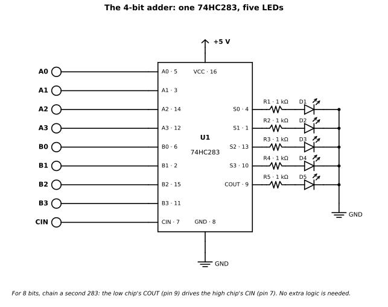
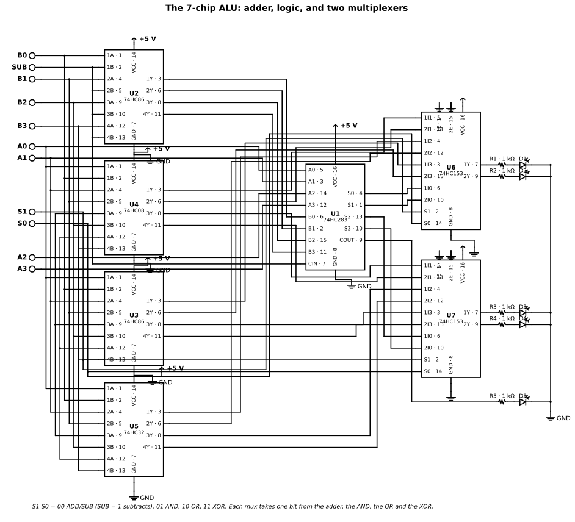

# Chapter 6 — Combinational building blocks on the bench

Status: draft

Builds for [Chapter 5](05-combinational-building-blocks.md) — the
theory is there, the wiring is here.

## Purpose

Build what Chapter 5 described. Three builds, in order, each one
reusing the last: a 4-bit adder on one chip, an 8-bit adder from
two, and an ALU grown from the adder — plus a carry-chain race you
can see with no oscilloscope.

You need Chapter 5 first, and Chapters 1–2 for bench skills. If
you are not building, skip this chapter: Chapter 5 stands on its
own, and Chapter 7 does not assume you built anything here.

## Prerequisites

- Chapter 5: combinational building blocks
- Chapters 1–2: breadboard, power, wiring and measurement

## You will need

- 74HC283 × 2 (CD74HC283E from TI, or 74HC283N from Nexperia) — the adder
- 74HC153 × 2 (CD74HC153E from TI) — the ALU's multiplexers
- 74HC86 × 2, 74HC08, 74HC32 — the ALU's gates
- 74HC00 and 74HC4040 — the carry-delay race in the bench build
- Two 8-position DIP switch banks (Grayhill 76SB08 or similar),
  10 kΩ pull-down resistors, LEDs with 1 kΩ series resistors,
  100 nF ceramic capacitors, one per chip
- 5 V supply, breadboard, solid-core jumper wire (as in Chapters 1–2)
- Chapter 5's Theory sections discuss further parts — 74HC138,
74HC148, 74HC151/153/157, 74HC85, 74HC280, 74HC244/245, in
Appendix A; only the adder and ALU chips above go on the bench.
  (Version B of the ALU, in Extensions, adds a 74HC04 and four
  74HC151s.)

## Bench build

Three builds, in order, each one reusing the last. Build A is
the 4-bit adder on one chip. Build B chains two of them into
an 8-bit adder. Build C grows the adder into an ALU. A fourth
build, the carry-chain race, turns the adder's delay into
something you can see with no oscilloscope.

Two things before the first step, because they apply to all
three builds. **No debouncer is needed anywhere in this
chapter.** The adder and the ALU are combinational: there is
nothing to latch a wrong value. Switch bounce changes the
inputs for a few milliseconds and the outputs follow; the eye
sees only the settled sum. Say this explicitly to the reader
who has just built the Chapter 2 debouncer: the debouncer
board is a nicety for these builds and a necessity only once
Chapter 7's sequential logic arrives, where a bouncing edge
can clock a flip-flop twice. **And a note on the reader's
bench.** Travis's adder board for his son carries two
8-position DIP switch banks, so the 8-bit adder (16 switch
bits) and the ALU (11 switch bits) both fit as drawn — no
second switch module is needed. The board also supplies
debounced switch levels and buffered LED outputs, so a reader
building on that board needs no 10 kΩ pull-downs and no LED
series resistors. The parts lists below are written for the
generic reader, without the board; where the board changes
something, the text says so. The 8-LED module covers eight
output bits; the 8-bit adder's ninth LED (COUT) is a discrete
LED plus a 1 kΩ resistor beside the module.

UNVERIFIED: the ALU chip counts below (7 chips for Version A,
10 for Version B) are design arithmetic — counting gates per
function and mux inputs — not a built-and-tested circuit. The
logic is straightforward, but no ALU was wired in the research
behind this chapter, so the drafting stage should validate the
design in KiCad, as Chapters 2–3 did for their schematics,
before the chapter prints it as a finished schematic. The 74HC153 pinout is verified from the TI CD74HC153 datasheet,
Rev. C, Oct 2003 (CD74HC153E, PDIP-16): 1E pin 1, S1 pin 2,
1I3–1I0 pins 3–6, 1Y pin 7, GND pin 8, 2Y pin 9, 2I0–2I3 pins
10–13, S0 pin 14, 2E pin 15, VCC pin 16.

**Build A — the 4-bit adder, one 74HC283.** One switch bank,
five LEDs, one chip, and you are adding.

KiCad source:
[ch05-adder-4bit.kicad_sch](https://github.com/marsairforce/digital_logic_e_book/blob/main/schematics/ch05-adder-4bit.kicad_sch)

Parts:

| Qty | Part | Notes |
|-----|------|-------|
| 1 | 74HC283 adder — **CD74HC283E** (TI) or 74HC283N (Nexperia) | DIP-16. Buy the TI part; see Chapter 5's Arithmetic section. |
| 1 | 8-position through-hole DIP switch — **Grayhill 76SB08** (rocker) or 76RSB08LT (rocker, flush) | 8× SPST, PC pin, 2.54 mm pitch, 150 mA, 30 VDC. One bank carries A (4 bits) + B (4 bits). Do not buy the CTS 219 series for a breadboard — it is surface mount (gull-wing / J-lead). |
| 8 | 10 kΩ resistors, ¼ W | Pull-downs, one per switch bit. |
| 5 | Red LEDs, 5 mm (or 3 mm) | Vf ≈ 2.0 V at working current (Chapter 1). |
| 5 | 1 kΩ resistors, ¼ W | LED series resistors. 680 Ω–1.5 kΩ is the acceptable range. |
| 1 | 100 nF ceramic capacitor | Decoupling across the 283's VCC/GND. |
| 1 | SPST switch or a jumper wire | CIN control. |
| — | 5 V supply, breadboard, solid-core jumper wire | As established in Chapters 1–2. |

1. **Power first.** 5 V to pin 16, GND to pin 8, 100 nF
   ceramic across VCC/GND as close to the chip as the board
   allows. One capacitor per chip, always — every build in
   this chapter gets one, and the later builds' parts lists
   assume it without repeating the reason.
2. **Wire the inputs from the datasheet figure, not from bit
   order.** A1–A4 are pins 5, 3, 14, 12; B1–B4 are pins 6, 2,
   15, 11; S1–S4 are pins 4, 1, 13, 10; CIN is pin 7, COUT
   is pin 9. S2 is on pin 1 and A3/B3 are pins 14/15 — the
   scrambled pinout from Chapter 5's Arithmetic section, and the
   mistake to make once and remember.
3. **Switches.** One side of each DIP-switch position goes to
   VCC, the other side to the 283 input pin with a 10 kΩ
   pull-down to GND. Switch ON = 1, OFF = 0 — the bit reads
   the same way the switch looks. Positions 1–4 = A0–A3,
   positions 5–8 = B0–B3. Pick one end as the MSB, label the
   board, and do not change your mind halfway: the 283's own
   pinout is scrambled and the reader will otherwise wire A
   backwards. (On Travis's board the debounced outputs drive
   the inputs directly and the pull-downs are not needed.)
4. **CIN.** Tie it to GND with a jumper for plain addition,
   or put it on a switch if you want to experiment — a 9th
   switch bit, a spare position on a second DIP switch, or a
   plain jumper. Never leave it floating.
5. **Outputs.** S0–S3 (pins 4, 1, 13, 10 in bit-0 numbering)
   and COUT (pin 9) each drive an LED through a 1 kΩ series
   resistor to GND, so output HIGH lights the LED. Current
   maths, sourcing, using the verified numbers: VOH minimum
   3.98 V at 4 mA, LED Vf ≈ 2.0 V, so I ≈ (4.3 − 2.0) / 1 kΩ
   ≈ **2.3 mA** typical — inside the ±4 mA recommended output
   current. Five LEDs on is about 12 mA total, well inside the
   ±50 mA per-package VCC/GND limit. (On Travis's board the
   buffered LED driver takes the load and the series resistors
   are not needed.)
6. **Check it.** Run the test vectors from the Worked example:
   0 + 0, 1 + 1 = 2, 7 + 1 = 8, 15 + 1 = 16 with COUT lit,
   15 + 15 + 1 = 31, and CIN = 1 adding one. Then try a
   subtraction preview: the adder alone cannot subtract, but
   4-bit addition is modulo 16, so 15 + 2 reads as 1 with
   COUT = 1 — the overflow case from Chapter 5's Arithmetic section,
   seen on LEDs.

**Build B — the 8-bit adder, two 74HC283s.** Everything in
Build A, twice for the adder chips, plus a second 8-position
DIP switch (16 switch bits total: A0–A7, B0–B7) and 9 LEDs
with 9 × 1 kΩ resistors (8 sum bits + COUT). On Travis's
board both switch banks are already there, and eight of the
nine LEDs are the module — the ninth, COUT, is the discrete
LED beside it.

1. **Chain the chips with one wire.** Low-nibble COUT (pin 9
   of the low 283) → high-nibble CIN (pin 7 of the high 283).
   Low CIN tied to GND, or to the CIN switch from Build A.
   No other logic is needed — the datasheet says so.
2. **Wire the operands.** Low chip: A = bits 0–3, B = bits
   0–3. High chip: A = bits 4–7, B = bits 4–7. High-nibble
   sum bits are bits 4–7 in value terms. Keep the same
   switch-bank order for both nibbles (bank 1 = low nibble,
   bank 2 = high nibble) and label both.
3. **Decouple both chips** — one 100 nF capacitor per chip.
4. **Check it.** 165 + 60 = 225, from the Worked example:
   low nibble 5 + 12 = 17 (Σ = 0001, carry 1), high nibble
   10 + 3 + 1 = 14 (Σ = 1110), result 1110 0001 = 225,
   COUT dark. Then 255 + 1 = 256: Σ = 0000 0000, COUT lit —
   the 8-bit overflow, the same shape as 15 + 1 in 4 bits.
   The worst-case delay, derived from the datasheet tables,
   is about **43 ns typical, 85 ns maximum** from a low-bit
   input change to the top sum bit settling — tens of
   nanoseconds, and the race in Build D is how you see it.
5. **Going further.** The same pattern makes 16 bits from
   four chips (32 switch bits, 17 LEDs) and 32 bits from
   eight. The ripple delay grows by about 20 ns typical
   (39 ns maximum) per added chip on the carry path — which
   is exactly the motivation for carry lookahead in the
   history section, and the reason the 283's internal
   lookahead only helps inside each nibble.

**Build C — the ALU, seven chips (main build).** The adder
from Build A, plus the logic operations computed in parallel
and selected with multiplexers. The full schematic is the
figure below; the wiring plan after it is the block-level
description, so a reader can follow the figure without
getting lost in it.

KiCad source:
[ch05-alu-7chip.kicad_sch](https://github.com/marsairforce/digital_logic_e_book/blob/main/schematics/ch05-alu-7chip.kicad_sch)

The principle, before the parts list: compute every
candidate result in parallel with cheap gates, then select
one with a multiplexer. The function-select switches drive
the mux select inputs directly — no decoding logic needed.
Per bit, the functions computed are: ADD/SUB from the 283
(with the B-invert XORs in front of it), AND from a 74HC08,
OR from a 74HC32, XOR from a 74HC86. NOT, PASS A and PASS B
need no gates at all in this version — they are the fuller
version's business, below.

**Subtraction detail.** SUB is one switch (or one bit of the
function code). When SUB = 1, each B bit passes through a
74HC86 XOR with SUB (B XOR 1 = NOT B) and CIN = 1, so the
283 computes A + NOT B + 1 = A − B in two's complement.
When SUB = 0 the XORs pass B unchanged and CIN = 0, so the
283 adds. This is the same 1's-complement-plus-carry trick
the 74181 uses internally — except our SUB switch supplies
the forced carry directly, so there is no A − B − 1 trap:
A − B comes out right. **Borrow convention:** for SUB,
COUT = 1 means no borrow (A ≥ B, unsigned); COUT = 0 means
borrow (A &lt; B), and the result is the two's-complement
negative (4 − 9 = 1011 = −5 in 4-bit two's complement).
State the convention once, plainly, and the LEDs make sense.

Parts (Version A — 7 chips, 5 operations):

| Qty | Part | Notes |
|-----|------|-------|
| 1 | 74HC283 — **CD74HC283E** (TI) | The adder, from Build A. |
| 2 | 74HC86 — **SN74HC86N** (TI) | Quad XOR. One chip for the four B-invert XORs, one for the four A XOR B gates. Nexperia's 74HC86 has no DIP version — do not print 74HC86N as a Nexperia part. 74HC86 tpd is 11 ns typical at 5 V / 15 pF (Nexperia Rev. 6). |
| 1 | 74HC08 — **SN74HC08N** (TI) | Quad AND, for A·B. UNVERIFIED: TI lists the SN74HC08 family ACTIVE, but the N (PDIP) variant's stock was not individually confirmed. |
| 1 | 74HC32 — **SN74HC32N** (TI) | Quad OR, for A+B. Nexperia's 74HC32 has no DIP version. |
| 2 | 74HC153 — **CD74HC153E** (TI) | Dual 4-to-1 multiplexer. Each 153 handles two result bits; two chips cover four bits. ACTIVE, PDIP-16; TI store price $1.07 at 1–99 on the day checked (2026-10-25 snapshot), though TI direct stock showed out of stock that day — buy from a distributor. SN74HC153N is Discontinued and CD74HC153M is OBSOLETE at TI: print the E suffix. |
| 1 | 8-position DIP switch bank (second bank) | Function selects + SUB. On Travis's board this is the second bank already fitted. |
| 5 | LEDs + 5 × 1 kΩ | Result 4 + COUT 1, as in Build A. COUT is meaningful for ADD/SUB only. |
| 7 | 100 nF ceramic capacitors | One per chip. |

Switch bits: A 4 + B 4 + S1 S0 2 + SUB 1 = **11**. LED
bits: result 4 + COUT 1 = **5**. Both fit on Travis's board
(two 8-position banks for switches; the 8-LED module for
outputs).

| S1 S0 | Result | SUB switch |
|-------|--------|------------|
| 0 0 | ADD / SUB (283) | 0 = ADD, 1 = SUB |
| 0 1 | AND | don't care |
| 1 0 | OR | don't care |
| 1 1 | XOR | don't care |

1. **Power and decoupling.** 5 V and GND rails down both
   sides of the breadboard; 100 nF across VCC/GND at every
   chip. Version A fits on one full-size 830-point breadboard
   with care, plus the switch/LED board beside it.
2. **Inputs.** A0–A3 and B0–B3 from the DIP switches with
   10 kΩ pull-downs (the Build A scheme; not needed on
   Travis's board, whose debounced outputs drive the inputs
   directly); S1, S0 and SUB likewise. All switch outputs are
   fanned out to every chip that needs them — A goes to the
   283, the 08, the 32, both 86s and the muxes — so plan the
   wiring with the A/B rails running as busses along the
   board, not as a star of individual jumpers from the
   switches.
3. **Compute layer.** The 283, with the B-invert XORs and
   CIN = SUB in front of it; the 08, the 32 and the 86
   (XOR) alongside it. Outputs are per-bit wires: one SUM
   wire, one AND wire, one OR wire and one XOR wire per bit.
4. **Select layer.** The two 153s, select lines S1:S0 wired
   to both chips in parallel, each chip's enable E (active
   LOW) tied to GND. Mux outputs go to the result LEDs
   (1 kΩ each) and the 283's COUT goes to its own LED.
5. **Unused inputs.** Tie every unused input to VCC or GND —
   never leave a CMOS input floating — including the spare
   gates on the 86s and the mux enables as specified. Leave
   unused *outputs* unconnected.
6. **Check it.** Same operands through every function.
   A = 1010, B = 1100: ADD → 0110, COUT 1 (10 + 12 = 22);
   SUB → 1110, COUT 0 (10 − 12 = −2, borrow); AND → 1000;
   OR → 1110; XOR → 0110. The borrow case (A &lt; B, COUT 0)
   and the overflow case (7 + 1 = −8 in signed 4-bit) are the
   two "gotcha" measurements. Overflow detection — XOR of
   the carry-in and carry-out of the most-significant bit —
   is an extension, not part of the build.
7. **What this ALU does not do.** No shifts, no
   multiplication, no flags register, no 74182 lookahead
   (the carry between nibbles in an 8-bit version ripples
   through the 283s). The 74181's 32 functions against our
   5 is the honest comparison to print: ours is a teaching
   ALU, not a minicomputer ALU.

**Version B — the fuller ALU, ten chips, eight operations
(extension).** Same compute layer, different mux: four
**74HC151** 8-to-1 multiplexers, one per result bit, with
three select switches S2:S1:S0 wired in parallel to all
four chips. Enable E (pin 7, active LOW) tied to GND; use
the true output Y (pin 5), not the inverted W (pin 6).
The 151 pinout, verified from two sources: 1 = D3, 2 = D2,
3 = D1, 4 = D0, 5 = Y, 6 = W (inverted), 7 = E, 8 = GND,
9 = C (S2), 10 = B (S1), 11 = A (S0), 12 = D7, 13 = D6,
14 = D5, 15 = D4, 16 = VCC. Data-select-to-Y is 26 ns
typical (MM74HC151); Nexperia's Q100 parametrics quote
tpd 17 ns.

| S2 S1 S0 | Result | Note |
|----------|--------|------|
| 0 0 0 | ADD | SUB = S0 = 0, so the 283 adds |
| 0 0 1 | SUB | SUB = S0 = 1, so the 283 subtracts |
| 0 1 0 | AND | |
| 0 1 1 | OR | |
| 1 0 0 | XOR | |
| 1 0 1 | NOT A | needs the 74HC04 below |
| 1 1 0 | A | pass-through, a wire |
| 1 1 1 | B | pass-through, a wire |

The trick that makes this work with one 283: mux inputs 0
and 1 are wired to the **same** SUM wire, and S0 doubles as
the SUB control — selecting slot 1 simultaneously switches
the 283 into subtract mode. No extra decoding. Chip count:
74HC283 ×1, 74HC86 ×2, 74HC08 ×1, 74HC32 ×1, 74HC04 ×1,
74HC151 ×4 = **10 chips**. Switch bits: A 4 + B 4 + S 3 =
**11**. LED bits: 5. The extra part is the **74HC04**
(hex inverter, **SN74HC04N** from TI — in stock at TI's
store at $0.248 on the day checked, a 2026-10-25 snapshot;
print the N, not the AN, which is Discontinued) for NOT A
and for generating control-signal complements; tie its two
spare inverters' inputs to GND.

The DIP warning is the reason Version B is the extension
and Version A is the main build: **Nexperia's current
74HC151 line has no DIP version** — only SO, SSOP, TSSOP
and Q100 are Active. The DIP buy is **onsemi MM74HC151N**
(PDIP per the 1999 Fairchild datasheet). UNVERIFIED: TI
CD74HC151E — existence and stock were not checked. Do not
print "74HC151N" as a Nexperia part; it is not a current
Nexperia orderable. Version B realistically wants two
breadboards, or one full-size board plus the switch/LED
board — ten chips plus switches and LEDs is a real
afternoon's build, which is the point, but the chapter
must budget the space. The 24-pin 74181, by comparison,
would have been one chip — worth one sentence about what
integration buys you.

**Build D — the carry-chain race: seeing 20 ns with no
scope.** The adder *looks* instantaneous. This build shows
it is not, by turning the carry path into the delay element
of a ring oscillator and dividing the result down until a
human can see it. It extends Chapter 3's "great race" —
a ring oscillator (an odd number of inverters in a loop),
whose frequency you measure — with the adder's carry chain
as the delay element.

1. **Build the oscillator.** One 74HC283 plus one 74HC00
   NAND gate wired as an inverter (both inputs tied
   together, or one input tied HIGH — the 74HC00 is already
   verified in Chapter 2, tpd typical 7 ns at 5 V / 15 pF).
   Set A = 1111, B = 0000 on the DIP switches. Wire COUT
   (pin 9) → 74HC00 inverter → CIN (pin 7). Why it
   oscillates: with CIN = 0, A + B + 0 = 15, COUT = 0; with
   CIN = 1, A + B + 1 = 16, COUT = 1. So COUT follows CIN
   after the carry delay, and the inverter flips it — one
   inversion in the loop, so the loop is astable.
2. **Divide it down.** The oscillator output goes to the CP
   input of a **74HC4040** 12-stage binary ripple counter
   (Nexperia 74HC4040, Rev. 5; TI SN74HC4040N is the ACTIVE
   PDIP equivalent). Verified facts: 12 stages Q0–Q11; it
   advances on the HIGH-to-LOW transition of CP;
   asynchronous master reset MR is active HIGH, so tie it to
   GND; fmax is 79 MHz at 5 V / 15 pF (HCT figure) —
   comfortably above our oscillator. Pinout: CP = 10,
   MR = 11, Q0 = 9, Q1 = 7, Q2 = 6, Q3 = 5, Q4 = 3, Q5 = 2,
   Q6 = 4, Q7 = 13, Q8 = 12, Q9 = 14, Q10 = 15, Q11 = 1,
   GND = 8, VCC = 16. Qn divides by 2^(n+1), so Q11 divides
   by 2048.
3. **Read the frequency two ways.** The frequencies below
   are **derived estimates from typical tpd values at 5 V /
   15 pF — expect roughly, never built, never measured**;
   breadboard capacitance will slow the real circuit
   somewhat, and the reader's measured number is the
   authority. Loop delay per pass = tpd(CIN → COUT) 20 ns
   typical + tpd(74HC00) 7 ns typical = 27 ns; period =
   2 × 27 ns = 54 ns, so **f ≈ 18 MHz**. That is far too
   fast to see or hear, so divide it. **Audio / meter
   method:** oscillator → CP of one 4040; Q11 ≈ 18 MHz /
   2048 ≈ **8.8 kHz** — measurable on a cheap multimeter's
   frequency range. **Visible method:** cascade a second
   4040 (Q11 of the first → CP of the second); total division
   2²⁴. An LED on the second chip's Q11 blinks at ≈ 18 MHz /
   16,777,216 ≈ **1.1 Hz** — about one blink per second,
   countable with a stopwatch. UNVERIFIED: no piezo buzzer
   part was verified for the audio method, and a piezo
   element's capacitive load may exceed the 74HC4040's ±4 mA
   recommended output current at audio frequencies — a
   transistor driver would be the safe route — so the chapter
   recommends the LED blink and the multimeter-frequency
   methods, and does not specify a buzzer.
4. **Show the ripple delay.** Rebuild the oscillator with
   the carry looping through **two** 283s (COUT of chip 1 →
   CIN of chip 2, COUT of chip 2 → inverter → CIN of chip 1;
   set both chips A = 1111, B = 0000). The added delay is
   about one more CIN → COUT, 20 ns typical, so the loop is
   47 ns per pass and **f ≈ 10.6 MHz** (derived estimate, as
   above) → Q11 ≈ **5.2 kHz**, blink ≈ **0.63 Hz**. The
   pitch drops and the blink slows by nearly half. The reader
   has *seen* 20 ns of carry delay with no scope — and the
   same trick with three or four 283s in the chain shows the
   delay growing linearly, which is the ripple-carry story
   in one measurement. The direction and rough size of the
   change are the point, not the absolute numbers.
5. **Parts for the race.** 1 × 74HC283 (already owned),
   1 × 74HC00 (already owned from Chapter 2), 1–2 ×
   **74HC4040N** (Nexperia DIP-16; TI SN74HC4040N is the
   ACTIVE PDIP equivalent), 1 LED + 1 kΩ for the blink,
   decoupling capacitors (one per chip). A second 283 for
   the two-chip race.

## Gotchas

- **Three-state outputs fighting on a bus.** Only the 244/245 actually
  go high-impedance when disabled. On the 151/153/157 a HIGH enable
  forces the output to a driven LOW; on the 138/139/154 it forces a
  driven HIGH. Two outputs driving opposite levels onto one wire is a
  short through two output transistors — enable exactly one driver.
- **Ripple-carry glitches on changing inputs.** While the carry
  ripples, the sum outputs pass through wrong values for a few tens of
  nanoseconds. It does not matter for an LED you watch, and it matters
  a great deal if a clock edge samples the sum mid-ripple — Chapter 7
  is where that bill comes due.
- **Enable pins do not all mean the same thing.** See the first bullet:
  "disabled" is a driven level on most of these parts, not a
  disconnection. Read the enable row of the truth table before you
  wire it.
- **The 283's pinout is scrambled.** S2 sits on pin 1 and A3/B3 on
  pins 14/15. Wire from the figure, not from pin order, or you will
  add the numbers backwards.
- **Cn on the 74181 is active-low.** HIGH means no carry — the
  number-one bench gotcha on the old part, and the reason the ALU
  section states its carry convention out loud.
- **Do not buy a 74HC181, and do not buy a "74HC83".** The HC181
  exists only as surplus and broker stock; the HC83 was never made
  by a major vendor at all (the name survives in hobby-shop
  listings). Buy the 283.
- **The 74182 does not pair with the 283.** The 283 exposes no P/G
  outputs for a lookahead generator to read. One 4-bit slice
  already has fast carry inside; multi-slice builds ripple Cn+4.

## Summary

- One chip adds: the 74HC283 is a 4-bit adder with fast carry, and
  Build A proves it with five LEDs.
- Two chips add wider: chaining carries makes an 8-bit adder, and
  the same trick reaches 16 bits.
- An ALU is an adder with a menu: Build C grows the adder into
  five operations with two multiplexers and a handful of gates.
- Delay is visible: the carry-chain race turns gate delays into a
  blink you can see, no oscilloscope needed.

## Extensions

- Build the adder from gates, no 283: one full adder is 2 XOR +
  2 AND + 1 OR — a 74HC86, a 74HC08 and a 74HC32, all already in
  the parts list — wired as two half adders plus an OR for the
  carries. Four of them chained make a 4-bit ripple adder:
  20 gates on 5 chips (two 86s, two 08s, one 32 — one more 08
  than the chapter's list). Then compare: the 283 does the
  same job in one chip, with carry lookahead instead of ripple.
  The wiring tedium is the point — it is why the IC exists.
  Bonus: on the ripple build you can watch the carry glitch
  the Gotchas section warns about, where the 283's lookahead
  hides it.
- Cascading adders to 8 bits and beyond; a multiplier as repeated
  addition.
- Version B of the ALU: four 74HC151 8-to-1 multiplexers in place of
  the two 74HC153s, for eight operations including NOT A, PASS A
  and PASS B — ten chips, and the fuller menu.

## References

- Datasheet citations for every part in this chapter are in
  [Chapter 5, References](05-combinational-building-blocks.md).
